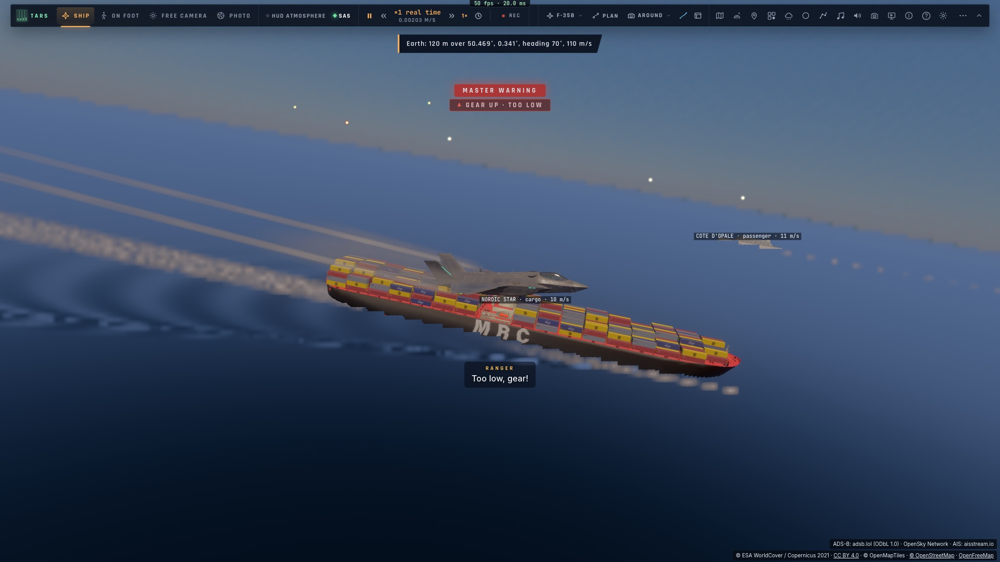
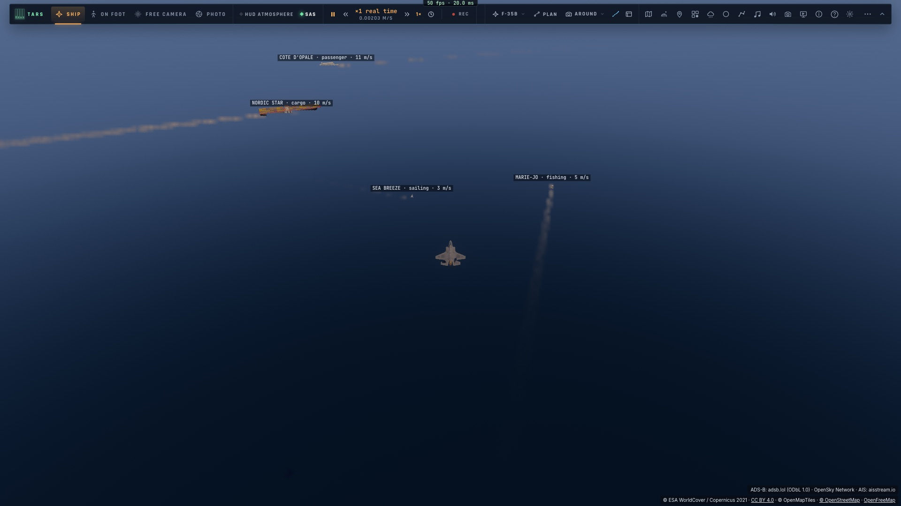
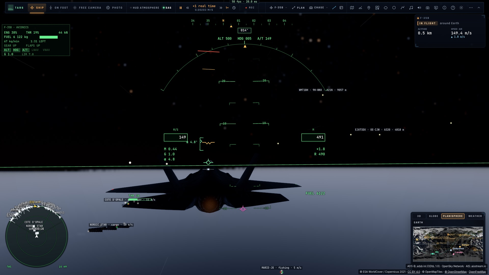

# T3 — Les bateaux sur la mer

*2026-10-15 — [PLAN-AVIATION-AAA](../../PLAN-AVIATION-AAA.md), phase T.*

## Les modèles (`scripts/build-ships.py`, `scripts/build-ships.ts`)
- **Le porte-conteneurs fourni** (FBX) passe par Blender :
  - ses rotations et son échelle sont appliquées ;
  - ses grandes pièces sont allégées au quart, soit 53 000 triangles.

  Il est ensuite mis au repère du navire, ramené à 300 m, sa ligne de flottaison à 0. On la trouve au pied des
  œuvres mortes noires sur sa texture de coque.
  - **Sa proue est trouvée seule** : c'est le bout le plus fin à la flottaison, celui de la poupe ayant la largeur
    du tableau arrière. Le critère du bulbe d'étrave s'était trompé.
  - Sa coque, sa passerelle et ses conteneurs gardent leurs textures, en couches 2 à 4 du tableau de textures du
    trafic (`ship.wgsl`, matériaux 44 à 46).
- **Le pétrolier** : la même coque et la même passerelle, sans les conteneurs.
- **Le ferry, le chalutier et le voilier** sont dessinés par le script :
  - une coque en sections (antifouling sous la flottaison, œuvres mortes peintes, pont, tableau arrière) ;
  - le ferry : quatre ponts de cabines et leurs vitrages, sa passerelle, deux cheminées ;
  - le chalutier : sa timonerie, son portique, son mât ;
  - le voilier : sa quille, son roof, son mât, sa grand-voile et son foc ;
  - leurs peintures sont les matériaux 47 à 53.
- **Le type AIS choisit le modèle** (`game/shiptypes.ts`) :
  - 70–79 cargo, 80–89 pétrolier, 60–69 passagers, 30 pêche, 36 et 37 voile et plaisance ;
  - remorqueur, pilote, sauvetage, militaire et grande vitesse ont aussi leur modèle ;
  - un type inconnu est rangé selon sa longueur.
- **La taille AIS met le modèle à l'échelle** : sa longueur et sa largeur, bornées. Sans dimensions, on prend
  celles de son genre.

## Où il est
- Le flux garde l'**historique de chaque navire** (un quart d'heure), comme pour les avions.
- **Même minute de différé que le trafic aérien**, sur sa route reconstruite comme celle d'un avion
  (`game/flightpath.ts`) : vitesse et route fond lissées, intégrées, recalées sur ses positions. Le lissage est
  plus fort, car un navire change de route lentement. On prend ses messages autour du moment montré.
- **Sa proue suit son cap vrai**, interpolé entre deux messages, et non sa route : la dérive est gardée.
- **À quai ou au mouillage** (moins de 0,25 m/s), il reste où il est, sur son cap.
- **Il roule, tangue et pilonne selon la mer** (`shipMotion`, hauteur significative `seaHs`, 1 m par défaut en
  attendant M1) : un petit bateau bouge beaucoup plus qu'un grand.
- **À sa place** : posé sur l'ellipsoïde WGS84 à la hauteur de la mer. Sa coque sous l'eau est cachée par la mer
  tracée, ce qui donne une vraie ligne de flottaison.

## Son sillage, dans le shader de la mer (`trace.wgsl` `seaWake`)
Les huit navires en route les plus proches dans 15 km passent au noyau (`Params.wake`) : leur place depuis la
caméra sur les axes de la Terre, leur cap, leur vitesse, leur longueur et leur largeur.
- **Le sillage de Kelvin**, immobile dans le repère du navire :
  - dans le coin de 19,47° derrière l'étrave, en un point à x en arrière et y de côté (r = |y|/x), deux familles
    d'ondes : les angles θ où la phase est stationnaire (2r·tan²θ − tanθ + r = 0), les ondes transversales et
    les divergentes ;
  - leur phase vaut k₀(x cosθ + |y| sinθ)/cos²θ, avec k₀ = g/U² (longueur d'onde transversale 2πU²/g, 58 m à
    9,5 m/s) ;
  - leur hauteur décroît en 1/√distance, renforcée le long des cuspides ;
  - elles s'effacent là où le pixel ne les résout plus.
- **Le sillage turbulent** derrière la poupe : une bande d'écume d'une ou deux largeurs qui s'élargit et
  s'efface sur quelques longueurs, et une bande plus lisse plus large et plus longue.
- **La vague d'étrave** : son écume le long des flancs à l'avant.
- **L'écume dépend du navire** : selon sa vitesse et sa taille. Un voilier à 3 m/s n'en fait presque pas, un
  cargo à 10 m/s beaucoup.

## Le reste
- **Étiquettes** dans 30 km : nom · genre · vitesse, dans les unités choisies.
- **Feux de navigation la nuit** (Soleil sous l'horizon au lieu de l'avion), selon le règlement :
  - le feu de tête de mât blanc à l'avant, un second plus haut à l'arrière au-delà de 50 m ;
  - rouge à bâbord, vert à tribord ;
  - le feu de poupe blanc ;
  - un voilier n'a que ses feux de côté et de poupe ;
  - les feux sont dessinés un peu plus gros de loin.
- **Au radar** : contacts de surface neutres, qui répondent par l'AIS.

## Mesuré
- **`tests/ships.test.ts`** :
  - les genres et tailles AIS ;
  - les feux, dont le rouge à gauche ;
  - dans une mer de 2 m, un chalutier roule de 10,7°, un porte-conteneurs de 0,6°, et rien par mer calme ;
  - **une minute en retard** : 0,0 m de son message d'alors, à 0,03 m de la mer, la proue à 75,0° (son cap)
    alors que sa route est à 70° ;
  - le navire à quai reste immobile ;
  - un seul sillage, celui du navire en route.
- **Dans le jeu, sur kerr-mini, au-dessus de la Manche** (`tests/e2e/traffic-ships`). Quatre navires sont donnés
  par leurs messages AIS, mis dans le flux de la page : NORDIC STAR (cargo, 300 m), CÔTE D'OPALE (passagers,
  186 m), MARIE-JO (pêche, 24 m), SEA BREEZE (voilier, 12 m).
  - Chacun a son modèle à sa taille.
  - Le cargo est montré **571 m derrière son message présent** (une minute à 9,5 m/s : 570).
  - Leurs étiquettes s'affichent, ce sont des contacts radar neutres, et leurs quatre sillages sont dans le shader.
  - Croisé à 120 m, puis vu d'en haut ; de nuit, **18 feux**.
- 1 197 tests unitaires passent.

## Écarts
- **Le relais de production n'a pas ses clés** : `/traffic/health` répond `ais: false, opensky: false`.
  `AISSTREAM_API_KEY`, `OPENSKY_CLIENT_ID` et `OPENSKY_CLIENT_SECRET` sont à mettre dans l'environnement de la pile
  Portainer (`docs/DEPLOY.md`). Sans elles, aucun navire réel en ligne.
- **Les navires réels n'ont pas été vus en jeu** : le `.env` du poste n'est pas copié vers kerr-mini. Le chemin
  est pourtant le même, seule la source change : le relais de T1 a reçu 11 navires réels dans le pas de Calais.
- **Le pétrolier** n'a pas de tuyauteries sur le pont. Une seule livrée de porte-conteneurs. Pas de lumières de
  hublots la nuit.
- **La mer la nuit est trop claire** sous le crépuscule nautique, ce qui existait déjà avant T3. À reprendre avec
  M1.
