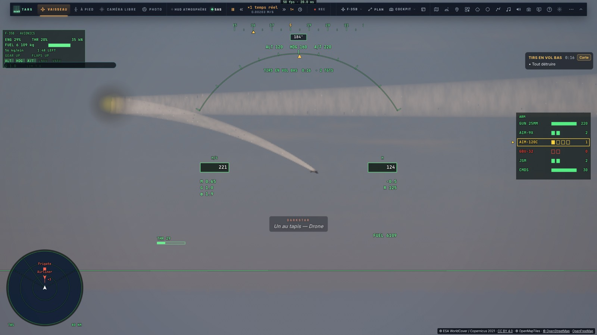
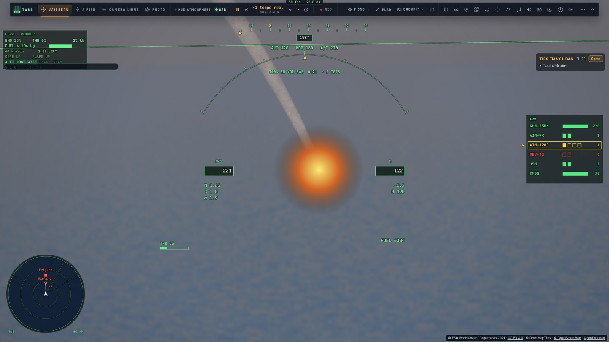
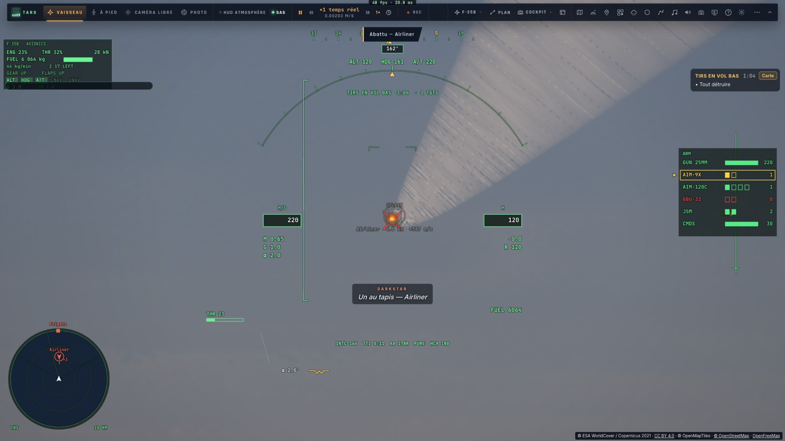
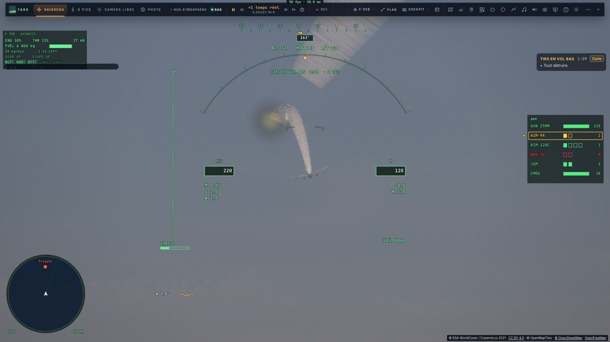
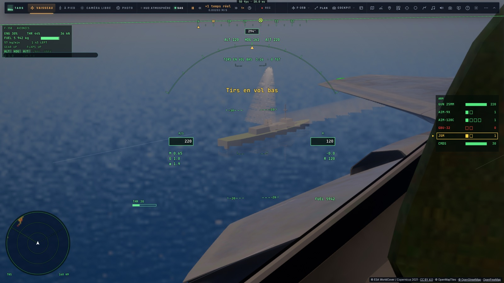
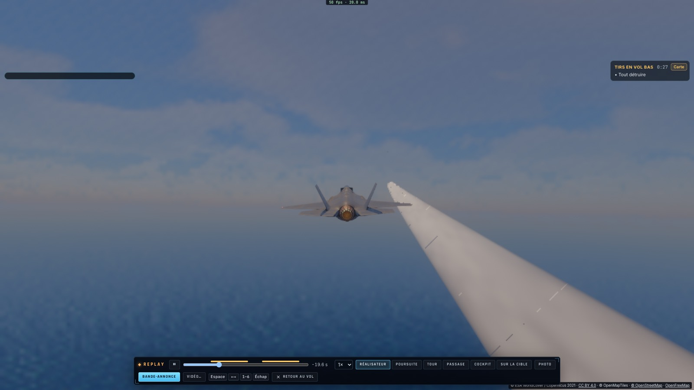
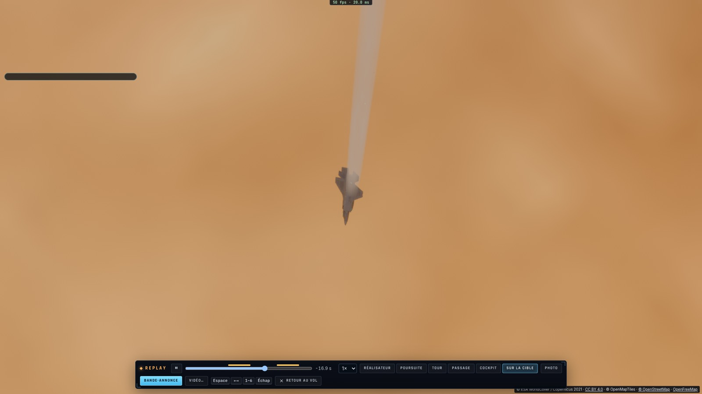
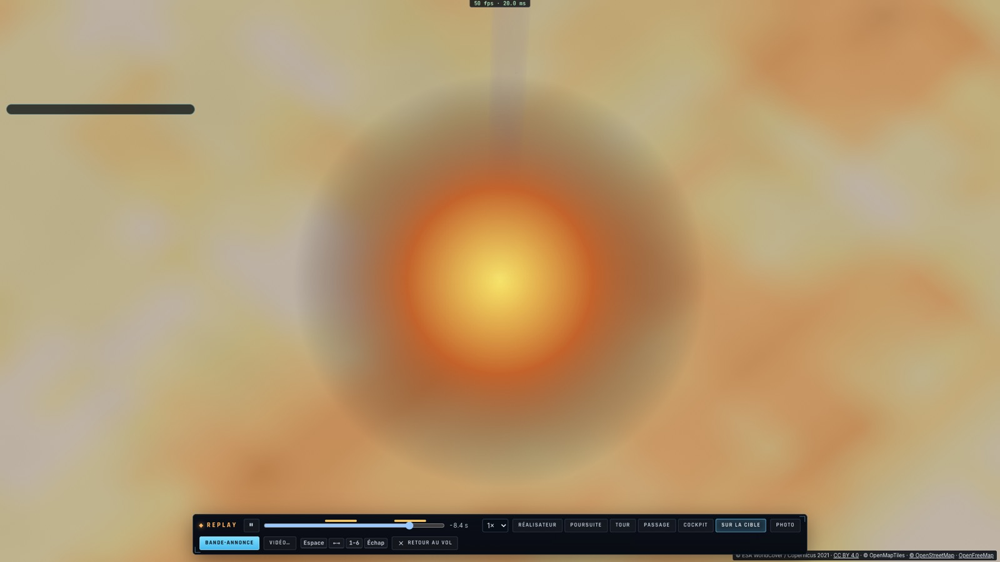

# Le tir, en direct et en replay

*2026-10-16 — [PLAN-AVIATION-AAA](../../PLAN-AVIATION-AAA.md), à la suite de S3.*

## En direct
- **Un appareil touché fume**, d'autant plus qu'il est endommagé.
- **Détruit, il perd le contrôle** (`game/combat.ts` `wreckStep`) :
  - ses ailes ne portent plus ;
  - il tombe, freiné par l'air jusque vers 170 m/s ;
  - son nez plonge dans le sens de sa chute et il part en roulis ;
  - il brûle en tombant.
  - Le coup au but ne donne qu'une petite gerbe.
- **Au sol ou en mer, il explose**, une seule fois, puis une colonne de fumée s'élève pendant 45 s.
  - Valable pour les drones, les chasseurs et les avions de ligne, y compris ceux d'un autre joueur dans une salle.
  - Le combat se poursuit après la victoire tant qu'une épave tombe, que sa fumée monte ou qu'un navire coule (2 min 30 au plus).
  - Une mission gagnée fait de même, au lieu de tout effacer d'un coup.
- **Un navire touché fume ; coulé, il brûle** et sa fumée monte pendant une minute.
- **La tête verrouillée sur la cible** (⇧L, ou bouton View maintenu à la manette) :
  - en cockpit, le regard suit la cible verrouillée, puis la cible du missile, puis l'épave dans sa chute, puis son crash ;
  - le zoom s'ajuste à sa taille ;
  - relâchée, la tête revient devant et le champ redevient normal.
- **La vue « Sur la cible »** est une caméra extérieure : derrière l'avion, au téléobjectif, elle cadre la même chose.
- **Les missiles se voient** :
  - leur traînée est plus large ;
  - la lueur de leur moteur et les explosions apparaissent aussi dans les vues extérieures, qui n'ont pas de HUD.
- **Le point de repérage** : un appareil lointain qui ne fait que quelques pixels est marqué d'un point sombre dans sa boîte HUD. Le point disparaît dès que l'appareil est assez grand à l'écran, par exemple au zoom.

## Le replay
- **La cinématique du tir.** Le réalisateur choisit :
  - la poursuite au départ du missile, pour le voir quitter son rail dans sa fumée ;
  - puis le téléobjectif sur ce qu'il vise (nouvelle caméra « Sur la cible ») ;
  - l'impact, l'épave qui tombe, le crash, en alternant avec la poursuite.
  - L'événement visé (cible du missile, épave, navire) est enregistré à chaque image.
- **Les traînées et la fumée sont rejouées** :
  - l'état des traînées est gardé toutes les 1,5 s, avec les sources de chaque image ;
  - le replay rejoue la simulation à partir de là ;
  - un saut dans le temps coûte moins de 2 ms.
- **Les explosions sont redessinées** sur l'image du replay.
- **Plus de saccades.** Le temps du replay et celui des images enregistrées ne tombaient pas au même rythme : des images étaient montrées deux fois, d'autres sautées. Mesuré : la caméra de passage avançait par 0 m puis 7,6 m. Désormais :
  - l'avion, les autres appareils et l'horloge sont interpolés entre deux images ;
  - les traînées sont simulées au temps exact affiché.
- **Les autres appareils sont replacés pour chaque caméra du replay.** Ils étaient enregistrés dans les axes de la caméra d'origine, ce qui décalait l'épave de sa traînée.
- **Le réalisateur ne ratait plus un tir.** Il échantillonnait l'avenir par pas de 0,1 s, alors qu'un tir n'est marqué que sur une image. Et après un saut dans le temps, il repart de zéro.

## Mesuré
- **Unitaires** :
  - la chute d'une épave : nez sous −0,8, au moins 1,5 rad de roulis, moins de 200 m/s, explosion de 2,5 au sol, une seule fois ;
  - la part de dégâts ;
  - les épaves qui tombent encore après la fin du combat ;
  - les traînées rejouées depuis un état gardé : identiques, et l'état gardé reste intact ;
  - l'interpolation : la caméra de poursuite à 50 Hz sans à-coup ;
  - la caméra « Sur la cible » centrée sur la cible ;
  - le réalisateur : poursuite pour un tir d'une seule image, cible ensuite ;
  - la projection des explosions ;
  - le maintien du bouton View de la manette.
- **Sur kerr-mini, `tests/e2e/shootdown.e2e.test.ts`**, vue cockpit, à 120 m au-dessus de la mer à l'ouest de la Sardaigne, les Alpes d'abord :
  - **le drone de face**, avec les vraies touches (Tab, =, Entrée) : AIM-120 tiré à 5,3 km ; la tête sur lui (8°, 1°, zoom 6°) ; touché, en vrille à 245 m au-dessus de la mer, la tête qui le suit ; le crash et son explosion ; la tête relâchée, revenue devant (0°, 0°, 60°) ;
  - **le replay** : poursuite, puis cible, poursuite, cible, poursuite ; deux explosions dessinées ;
  - **l'avion de ligne de face** : AIM-9X à 7,8 km, sa chute dans la fumée, son crash ;
  - **la frégate** : JSM à 19,9 km ; elle brûle et coule, sa fumée monte (447 segments).
- **`tests/e2e/wreck-replay.e2e.test.ts`** : la caméra « Sur la cible » du replay pendant la chute et au crash ; la fumée reconstruite en 0,1 à 1,2 ms.
- **`tests/e2e/s3-replay.e2e.test.ts`** : toujours vert.

## Écarts
- **Le missile n'a pas de modèle 3D** : on voit la lueur de son moteur et sa fumée.
- **Les explosions sont dessinées par-dessus l'image** (HUD, calque du replay) : elles n'apparaissent pas dans une vidéo rendue hors ligne.
- **Le drone et le chasseur ennemi** sont dessinés avec le modèle du F-35, le seul modèle de chasseur du jeu.
- **Le JSM laisse une fumée sur tout son trajet**, alors qu'un vrai missile de croisière à turboréacteur n'en laisse presque pas.
