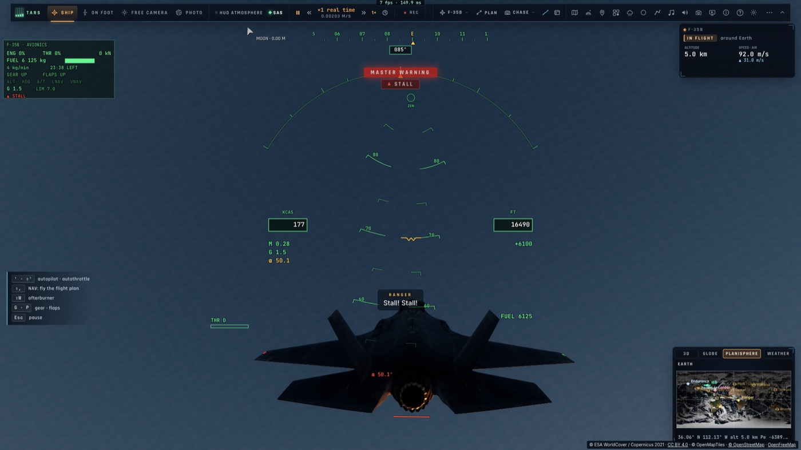
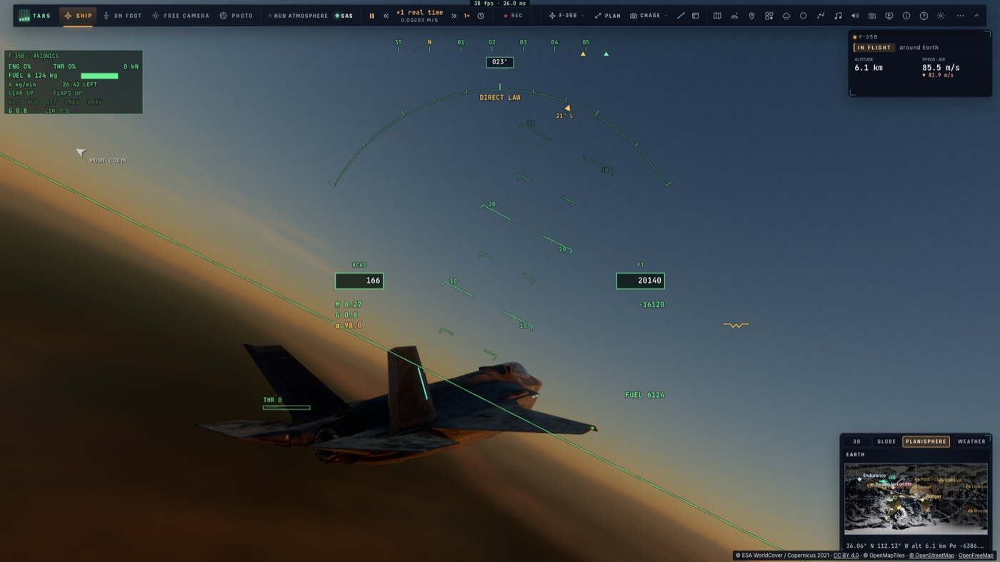
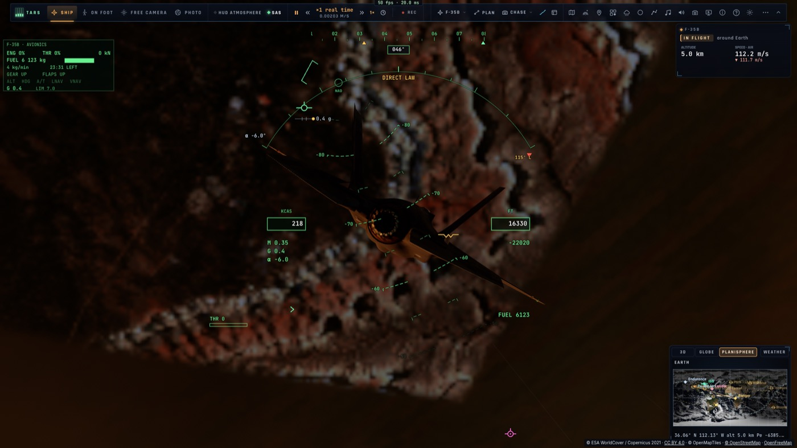

# V2 — Le F-35B à grande incidence

*2026-10-15 — [PLAN-AVIATION-AAA](../../PLAN-AVIATION-AAA.md), phase V.*

Le F-35 vole désormais à grande incidence comme un vrai chasseur.
- **Avec sa loi** (« Normale », celle du vrai avion) : il tient 50° d'incidence sous contrôle et ne part jamais
  en vrille, quoi que fasse le manche.
- **Sans calculateur** (« Directe », nouveau réglage *Jeu › F-35 › Loi de pilotage*, « DIRECT LAW » en ambre
  sur le HUD) : le super-décrochage et la vrille deviennent possibles, et on en sort en lâchant les commandes.

## Ce qui a changé
- **Aérodynamique** (`aero.ts`, `HighAlpha`, propre au F-35 et sans effet sur les autres engins) :
  - **la portance tabulée par incidence** : la pente de 3,8/rad jusqu'à 20°, puis la portance des tourbillons
    des chines jusqu'à un maximum de 1,77 vers 35°, encore 1,47 à 50° et 0,84 à 70°, avec la correction de
    compressibilité. Les deux demi-ailes gardent leur incidence propre : au-delà du maximum, la pente négative
    donne l'autorotation ;
  - **le cabré au-delà du décrochage** (40–48°), puis le piqué de plaque plane qui ramène l'avion, à toutes
    incidences, même au-delà de 90° ;
  - **les dérives masquées** (la moitié de leur efficacité à 35°, un quart à 50°) et **l'avant qui déstabilise
    en lacet** au-delà de 40° ;
  - **le dièdre de flèche** qui croît avec la portance ;
  - **l'amortissement** : en lacet, il devient moteur entre 50 et 70° jusqu'à la vitesse de rotation de la
    vrille (rb/2V ≈ 0,08), puis redevient amortissant, ce qui fait une vrille qui s'établit au lieu de
    s'emballer ;
  - **les gouvernes moins efficaces** à grande incidence (le stabilisateur décroche au-delà de 50° : plein
    manche arrière tient un super-décrochage, il ne retourne pas l'avion) ;
  - **le tremblement**, de 18° à 32°, qui fait trembler la caméra.
- **Loi normale** (`pilot.ts`) :
  - limite d'incidence de 27° à 50° ;
  - **roulis autour du vecteur vitesse** (r = p tan α) ;
  - taux de roulis réduit avec l'incidence (190°/s, puis ~15°/s à 50°, moins encore si un dérapage naît) ;
  - le dérapage contré plus fort à grande incidence ;
  - **le palonnier fait un « pedal turn »** à grande incidence (un roulis autour de la trajectoire, sans
    dérapage).
- **Loi directe** : le manche donne une accélération angulaire, sa part de l'autorité des gouvernes, sans rien
  tenir ni limiter. Un trim lent tient le tangage quand le manche est lâché.
- **Alarmes** : plus de « STALL » quand le F-35 vole sur sa loi au-delà du maximum de portance (c'est un état
  contrôlé) ; l'α du HUD passe en ambre au-delà de 35°.

## Mesuré (`tests/f35-high-alpha.test.ts`, contrôleur image par image)

| Essai | Résultat |
|---|---|
| Loi normale, plein manche arrière, 140 m/s | α 51,2° au plus, β 0,5° |
| Loi normale, manche arrière + roulis + palonnier à fond, 110 m/s, 8 s | α 51,5°, β 5,3° : pas de départ |
| Loi normale, entrée de vrille tenue 14 s | « pedal turn » coordonné (β 5,8°), arrêté 0,8 s après avoir lâché |
| Loi directe, plein manche arrière | super-décrochage : α 75° de moyenne, chute de 33 m/s à 70 m/s |
| Loi directe, manche arrière + palonnier | **vrille entretenue à 90°/s**, α 82°, chute de 73 m/s ; **sortie 10,4 s** après avoir lâché |

Dans le jeu lui-même (`tests/e2e/f35-high-alpha`, kerr-mini) : 50° tenus avec le tremblement ; vrille à 98°/s,
sortie 8,5 s après avoir lâché.

Banc V1 : l'incidence atteinte passe de 27,5° à **51,3°** (référence : 50°), et cet écart est fermé. Le
décrochage, lisse et sans calculateur, tombe à 116 kt, soutenu par la portance tourbillonnaire. Le reste ne
bouge pas. Les 1 099 tests unitaires et les 10 e2e F-35 (défis, combat, plan de vol, HUD) passent.

| Loi normale, 50° tenus | Loi directe, en vrille | Sorti de vrille |
|---|---|---|
|  |  |  |

*(La première capture date d'avant la correction de l'alarme : elle affiche encore « STALL ».)*

## Reste pour V3
La loi de tangage commande une vitesse de tangage bornée : 7 g sont approchés sans être atteints en 3 s, et le
virage instantané plafonne à 14 °/s. Le vrai F-35 commande un facteur de charge.
