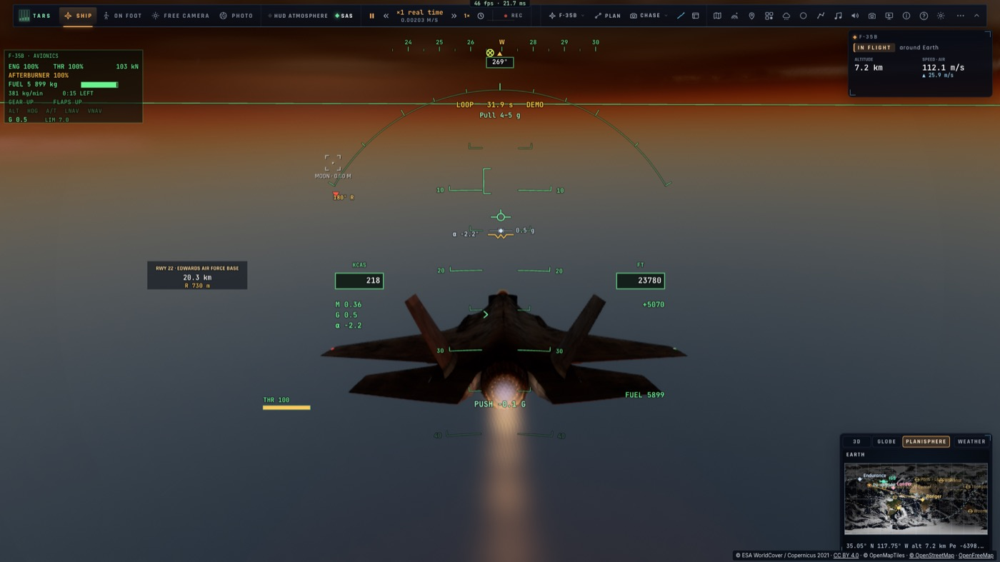
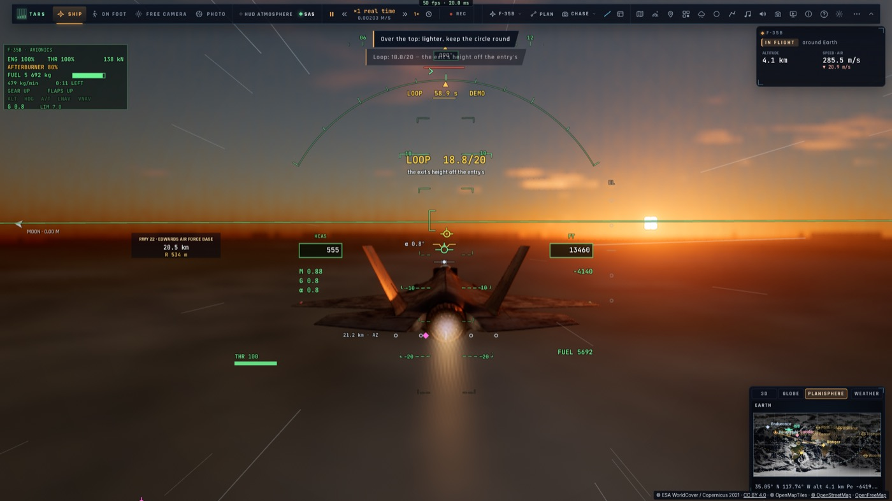
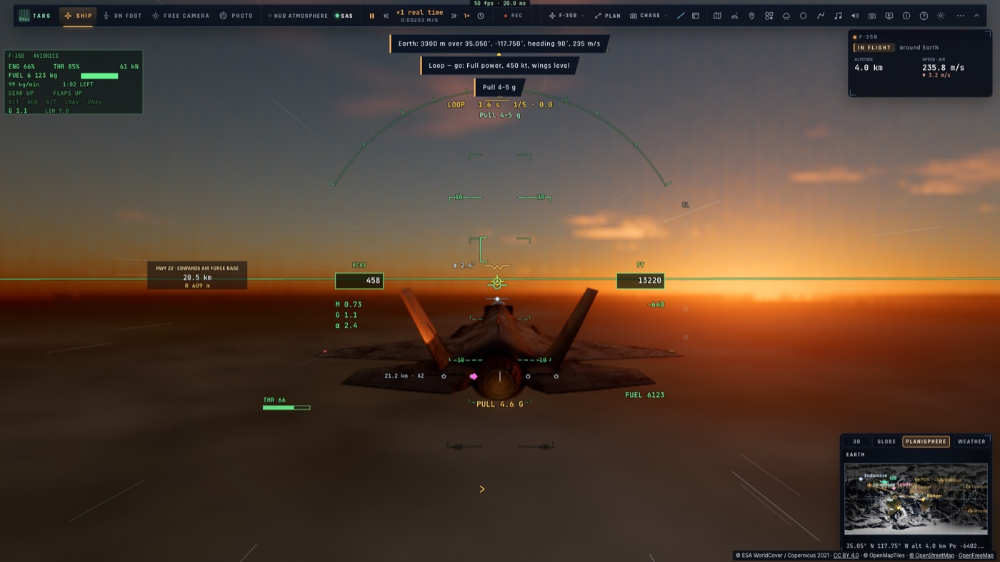

# V4 — Les figures de voltige

*2026-10-15 — [PLAN-AVIATION-AAA](../../PLAN-AVIATION-AAA.md), phase V.*

Dix figures que le F-35 vole comme le vrai.
- **Démontrées** : le pilote automatique les vole devant le joueur, repères annoncés.
- **Jugées** : la trace est comparée à la figure idéale et notée sur 20.
- **Enseignées** : pendant le vol du joueur, le HUD affiche le facteur de charge que tirerait le programme et le
  sens du roulis.

S'y ajoute **la boîte de voltige** : cinq figures enchaînées, notée sur 100.

Accès : *Défis › Voltige* (« Regarder » ou « Voler » sur chaque carte), ou TARS (`f35 figures`, puis
`f35 figure <id> watch|fly`, et `box` pour la boîte).

## Les figures (`game/aerobatics.ts`)
Chacune a un **programme de pilote**, qui fait voler le F-35 à travers sa loi, et un **juge**. L'état est lu
dans un repère local fixé au début de la figure, et ce sont les axes de l'avion qui comptent, pas ses angles
d'Euler : ailes à plat veut dire aile droite horizontale, ce qui reste vrai au sommet d'un looping.

| Figure | Programme | Note de sa démonstration |
|---|---|---|
| Looping | n = V²/gR + cos θ, l'écart au cercle corrigé, ailes à plat | 19,3 |
| Immelmann | demi-looping, puis demi-tonneau au sommet en palier | 20,0 |
| Split-S | demi-tonneau sur le dos, puis demi-looping à 4 g sans dépasser 32° d'incidence | 20,0 |
| Tonneau rapide | nez à +5°, roulis à fond, la hauteur tenue | 19,8 |
| Tonneau barriqué | roulis régulier, ressource qui le suit (n = 2,5 + 2 cos φ) et hauteur corrigée | 20,0 |
| Huit cubain | deux 5/8 de looping, demi-tonneaux et lignes à 45° jusqu'à R(1 − cos 45°) | 18,7 |
| Vol dos | dix secondes sur le dos, à −1 g | 19,9 |
| Passage à grande incidence | 40° au manche, la hauteur aux gaz (avec postcombustion), comme le vole le pilote de démonstration | 19,4 |
| Renversement à 7 g | 82° d'inclinaison (cos φ = 1/n), 7 g, la hauteur tenue | 20,0 |
| Vrille et sortie | loi directe, deux tours, tout lâché, ressource | 19,2 |

**Le juge** note dans la masse d'air (la dérive du vent retirée, comme le font les juges de voltige) :
rondeur (cercle ajusté), plan, cap et hauteur de sortie, ailes, régularité de l'incidence, temps. Un looping
rond fait 20/20 ; un looping ovale 14/20 ; un looping qui dérive de 14° en cap 13,7/20.

## La loi du F-35, corrigée en chemin
À basse vitesse, au-delà du maximum de portance, la commande de facteur de charge était instable : pour plus de
portance, elle demandait plus d'incidence, qui en donnait moins (le passage à grande incidence oscillait entre
13° et 53°). Le manche borne désormais aussi l'incidence : 35° (le maximum de portance) jusqu'à mi-course, 50°
plein arrière. La plus restrictive des deux commandes l'emporte, et l'incidence est tenue à ±1°.

## Dans le jeu (`tests/e2e/f35-aerobatics`, kerr-mini)
- Looping regardé depuis sa carte : l'avion est placé à son entrée et vole son programme ; **18,8/20** au HUD.
- Boîte de voltige : armée, puis commencée dès que l'entrée est atteinte, le guide affiché (« PULL 4.6 G »).

| Au sommet du looping (démonstration) | La note | Le guide du joueur (la boîte) |
|---|---|---|
|  |  |  |

Les 1 119 tests unitaires passent (dont `tests/aerobatics.test.ts` : le juge, les dix démonstrations, l'armement,
le français de chaque figure).
