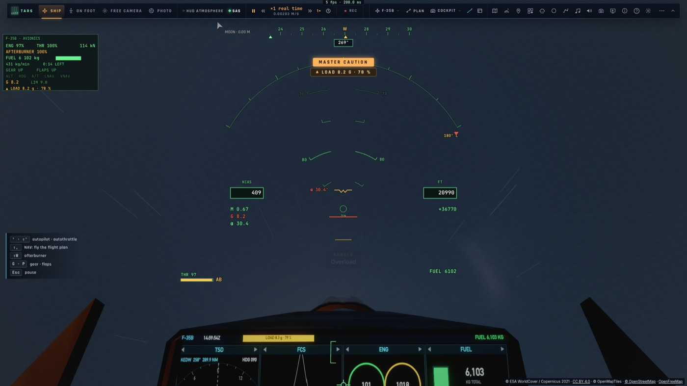
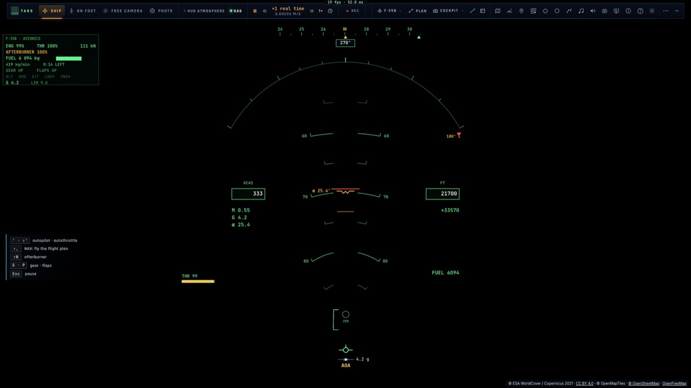
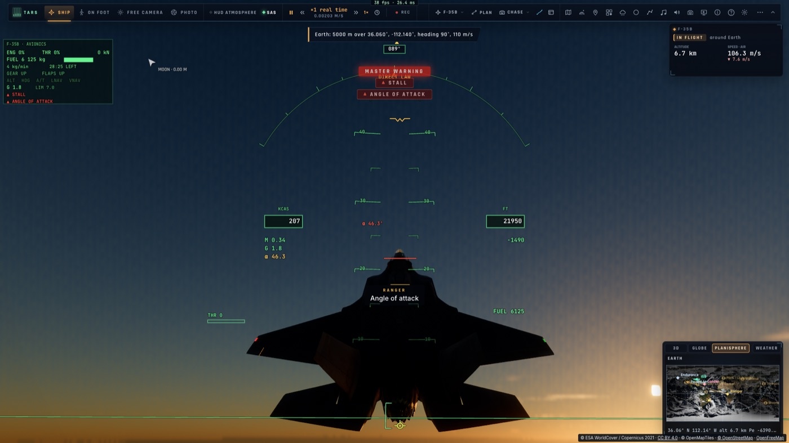

# V5 — Sentir l'avion

*2026-10-15 — [PLAN-AVIATION-AAA](../../PLAN-AVIATION-AAA.md), phase V.*

## Le corps du pilote (`game/gstrain.ts`)
Le modèle existait (F7), mais il était **nourri par la norme de l'accélération** : poussée comprise, jamais
négative. Le voile rouge ne pouvait donc jamais se produire, et le voile gris comptait la poussée de la
postcombustion. Désormais :
- il est avancé par le contrôleur avec le **facteur de charge signé** (la force aérodynamique le long du haut de
  l'avion, rapportée au poids) ;
- **fatigue** : tenir plus de 5 g use le pilote (jusqu'à 1,2 g de tolérance perdue), qui récupère sous 3 g. À
  7 g tenus, le voile gris passe de 0,28 à 6 s à 0,67 à 31 s ;
- **voile noir** distinct du voile gris : le champ se resserre en tunnel puis disparaît ;
- **perte de connaissance (G-LOC)** : voile noir tenu 1,5 s, environ 8 s inconscient, puis 4 s à revenir. Les
  mains lâchent les commandes, et la loi de l'avion continue de voler. À 9 g tenus : perte de connaissance au
  bout de 10,9 s ;
- **voile rouge** sous −1,5 g, enfin effectif.

L'ensemble reste derrière le réglage existant *Jeu › F-35 › Effets de g*.

## Les sons
- **La respiration au masque** (réglage *Respiration du pilote*, en vue cockpit) : calme au repos (environ 14
  par minute), puis forcée sous charge avec les grognements de la manœuvre anti-g (existants, F7). Muette pendant
  une perte de connaissance, une inspiration brusque au réveil.
- **Le tremblement de l'aile à grande incidence** : un grondement bas, secoué, à travers la cellule, selon le
  tremblement aérodynamique et la pression dynamique.
- **Les alarmes** : « Bingo fuel » (l'avion avait le texte, il disait « Fuel low »), et **« Angle of attack »**
  en loi directe au-delà de 30°. Chacune a son aide (pourquoi, quoi faire).

## La manette
Elle vibre avec le tremblement de l'aile et au toucher des roues (selon le taux de chute), six fois par seconde
au plus.

## Corrigé en chemin
- **Le maintien d'inclinaison à la verticale** : en ressource plein manche sans roulis, l'inclinaison d'Euler
  saute de 180° au passage de la verticale. Le maintien partait alors en roulis à 158°/s, et un looping tiré au
  seul manche aurait été remis à l'endroit au sommet. Le maintien d'inclinaison est désormais une aide du vol
  ordinaire seulement (pente sous 60°, inclinaison sous 70°). Au-delà, manche lâché veut dire roulis nul, comme
  la commande en vitesse de roulis du vrai F-35.
- **HUD** : « DIRECT LAW » est sous les valeurs M / G / α (il recouvrait l'alarme principale).
- **Harnais e2e** : un bouton hors de la zone visible d'un panneau est amené à l'écran avant le clic, comme le
  ferait un joueur.

## Mesuré
- `tests/gstrain.test.ts` : impulsion brève supportée ; voile gris tenu qui s'aggrave avec la fatigue ; 9 g →
  G-LOC → réveil ; voile rouge. Dans le F-35 : inconscient, manche toujours tenu plein arrière, la charge retombe
  de 7,0 g à 0,7 g. Sans calculateur au-delà de 30° : l'alarme.
- Dans le jeu (`tests/e2e/f35-body`, kerr-mini) : 9 g tenus depuis le cockpit, voile gris 0,36 pour 7 g
  ressentis, puis le noir ; « ANGLE OF ATTACK » au HUD et à la voix.
- **Cadence** (kerr-mini, 1600 × 1000) : 50 images/s (la limite de l'écran) en ressource à 9 g, en vue cockpit
  comme en vue poursuite, avec ou sans vapeur. Le seul creux (10 à 15 images/s pendant 2 s) ne vient ni du
  cockpit ni d'une compilation de noyau : toutes les variantes étaient prêtes. C'est le décor terrestre qui se
  charge à la **première arrivée** dans une région après une téléportation ; revenir au même endroit ne fait
  aucun creux. À traiter dans une passe décor (étaler ses téléversements sur plusieurs images).

| 9 g depuis le cockpit | Inconscient | Sans calculateur, 46° |
|---|---|---|
|  |  |  |
