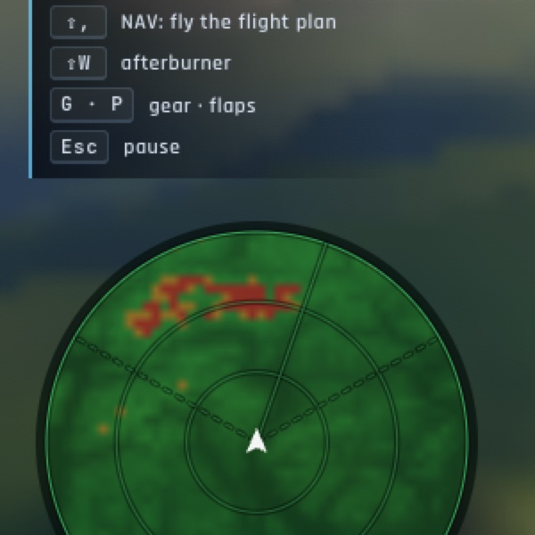
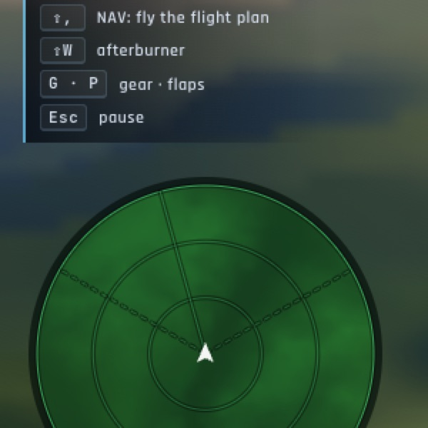

# Le relief sur le radar

*2026-10-15 — demandé en cours de phase A3 (« si ce n'est pas trop coûteux »).*

## Ce qui est affiché
Le sol est maintenant visible sous l'écran radar du HUD (le disque en bas à gauche), **cap en haut**, à la portée de
l'écran :
- **rouge** : le relief plus haut que nous ;
- **orange** : dans les 300 m sous nous ;
- **vert** : plus bas, plus clair quand c'est plus haut ;
- **bleu nuit** : la mer.

Les crêtes devant se voient d'un coup d'œil, et les contacts et le balayage restent dessinés par-dessus.

## Ce que ça coûte
- Une image de **48 × 48** cellules, recalculée seulement quand l'avion a avancé d'un vingtième de la portée, a
  tourné de 3°, a changé de 100 m d'altitude ou que la portée change, et **pas plus de deux fois par seconde**.
- Les hauteurs viennent du cache de relief de l'Auto-GCAS (A2) : une grille de 250 m, rafraîchie toutes les 10 s.
  Le coût reste négligeable : au plus 2 300 lectures par recalcul, la plupart déjà en cache.
- Le réglage **« Relief sur le radar »** (F-35) permet de l'enlever.

## Mesuré
- **`tests/e2e/radar-relief.e2e.test.ts`** sur kerr-mini (les Alpes d'abord) : à 3 143 m, le relief lu au
  Mont-Blanc vaut 4 694 m. Il est rouge sur l'écran à 40 km, vers 25 km devant.
