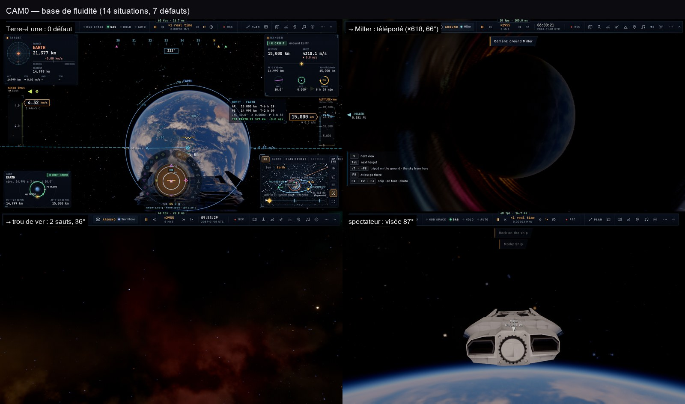

# CAM0 — la base de fluidité de la caméra (2026-10-29)

Le capteur `src/camera/metrics.ts` (`__bh.cam`, docs/BH-API.md) enregistre chaque image dessinée : la place de la vue
par rapport au corps le plus proche (sur son sol pour les nôtres : la rotation et l'orbite de la planète ne comptent
pas), sa hauteur (WGS84 + relief), sa visée, sa focale. Il compte les **sauts** (déplacement > 3× ses voisins et > 2 %
de la hauteur), les **visées cassées** (> 3× et > 1°), les **sauts de focale** (> 0,5°) et les **cassures de vitesse**
(vitesse en hauteurs/s doublée ou divisée par deux en une image). Les coupes voulues se marquent `mark("cut")`.

e2e `tests/e2e/camera-smooth.e2e.test.ts` (`BASELINE=1` : rapport seul), ici en headless 1280×720 :

| situation | images | sauts | visée | focale | vitesse | pire |
|---|---:|---:|---:|---:|---:|---|
| orbite tenue (Terre) | 179 | 0 | 0 | 0 | 0 | ×1,5 |
| molette (zoom avant/arrière) | 306 | 0 | 0 | **1** | 0 | ×7,6 |
| voyage Terre → Lune | 48 | 0 | 0 | 0 | 0 | ×0,8 |
| voyage Lune → Mars | 48 | 0 | 0 | 0 | 0 | ×0,8 |
| voyage Mars → ISS | 49 | 0 | 0 | 0 | 0 | ×0,8 |
| voyage ISS → Terre | 48 | 0 | 0 | 0 | 0 | ×0,8 |
| touche tenue, vol libre | 232 | 0 | 0 | 0 | 0 | ×1,5 |
| Gargantua, orbite tenue | 90 | 0 | 0 | 0 | 0 | — |
| → Miller | 18 | **1** | **1** | 0 | 0 | **×618, 66°** (téléporté) |
| → trou noir | 23 | 0 | 0 | 0 | 0 | 9,7° |
| → trou de ver | 148 | **2** | **2** | 0 | 0 | ×6,6, 36° |
| F-35, vues par V | 241 | 0 | **1** | 0 | 0 | 50° |
| spectateur dehors et retour (F3/F1) | 153 | 0 | **1** | 0 | 0 | **87°** |

**7 défauts sur 14 situations.** Les voyages de notre système (log-distance + slerp) sont propres mais **instantanés en
physique** (4,8 s quelle que soit la distance, aucun β) ; Gargantua est **téléporté** ; le retour du spectateur et le
changement de vue du F-35 **cassent la visée** ; la molette fait **sauter la focale**. Ce sont les cibles de CAM2/CAM9
(chaque situation doit passer à 0, hors coupes marquées).

Remarque : le headless d'ici dessine ~10 images/s pendant un voyage (48 images en 4,8 s) ; la campagne finale (CAM11)
tourne aussi sur kerr-mini en plein écran.

