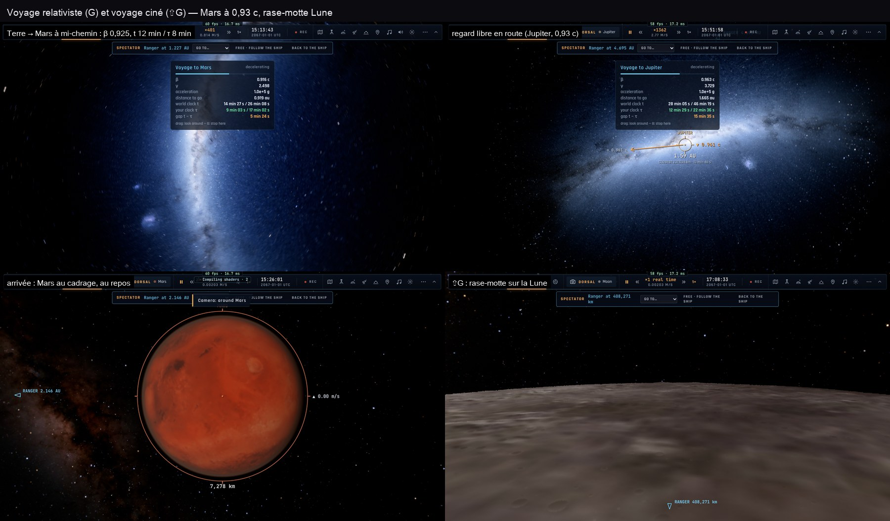

# CAM3–CAM7 — le voyage relativiste, le voyage ciné, la vitesse selon la surface (2026-10-29)

## Ce qui est fait

- **Le voyage relativiste** (`src/camera/voyage.ts` la physique, `src/camera/voyager.ts` le contrôleur) :
  - **Lancement** : G, la section **Voyage** du panneau caméra, ou `__bh.goTo`.
  - **Profil** : fusée relativiste à accélération propre constante jusqu'à mi-chemin, puis décélération.
  - **Allure** : « selon le trajet » (10⁵ g, plafond 0,999 c : quelques % de c vers la Lune, ~0,93 c vers Mars), ou
    une vitesse de pointe, ou une durée (τ du voyageur ou t du monde), ou une accélération.
  - **Calcul exact** : table s → (t, τ) par intégrales fermées en γ, inversée par dichotomie dans chaque intervalle.
  - **Borne de la sphère d'influence** : vitesse ≤ k × hauteur au-dessus du plus proche.
  - **Cibles mobiles** interceptées là où elles seront.
  - **Trajectoire** : spirale qui quitte le monde de départ et entre dans celui d'arrivée, jamais à travers une
    planète (l'ISS derrière la Terre au moment d'arriver).
  - **Horloges** : le monde avance de t (les planètes ont bougé). La HUD montre t, τ, l'écart, β, γ et l'accélération.
  - **Lecture variable** : temps réel près des mondes, l'accélération du temps monte dans le vide (~×900 vers Mars),
    ~20 s à l'écran.
- **Les effets** :
  - β est transmis au traceur : aberration, Doppler, effet projecteur.
  - **Regard libre** au glisser pendant le voyage, dans le repère du voyageur.
  - Espace met tout en pause, G arrête le voyage.
- **Qui voyage** :
  - la caméra libre (F3 : le vaisseau continue) ;
  - ou le vaisseau lui-même (`voyageWho: "ship"`) : l'horloge de l'équipage avance de τ, la mission continue.
- **Le voyage ciné** (⇧G, `src/camera/cinevoyage.ts`, `src/camera/skim.ts`) :
  - **Déroulé** : rase-motte sur le monde quitté (plongée depuis l'orbite, 900 m au-dessus du sol avec le relief
    anticipé, remontée), puis le voyage, puis rase-motte sur le monde atteint (vers le côté jour si on arrive de nuit),
    et montée au cadrage.
  - **Deux versions** : **plan-séquence** (continu) et **montage** (coupes : regard arrière, puis avant, puis sur la
    cible).
- **Gargantua** : Miller et le trou noir sont atteints en voyage, ils ne sont plus téléportés.
- **La vitesse selon la surface** (`src/camera/speed.ts`) :
  - minimum doux sur tous les mondes : plus de saut quand le plus proche change ;
  - une seule plage ×1/16 … ×32 pour la molette et le curseur ;
  - inertie sur les touches de l'orbite.
- **Corrigés** :
  - Retour à bord depuis le spectateur : 87° → 0° (deux conventions mélangées).
  - Faux « IMPACT » pendant un voyage.
  - Plans robustes aux éphémérides manquantes (ISS hors de sa fenêtre, pose figée du vaisseau piloté).

## Mesuré (headless ici, 1280×720)

| situation | avant (CAM0) | maintenant |
|---|---|---|
| Terre → Lune | aucun mouvement (refusé : un Ranger est piloté) | voyage, 1 158 images, **0 défaut** |
| Lune → Mars | — | 1 199 images, **0 défaut** |
| Terre → Mars (camera-voyage) | — | t 26,1 min / τ 17,0 min, 0,932 c, arrivée à 3,2 R au repos, **0 défaut** |
| Mars → ISS | — | arrive (spirale autour de la Terre) ; 13 visées cassées (la visée de l'ISS quand elle passe le limbe) |
| → Miller | téléporté ×618, 66° | voyage, **36 sauts à corriger** (le repère de Gargantua) |
| spectateur dehors et retour | 87° | **0°** |
| vues du F-35 par V | 50° | **0** |
| ⇧G Terre → Lune | — | rase-motte à 900 m (Terre) et 1 609 m (Lune), 0 saut, 7 petites cassures de vitesse (×2–3) |

## Reste à faire (phases suivantes)

- Le repère de Gargantua : les sauts vers Miller.
- La visée de l'ISS à l'arrivée.
- La focale à la molette.
- La caméra sur tout appareil (CAM8 : avions de ligne, bateaux, ailiers, joueurs ; orbite/poursuite, cockpit, tour).
- Les vidéos 720p.

