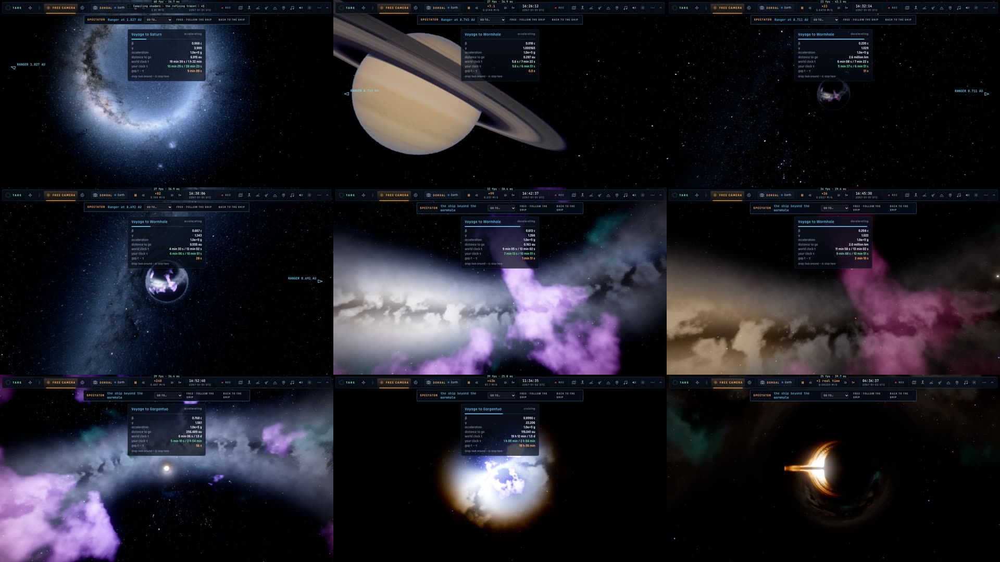

# CAM9–CAM11 — le grand voyage, les dernières cassures, la campagne (2026-10-29)

## Ce qui est fait

- **À travers le trou de ver** :
  - La traversée est un voyage relativiste comme les autres : horloges t / τ, accélération du temps, regard libre.
    Elle suit la coordonnée ℓ de la gorge (`startThroat`, `src/camera/voyager.ts`), ralentie dans la gorge même pour
    qu'on la voie passer.
  - Toute cible de l'autre côté s'y rend seule : voyage jusqu'à l'embouchure, gorge, puis la cible (`goTo`,
    `mouthGoal` dans `src/main.ts`). Dans l'autre sens aussi.
- **L'itinéraire** `__bh.tour(["saturn", "wormhole", "hole"])` :
  - depuis la Terre : Saturne (0,99 c), le trou de ver, la gorge (0,79 c), Gargantua (0,999 c) ;
  - une pause à chaque étape.
  - Film 720p : `bun scripts/camera-video.ts tour` (93 s).
- **Miller** : 36 sauts → **0**.
  - Le regard d'arrivée n'était pas un vecteur unitaire : la pose en tirait un tangage nul.
  - Résultat : 12,7° de bascule à la dernière image.
  - Le défaut touchait toute arrivée dont le cadrage regarde vers le haut ou le bas.
- **ISS** : 13 visées cassées → **0**.
  - Cause : de loin, l'ISS fait le tour de la Terre en une fraction de seconde à l'accélération du temps.
  - Le regard vise maintenant le monde qu'elle orbite, puis glisse sur elle en approchant.
  - Le regard est amorti sur ¼ s.
  - Le fondu vers le cadrage final ne revient plus en arrière quand l'accélération du temps retombe.
- **La tour** : la focale est deux fois plus serrée. De face, l'appareil n'était plus qu'un point.
- **Docs** : `docs/CAMERA.md` / `docs/CAMERA.fr.md` (guide joueur et développeur), `__bh.tour` / `__bh.touring` dans
  `docs/BH-API.md`.
- **Tests** :
  - unitaire : le plan de la gorge ;
  - e2e : `camera-voyage` traverse le trou de ver à la touche G.

## Mesuré

| situation (capteur `__bh.cam`, kerr-mini plein écran) | avant | maintenant |
|---|---|---|
| Terre → Lune, Lune → Mars, ISS → Terre | 0 | **0** |
| Mars → ISS | 13 visées (6 au 1ᵉʳ passage) | **0** (pire 8,5°/image, en rotation douce) |
| → Miller | 36 sauts, 95 cassures | **0** (pire 1,2°) |
| → Gargantua, → trou de ver (côté Gargantua) | — | **0** |
| G de la Lune à Gargantua (camera-voyage) | — | ℓ −0,95 → +0,42, 0,79 c dans la gorge, arrivée à 40 M, 1 saut (changement de repère du capteur) |

## Campagne (CAM11)

kerr-mini (plein écran) :

| fichier | résultat |
|---|---|
| camera-smooth (strict : 0 défaut exigé par situation) | ✓ 3/3 — 14 situations à 0 défaut |
| camera-voyage (dont la traversée du trou de ver) | ✓ 4/4 |
| camera-subject | ✓ |
| spectator | ✓ 3/3 après mise à jour (« Aller à Mars » est un voyage de ~20 s, plus une téléportation) |
| wormhole-map, place, view-reset | ✓ |
| camera-travel | 1/2 — le trépied fait 129–141 m en 7 s au lieu de 150 ; **déjà en échec avant le plan** (87 m au commit a081e107) |

Ce Mac (headless) :

| fichier | résultat |
|---|---|
| smoke, modes, title-foot, net-spectate, s5 | ✓ |
| observatory, title-ship | ✗ — **déjà en échec avant le plan** (même erreur au commit a081e107 : pas de sortie à pied près du vaisseau ; voile de l'écran-titre sur le clic) |

