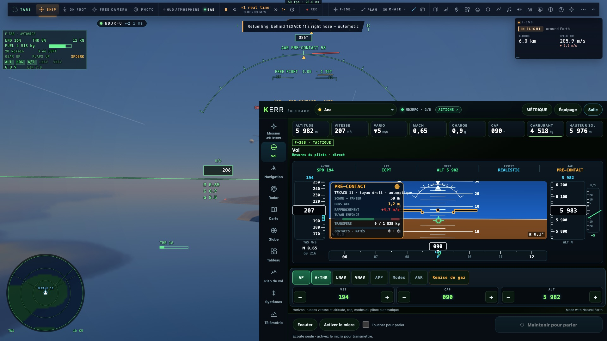
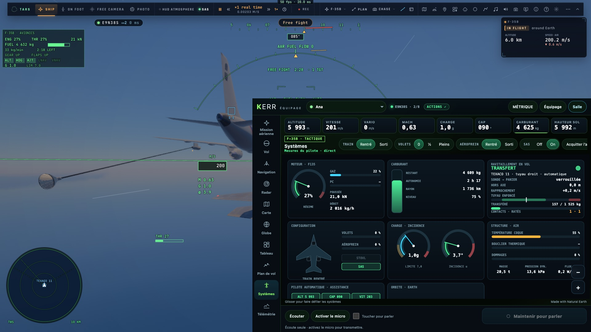
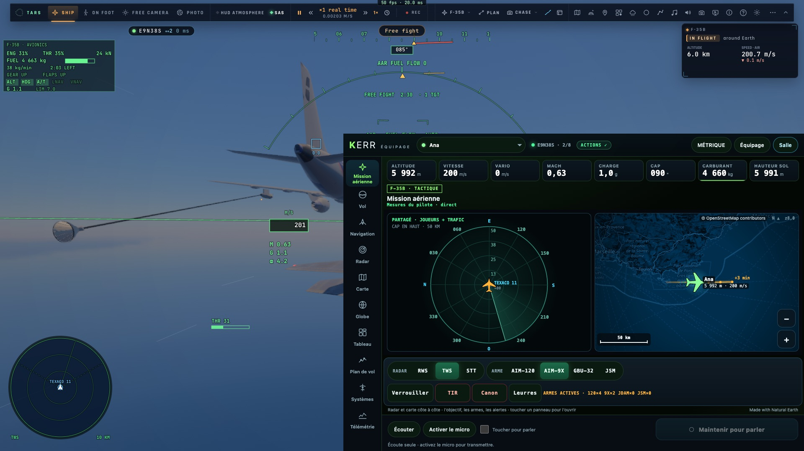

# Priorité 2 — Le ravitaillement en vol au crew

*2026-10-21, `main` — `docs/AUDIT-CREW-2026-10-21.md`, priorité 2.*

## Ce qui est fait

- **Le bloc `aar`** de l'instantané `instruments` (optionnel, `src/net/instruments.ts`, lu borné). Il vient du contrôleur
  (`controller/aar.ts aarCrew`) et n'est envoyé que pour le F-35 :
  - l'étape (rendez-vous `join`, ou derrière le tuyau `hose`) et la phase telle que le HUD du pilote la dit (PRE-CONTACT,
    CLEARED, CONTACT, FUEL FLOW, FULL, BREAKAWAY, DEPART) ;
  - la conduite (automatique, assistée, manuelle), le ravitailleur et le côté du tuyau ;
  - le carburant transféré et demandé, et s'il s'agit d'un exercice (réservoirs pleins ou carburant infini) ;
  - l'écart de la sonde au panier le long du tuyau et hors de son axe, la vitesse de rapprochement ;
  - le tuyau enfoncé, sa plage de transfert et son seuil de dégagement ;
  - les feux du pod, les contacts et les ratés, la distance au ravitailleur pendant le rendez-vous.
- **Une alerte `BREAKAWAY`** (rouge) dans le bandeau des alertes.
- **TEXACO dans le trafic** : les cibles d'un combat portent maintenant leur vitesse (`spd`). Le ravitailleur est nommé
  « A330 MRTT » : la console le dessine en ami et le fait avancer entre deux envois.
- **Les ordres** : `ap.mode` accepte `tanker` (côté du tuyau, ravitailleur proche, conduite), `refuelMode` et
  `tankerOff`.
  - `tanker` part toujours avec son côté : l'outil `jet_mode` sans côté *bascule* le ravitaillement. Un ordre répété (par
    exemple à travers le délai lumière) ne s'annule donc jamais lui-même.
  - `tankerOff` arrête le ravitaillement seul, sans couper l'orbite ni le suivi de terrain (contrairement à `off`).
- **La console** :
  - le **MCP** a un menu **AAR** : « Ravitailleur · tuyau droit », « Tuyau gauche », la case « à 1,5 km, à notre
    altitude », la conduite (Auto, Assisté, Manuel, allumée d'après l'instantané), « Arrêter le ravitaillement » ;
  - le **PFD** affiche la phase AAR dans le FMA (à la place du mode) et le panneau AAR sur l'horizon ;
  - la vue **Systèmes** a une carte « Ravitaillement en vol » : phase, feu du pod, sonde → panier, hors axe,
    rapprochement, jauge du tuyau enfoncé (plage verte, dégagement rouge), carburant transféré, contacts et ratés ;
  - le **bandeau de la Mission aérienne** donne la phase et le carburant pris.
- Les textes nouveaux sont bilingues dès maintenant (`src/crew/lang.ts`, la langue de la console : voir la priorité 3).
  Ce commit pose aussi les premières pièces de la console bilingue (postes, checklists EN, journal dans la langue de la
  console) ; la suite est en priorité 3.

## Mesures

- `bun test tests/crew*.test.ts` : 34 tests verts, dont `tests/crew-aar.test.ts` (3) :
  - le bloc lu borné, rien d'inventé pour un pilote plus ancien ;
  - les arguments de `ap.mode` vérifiés et ses mots en FR et EN ;
  - l'exécuteur : le ravitailleur toujours demandé avec son côté, `tankerOff` refusé sans ravitaillement et sans
    toucher à `jet_mode off`.
- **e2e sur kerr-mini** : `tests/e2e/crew-aar.e2e.test.ts`, 3/3 en 160 s, sur le vrai simulateur avec de vrais clics
  CDP dans le cadre de la console (`tests/e2e/lib/crew.ts`). Le F-35B vole au-dessus de la Méditerranée à 6 000 m :
  - TEXACO est posé depuis le MCP de la console (proche, tuyau droit). La console reçoit le bloc et voit TEXACO 11 dans
    son trafic (« A330 MRTT », plus de 100 m/s) ;
  - derrière le tuyau, la console affiche PRE-CONTACT. La conduite passe en Assisté puis en Auto depuis la console, et le
    jeu suit (`camera.aar.mode`) ;
  - le contact se fait : la console montre plus de 150 kg transférés (Systèmes, Mission aérienne). « Arrêter le
    ravitaillement » depuis la console met fin au ravitaillement, et le carburant à bord a gagné plus de 100 kg depuis
    le début du transfert.
- Non-régression sur le mini : `crew` 7/7, `crew-actions` 6/6, `crew-space-actions` 5/5.

## Ce qui reste

- Le crew ne voit pas le ravitailleur en 3D ni le panier : seulement les chiffres et le radar.
- Les autres pièces aéronavales de l'audit (porte-avions, STOVL) ne font pas partie de cette priorité.
