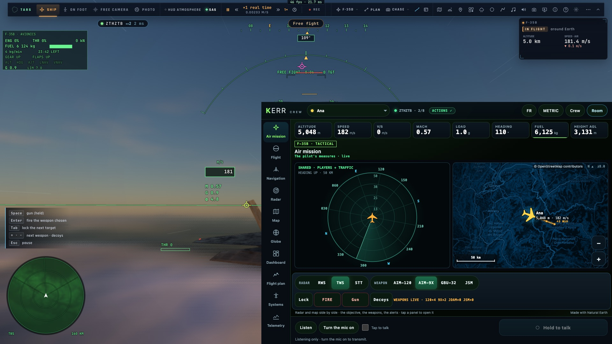
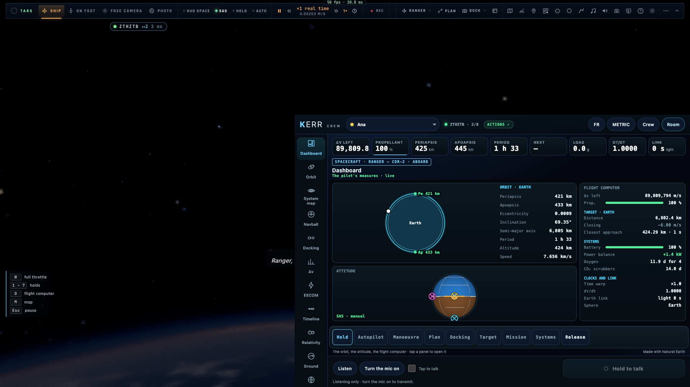
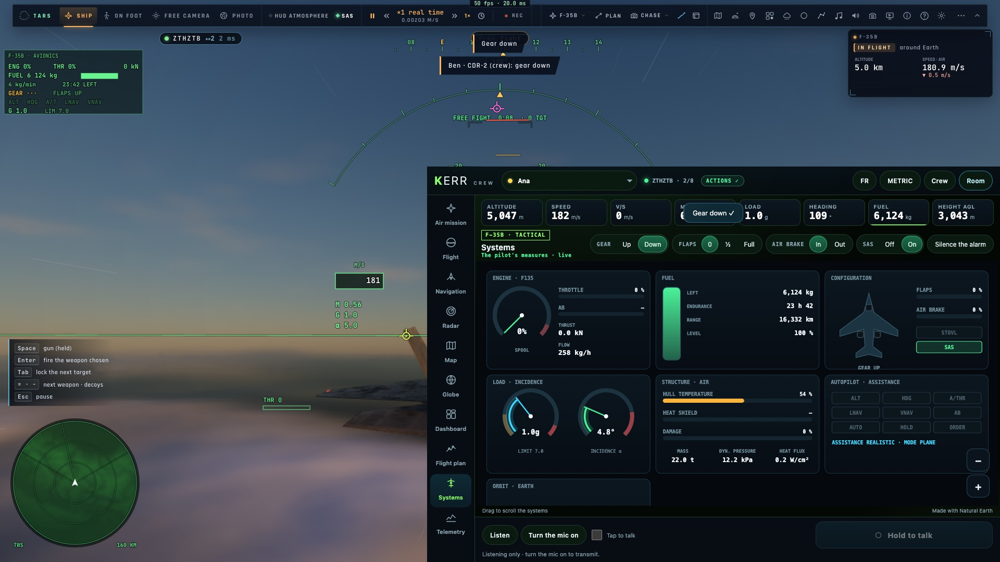

# Priorité 3 — La console en anglais

*2026-10-21, `main` — `docs/AUDIT-CREW-2026-10-21.md`, priorité 3.*

## Ce qui est fait

- **Une langue choisie dans la console** (`src/crew/lang.ts`) : par défaut celle du navigateur, changée au lobby
  (« Langue ») ou par le bouton FR/EN de l'en-tête, gardée (`kerr.crew.lang`). Tout est redessiné aussitôt :
  - la page (`crew/index.html` : `data-en` pour les textes, `data-en-aria-label` / `-placeholder` / `-title` pour
    les attributs) ;
  - les vues et leurs notes, les tuiles, le badge, la ligne d'état ;
  - les panneaux (Systèmes, MCP, armes, ordinateur de vol), les menus contextuels, le journal de bord, la radio, les
    messages ;
  - les dessins sur le canvas : PFD, ND, radar, carte, plan de vol, Systèmes, Orbite, Carte système, Boule, Amarrage,
    Δv, EECOM, Chronologie, Relativité, Sol, Mission aérienne, panneau AAR ;
  - les nombres (1 234,5 ou 1,234.5), les durées (j ou d), les points cardinaux (O ou W).
- **Les checklists de panne** dans les deux langues (`src/crew/checklists.ts`) : celles du jeu en anglais, et leur
  traduction française du dictionnaire du jeu. Un test garde les trois en phase.
- **Les phases de l'autopilote d'amarrage** (APPROACH, FINAL, HOLD 10 m, TO THE AXIS…) et les tenues, autopilotes et
  manœuvres (`holdWords`, `autoWords`, `maneuverWords` dans `net/crewcmd.ts`) sont traduits.
- **Plus de `sayOf().fr` codé** :
  - l'ordre porte la langue de la console (`crew-cmd.lang`) ;
  - le pilote y répond : ce qui a été demandé, les refus de ses contrôles, ses propres textes ;
  - les mots de ses outils passent par `translateTo` (`src/i18n.ts`). C'est le dictionnaire du jeu dans les deux sens,
    gabarits `{0}` compris, avec leurs valeurs traduites : « Tanker: TEXACO 11, 1.5 km ahead… — right hose » devient
    « Ravitailleur : TEXACO 11, 1,5 km devant… — tuyau droit » ;
  - l'accusé porte les arguments de l'ordre (`crew-ack.args`) : chaque écran redit la ligne du journal dans sa langue
    et ses unités.
- Le module de langue est propre à la console (pas les dictionnaires du jeu) : le bundle reste sous son budget
  (`tests/crew.test.ts`).
- Les e2e crew existants gardent la console en français (`App.boot({ crewLang })`, français par défaut) : leurs
  sélecteurs lisent ses libellés.

## Mesures

- `tests/crew-lang.test.ts` (3) :
  - aucun texte français hors d'une paire dans `src/crew/` (lecture de l'AST TypeScript) ;
  - `translateTo` dans les deux sens, gabarits et valeurs ;
  - le pilote répond dans la langue de l'ordre (anglais, puis français pour une console plus ancienne), refus du verrou
    en anglais, arguments portés.
- `tests/i18n.test.ts` vert (FR + EN complets) ; `bun test tests/crew*.test.ts` : 41 verts.
- **e2e sur kerr-mini** : `tests/e2e/crew-en.e2e.test.ts`, 4/4 :
  - la page et les vues en anglais (`lang="en"`, « Air mission »), aucun mot français sur sept vues F-35 ni sur six vues
    vaisseau du Ranger ;
  - le train sorti depuis la vue Systems : « gear down » au journal, « LOCKED » quand le pilote verrouille ;
  - la langue basculée par le bouton FR/EN de l'en-tête : « Tableau », puis « Dashboard ».
- Non-régression sur le mini (console en français) : `crew` 7/7, `crew-actions` 6/6, `crew-space` 3/3,
  `crew-space-actions` 5/5, `crew-stations` 2/2, `crew-demo-space` 2/2, `net-crew` 2/2.

## Ce qui reste

- Les textes que le jeu envoie dans l'instantané (titre et phase du hub, nom de l'objectif de mission, noms des pannes
  inconnues) restent dans la langue du pilote.
- Les indicatifs des postes (CDR-2, NAV, ING, FLIGHT…) ne sont pas traduits : ce sont les noms des membres dans la salle.
