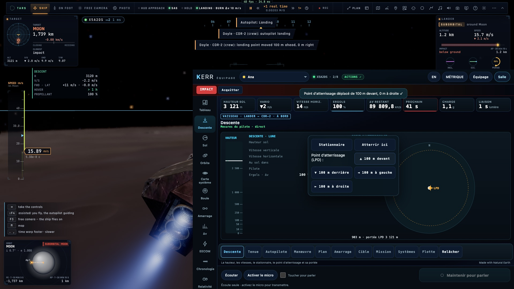
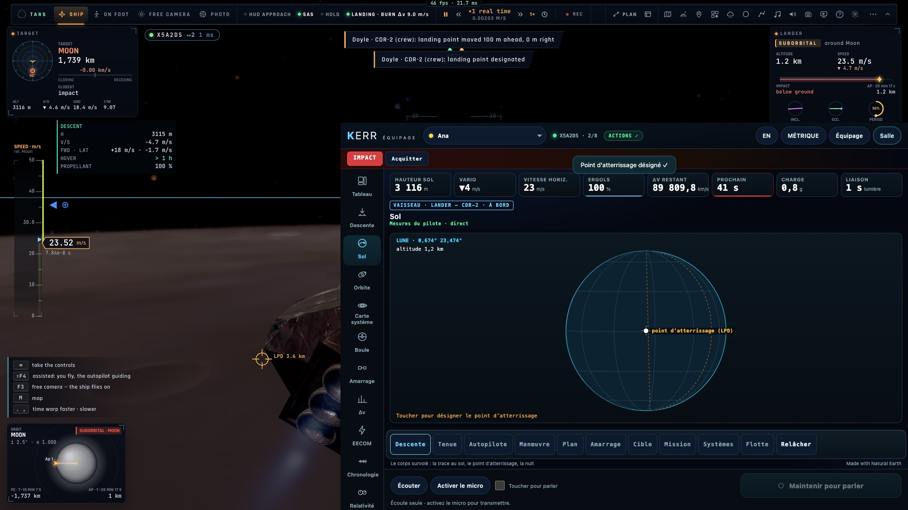
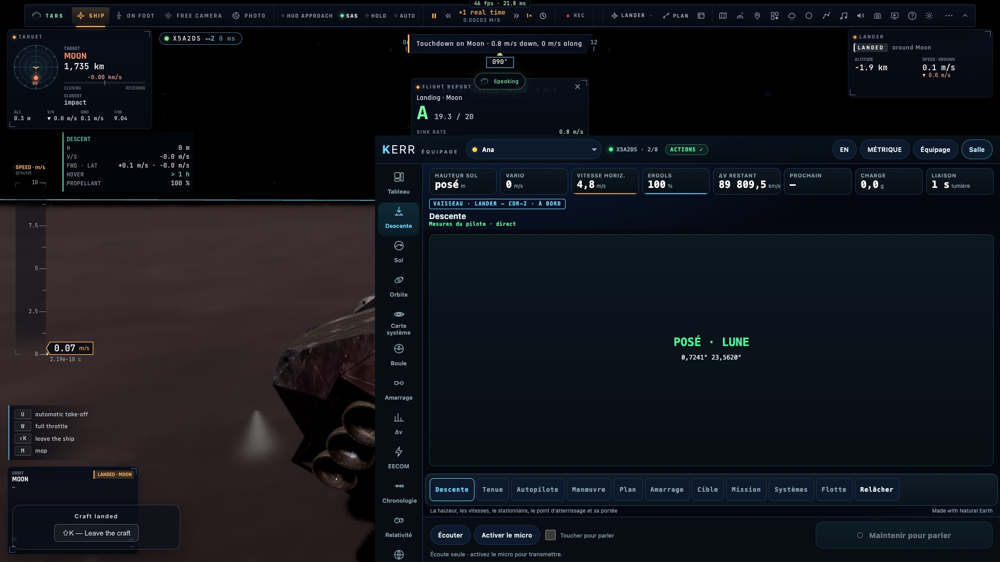
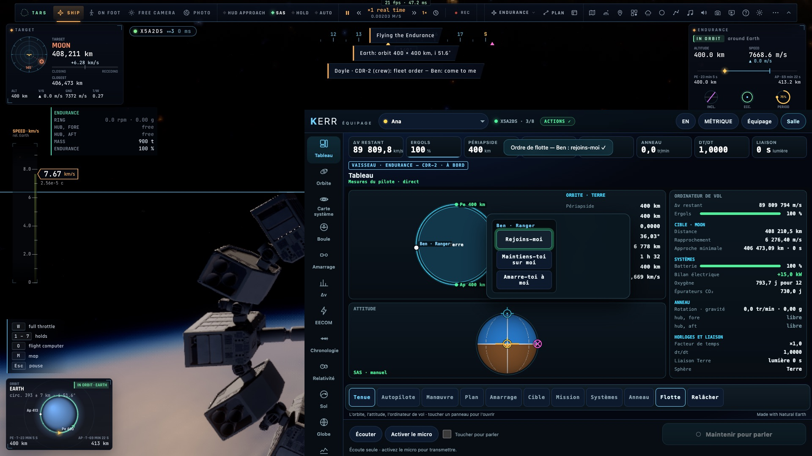
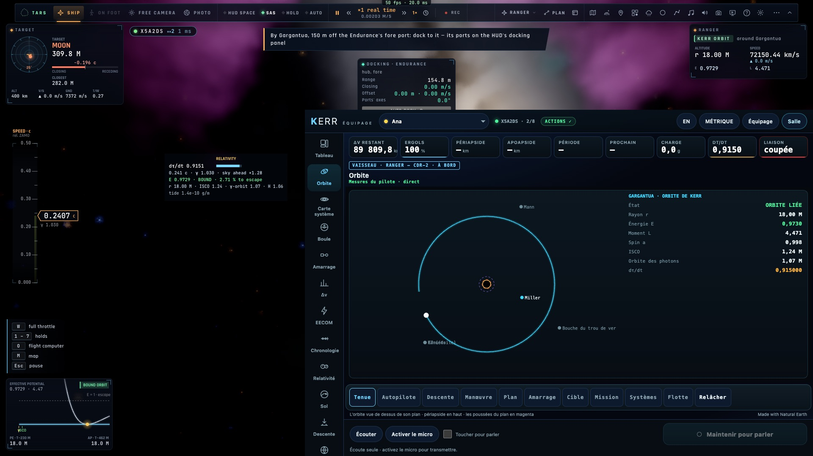
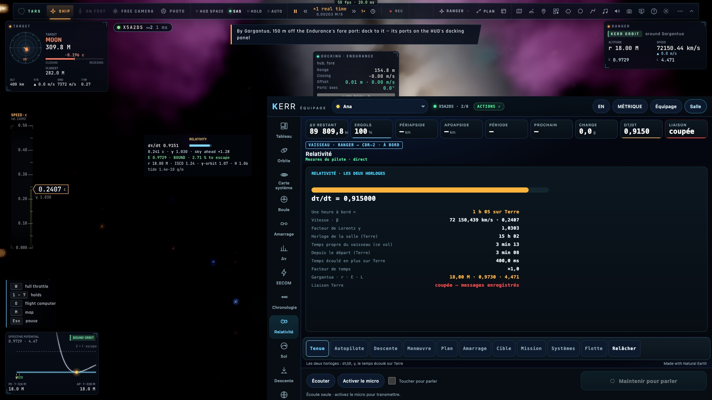

# Priorité 4 — Une console par vaisseau

*2026-10-21, `main` — `docs/AUDIT-CREW-2026-10-21.md`, priorité 4.*

## Ce qui est fait

- **Les vues et les tuiles de chaque appareil** (`src/crew/profile.ts craftViews / craftTiles`) :
  - le **Lander** : Tableau, Descente, Sol en tête ; tuiles hauteur sol, vario, vitesse horizontale, ergols, Δv ;
  - le **Ranger** (il se pose aussi) : la Descente après le Sol ;
  - l'**Endurance** (elle ne se pose jamais) : pas de Descente, pas d'atterrissage, de décollage, de rentrée ni de
    stationnaire dans ses autopilotes ; une tuile Anneau.
- **La vue Descente** (`draw/descent.ts`) :
  - la hauteur sol sur un ruban (échelle en racine) et sa tendance sur 10 s ;
  - les vitesses verticale et horizontale, le temps avant le sol, le stationnaire ou l'atterrissage piloté, les ergols ;
  - le point d'atterrissage vu de dessus autour du vaisseau, avec la portée du LPD.
  - Elle s'appuie sur un nouveau bloc `desc` de l'instantané : hauteur, vitesses, stationnaire, autopilote, temps avant
    le sol, distance du LPD et sa portée.
- **Le LPD depuis le crew** (`sp.lpd`) :
  - le panneau **Descente** de l'ordinateur de vol : Stationnaire, Atterrir ici, et le point déplacé de 100 m devant,
    derrière, à gauche ou à droite ;
  - sur la vue **Sol**, un point touché → « Désigner pour l'atterrissage (LPD) ».
  - Le contrôleur prend l'ordre à son prochain pas d'atterrissage (`camera.lpdOrder`), avec la même portée que le manche.
  - Refusé, avec sa raison, hors d'un atterrissage motorisé ou au-dessus de 5 km.
- **Les ordres de flotte depuis le crew** (`sp.fleet`) : le panneau **Flotte** liste les autres pilotes de la salle.
  Pour chacun, trois ordres : « Rejoins-moi », « Maintiens-toi sur moi », « Amarre-toi à moi ». Le pilote suivi les
  envoie par sa session (`netsession.spaceOrder`, N1), et l'autre reçoit sa carte Accepter / Refuser.
- **L'état posé** (`craft.status`, `craft.where`) : l'Orbite et la Descente disent « POSÉ · LUNE » au lieu d'une conique
  suborbitale ; les tuiles Périapside et Hauteur sol disent « posé ».
- **Le côté Gargantua** :
  - l'**Orbite** (`draw/kerr.ts`) dessine le trou de dessus : l'horizon, l'ergosphère, l'orbite des photons et l'ISCO
    pour son spin, ses mondes, la chute du vaisseau. Elle donne r · E · L et l'état (liée, non liée, chute dans
    l'horizon). Autour d'un monde (Miller, Mann…), elle dessine son orbite d'après ses apsides ;
  - la **Boule** dit qu'il n'y a pas de boule orbitale et renvoie à r · E · L ;
  - l'**Amarrage** dit « AMARRÉ · ENDURANCE » quand c'est le cas ;
  - le **Sol** dit « Posé sur Miller » ou « Autour de Mann » au lieu de « loin de tout corps solide ».
- **Le chiffre « temps écoulé sur Terre » était faux** : il valait `room − tau`, l'âge de la scène, alors que le temps
  propre repart de zéro à chaque vol. Il est corrigé :
  - les deux horloges sont prises ensemble au départ du vol (`clocksStep`, `time.since` et `time.lag`) ;
  - une date avancée n'est pas comptée comme du temps écoulé ;
  - la Relativité affiche « Depuis le départ (Terre) » et « Temps écoulé en plus sur Terre ».
- **La carte système** dessine les autres vaisseaux de la salle à leur couleur, et une cible station ou vaisseau (l'ISS)
  à sa place (`target.r`).
- La salle de démonstration (`--space`) envoie le bloc descente de Brand et l'état de chaque vaisseau.

## Mesures

- `tests/crew-craft.test.ts` (7) :
  - les vues et tuiles de chaque appareil ;
  - les blocs lus (état, descente, horloges, place de la cible) ;
  - `sp.lpd` et `sp.fleet` bornés, et leurs refus ;
  - les mots de l'état de Kerr ;
  - le temps écoulé sur Terre : une heure à dτ/dt 0,5 donne 1 800 s, une date avancée de dix jours n'est pas comptée,
    et un nouveau vol reprend à zéro.
- **e2e sur kerr-mini** : `tests/e2e/crew-craft.e2e.test.ts`, 4/4 en 197 s, avec de vrais clics :
  - le **Lander** au-dessus de la Lune, à 1,2 km : les vues (sdash, descent, ground…). « Atterrir ici » engage
    l'autopilote d'atterrissage. « ▲ 100 m devant » déplace le point (`lpd.moved`). Un point touché sur la vue Sol est
    désigné ;
  - le Lander **posé** : la console le dit (`craft.status = landed`, `where = moon`) ;
  - l'**Endurance** en orbite : pas de Descente, une tuile Anneau, pas de `land` parmi ses autopilotes. « Rejoins-moi »
    depuis le panneau Flotte → sur l'écran de Ben, « Ana asks you to come to their craft » ;
  - **Gargantua** (le Ranger près de l'Endurance) : l'orbite de Kerr à la console (r 18 M, E 0,973, liée), et les
    horloges depuis le départ.

## Ce qui reste

- Les mondes de Gargantua n'ont pas de carte au sol à la console (pas de latitude ni de longitude envoyées pour eux).
- Le Δv affiché pour le Lander et l'Endurance en carburant infini (~89 800 km/s) vient du budget du jeu, pas de la
  console : à revoir côté `fcBudget`.
- L'alerte IMPACT reste allumée pendant une descente motorisée (la trajectoire libre touche le sol) ; c'est le
  comportement d'avant.
