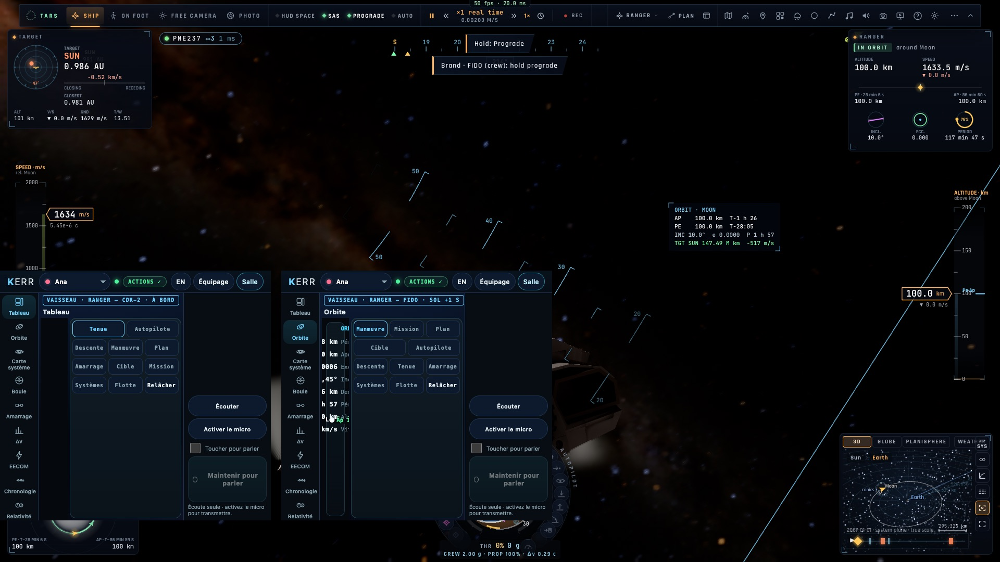

# Priorité 6 — Les postes

*2026-10-21, `main` — `docs/AUDIT-CREW-2026-10-21.md`, priorité 6.*

## Les décisions de l'utilisateur (2026-10-21)

| question | réponse |
|---|---|
| que peut ordonner chaque poste ? | **tous les postes, tout** : les postes changent la vue d'accueil et l'ordre des panneaux, pas les droits |
| comment vérifier « à bord » ? | **l'accord du pilote** |
| qui règle le délai lumière ? | **le créateur de la salle** |
| la voix et le délai | **pas de délai de communication** pour la voix |

## Ce qui est fait

- **À bord sur accord du pilote** :
  - une console à un poste de bord (copilote, navigateur, ingénieur) qui suit un **vaisseau** envoie `crew-aboard` au
    pilote ;
  - le pilote voit une carte « Doyle · CDR-2 demande à être à bord » (Accepter / Refuser) et répond `crew-aboard-ok` ;
  - accepté, la console est en direct ; en attente ou refusée, elle est **au sol** : délai lumière, et liaison coupée
    derrière le trou de ver ;
  - le badge le dit : « À BORD », « À BORD · EN ATTENTE DU PILOTE », « SOL +1 S » ;
  - l'instantané porte la liste des consoles acceptées (`caps.aboard`) ;
  - un avion n'a pas de délai lumière : rien à demander.
- **Un poste au sol ne peut plus échapper au délai** : c'est le **jeu du pilote** qui le tient (`caps.hold`).
  - Les ordres et messages d'une console non acceptée à bord sont retenus du temps de la lumière
    (`netsession.groundOf`), quoi qu'ait fait la console.
  - Derrière le trou de ver, ses ordres sont refusés (« Liaison coupée (trou de ver) : enregistrez un message », dans
    la langue de la console) et ses messages sont gardés jusqu'au retour de la liaison.
  - Une console envoie donc à ce pilote ses ordres tout de suite. Avec un pilote plus ancien, elle les retarde
    elle-même, comme avant.
- **Le délai lumière, réglé par la salle** :
  - le réglage *Réseau › Délai lumière vers le sol* de **celui qui a créé la salle** (le jeton de création gardé par sa
    page) part en événement `room-delay` ;
  - **le serveur vérifie le jeton** (`sha256` contre celui de la salle), le retire avant de relayer, et rejoue la valeur
    aux arrivants ;
  - chaque pilote applique le délai de la salle à ses instantanés, puis son propre réglage si la salle n'en dit rien
    (un serveur plus ancien : la fonction n'y est pas annoncée, `welcome.f`).
- **La voix** : jamais retardée (la décision). Derrière le trou de ver, elle est coupée entre le sol et ce vaisseau,
  comme le texte, des deux côtés :
  - la console coupe la voix d'un pilote qui y est (`radio.cut`) ;
  - le jeu coupe celle des postes au sol (`netVoice.cut`).
- **Quindar sur la radio** : les tonalités du CAPCOM (2 525 Hz à l'ouverture, 2 475 Hz à la fermeture) sont mêlées à
  la voix qu'il envoie. Toute la salle les entend, plus seulement lui.

## Mesures

- `tests/net-rooms.test.ts` : le délai de salle refusé à un autre que le créateur (erreur `owner`), relayé sans son
  jeton, rejoué à un arrivant.
- `tests/crew-posts.test.ts` (3) :
  - à bord en attente → au sol, accepté → en direct, un pilote plus ancien → à bord comme choisi ;
  - la console envoie tout de suite à un pilote qui retient, et retarde elle-même pour un plus ancien ;
  - le refus derrière le trou de ver, en FR et en EN.
- **e2e sur kerr-mini** : `tests/e2e/crew-posts.e2e.test.ts`, 5/5. Le Ranger d'Ana orbite la Lune (lumière 1,35 s) :
  - le copilote demande, Ana accepte par sa carte : ordre répondu en 21 ms ;
  - FIDO au sol : son ordre, envoyé tout de suite, est exécuté par le jeu d'Ana **1,37 s** plus tard ;
  - un second copilote refusé : au sol (« SOL +1 S ») ;
  - Ana règle « un dixième » : FIDO passe à 0,13 s ;
  - le CAPCOM ouvre et ferme la radio : deux tonalités, et la piste envoyée est celle du mélange.
- Non-régression sur le mini : `crew-stations` 2/2, `crew-space-actions` 5/5, `net-crew` 2/2, `crew` 7/7,
  `crew-actions` 6/6, `crew-aar` 3/3, `crew-craft` 4/4 (sa console à bord acceptée par la pilote).

## Ce qui reste

- Les **instantanés** vers un poste au sol sont encore retardés par la console elle-même : le réseau ne permet pas
  d'envoyer un événement à un seul membre. Une console modifiée verrait donc le vaisseau sans retard, mais ne pourrait
  pas agir plus tôt.
- Les messages vocaux enregistrés ne sont pas faits : la voix n'a pas de délai, par décision.
