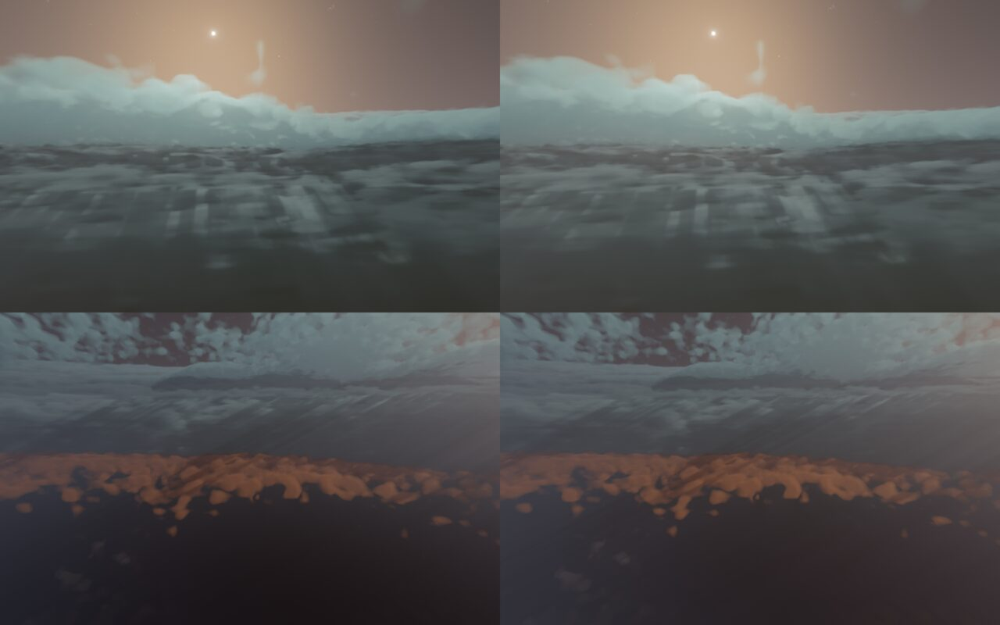
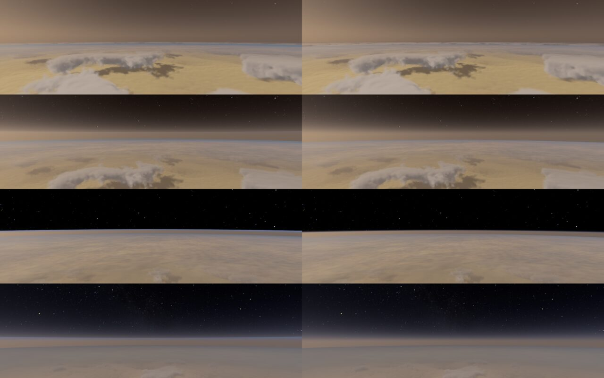
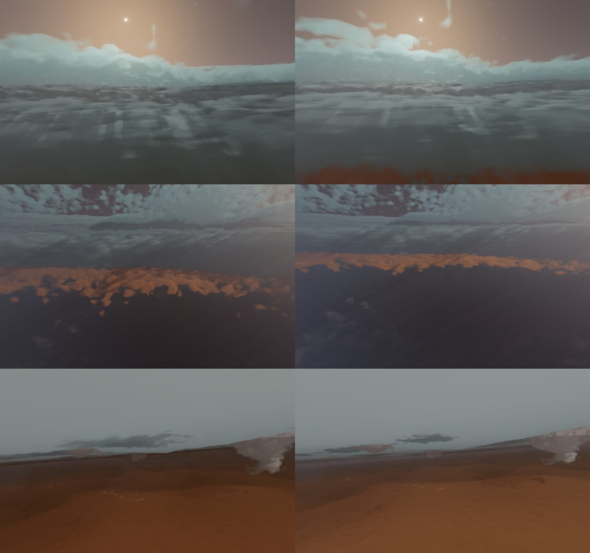
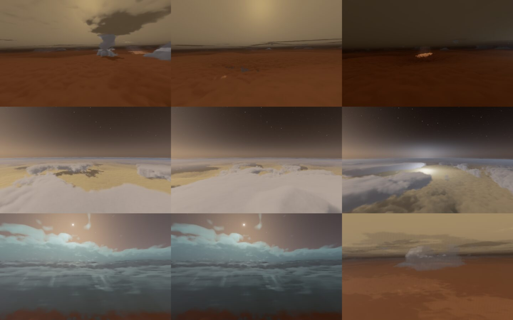
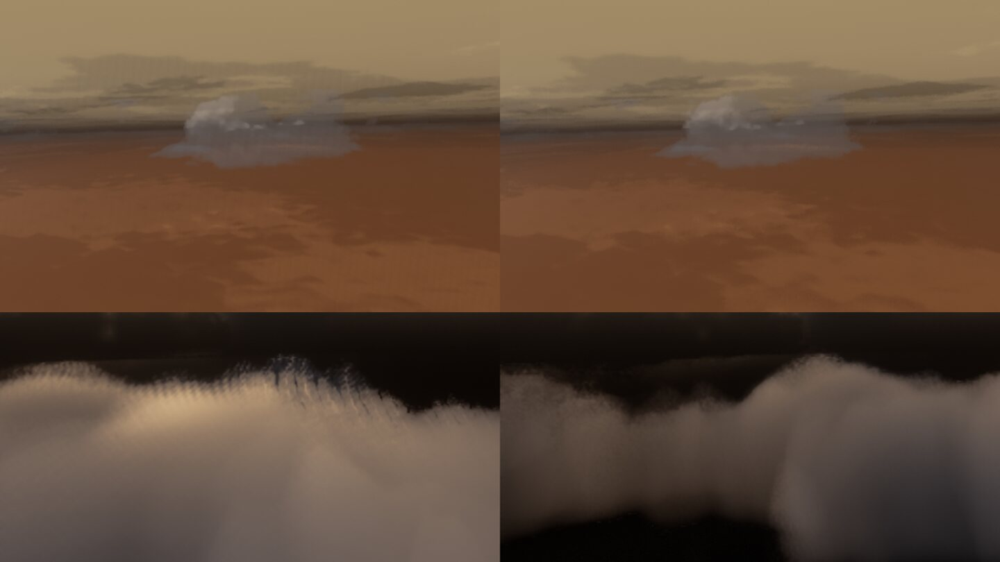
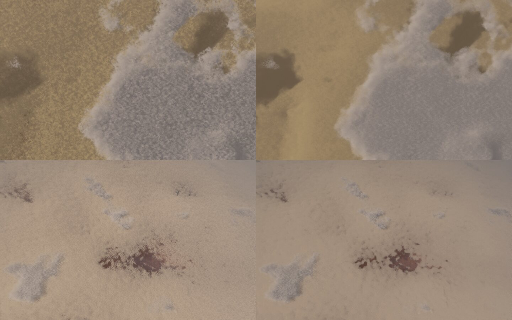
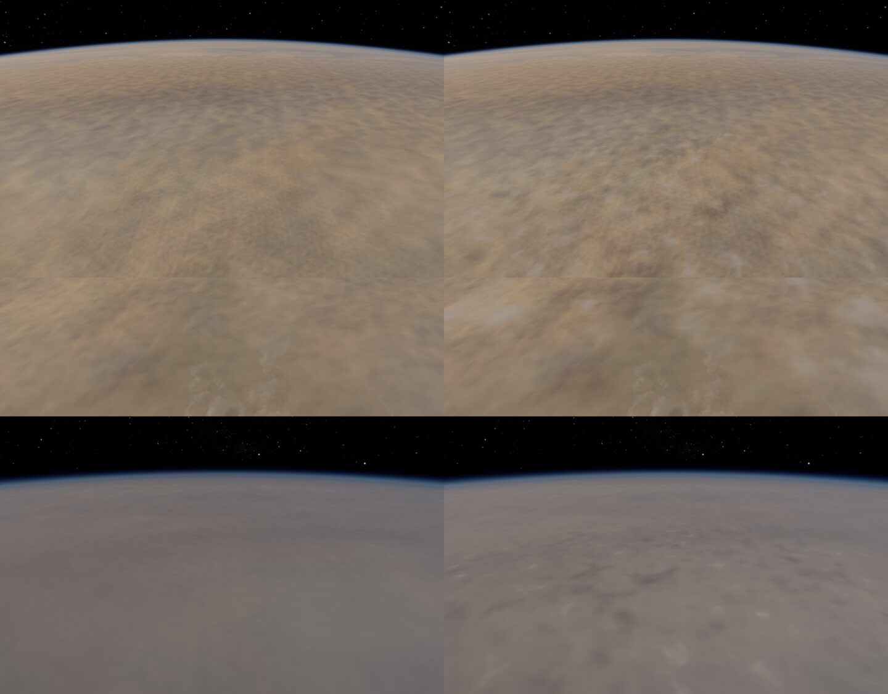
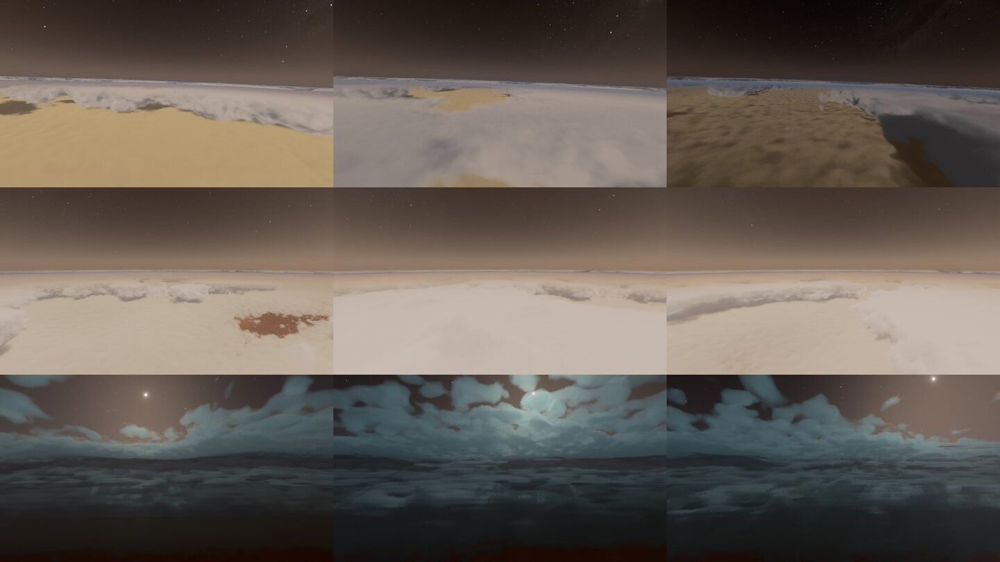

# Le volume des géantes — ce qu'on a repris de vr-solar-system

1er novembre 2026. Plan : [PLAN-GEANTES-VOLUME.md](../PLAN-GEANTES-VOLUME.md). Les idées viennent des sessions 4p à 4t du
Claude d'Alex (`vr-solar-system/docs/agent/`). Les images sont des vues fixes hors ligne (960 × 600, 16 échantillons par
pixel), prises sur ce Mac ; les temps sont mesurés sur kerr-mini (`planets-ab`, qualité fixe, A B B A deux fois).

## V1 — l'éclair cherché une fois par image (`b614ad5a`)

- **Avant** : chaque pixel refaisait la même recherche (`giantFlashes` : 4 flux, jusqu'à 16 lectures du bruit pendant un
  éclair) et gardait le résultat en registres.
- **Maintenant** : le renderer appelle le jumeau CPU (`system/giant-clouds.ts giantFlashes`) une fois par image et passe
  l'éclair le plus brillant au shader dans `P.wx[6]` (la place de l'éclair terrestre, vide près d'une géante). Le shader
  ne garde que la lueur (`giantFlashGlow`).
- **Coût** : Jupiter dedans 40,3 → 39,4 ms (−2 %), Saturne dedans 39,7 → 38,4 ms (−3 %), de jour. Moins que les
  1,5–2 ms attendus : ce chiffre de P11 mesurait D3 et D4 ensemble.
- **Test** : `giant-lightning` passe sur le mini (le GPU dessine les éclairs là où le jumeau les trouve).

## V2 — le puits de l'œil éclairé (`14e012df`)

- **Avant** : la lumière du Soleil au-delà de la marche et celle du ciel comptaient les ponts au-dessus d'un point par
  leur part moyenne, sans l'œil. Dans le puits, ces ponts absents assombrissaient encore tout.
- **Maintenant** : la part de chaque pont est celle de l'œil là où la colonne vers le Soleil le traverse, et celle du
  ciel au point même. Seulement près du pôle nord (la caméra à moins de ~10°).
- **Effet** : le puits est 2 à 3 % plus clair ; l'exposition automatique en reprend l'essentiel.
- **Coût** : nul. Une première version, avec `giantEye` entier (trois `acos` par échantillon), coûtait +4 % dans l'œil ;
  `giantEyeX` prend l'angle au pôle par son sinus.
- **Les stries du fond du puits** : ce sont des rayons crépusculaires dans la brume (elles convergent vers le Soleil), la
  lumière passée par les trous du mur — voulus depuis D3. Lire le mur plus à la moyenne dans la colonne du Soleil n'y
  change rien.

## V3 — plus de ligne à l'horizon du pont (`b2037fb3`)

- **La cause** : au-dessus du pont, un rayon qui touchait le pont au-delà de 450 km prenait la surface G9. S'il passait
  au-dessus du niveau de 1 bar, il y voyait le limbe de l'air de G9 : une ligne bleutée entre le ciel du volume et son
  pont.
- **La correction d'Alex** (la part revient au volume près de l'horizon du pont, sous ~50 km) **ne suffisait pas** : les
  rayons concernés commencent bien avant 0,75 de l'horizon.
- **Maintenant** : un rayon dont le point tangent passe au-dessus de 1 bar prend la part du ciel (celle de la hauteur de
  la caméra), et la marche du volume va jusqu'à l'horizon du pont.
- **Effet** : la ligne disparaît à 30 et 50 km ; à 100 km le limbe bleu aussi, il reste la bande brune de la brume du
  volume.
- **Coût** : nul dedans (mesuré avec V2).

## V4 — les ponts à leur pression

- **La règle** (décidée par Sam, la formule d'Alex) : un pont suit une pression, et l'écart entre deux pressions va en
  1/g. Toute hauteur que fixe l'air est celle de l'équateur × s(φ) = g_éq / g(φ), g la gravité normale de Somigliana sur
  l'ellipsoïde de 1 bar, entre g_éq = GM/a² (1 + 3/2 J2) − ω² a et g_pôle = GM/b² (1 − 3 J2 a²/b²), J2 de Juno et de
  Cassini. s vaut 0,859 au pôle de Jupiter et 0,753 à celui de Saturne (avant : 0,935 et 0,902, l'espace aplati seul).
- **Le shader** (`giantLevel`, lu une fois par rayon à la latitude de la caméra, comme Alex) : chaque échantillon prend sa
  hauteur « au niveau » (celle de l'équateur), et les colonnes au-dessus (ponts, brumes) repassent en mètres réels.
  Touchés : les ponts, les brumes, les orages, le mur de l'œil, l'échelle de hauteur de l'air dans la marche, le sommet du
  pont dans le fondu (`giantInsideW`, `giantInsideOn`) et la coquille du volume.
- **Le CPU** : le jumeau (`giantLevelScale`, `giantLevel`, `GIANT_FIGURE`, la hauteur des éclairs), l'air du vol à son
  niveau (`our-surface.ts airLevelOver` : le vol dans `motion.ts`, la traînée), le panneau AIR et les annonces (la hauteur
  affichée reste la vraie), le tonnerre, la caméra libre (`rig.ts` : le sommet des nuages plus bas aux pôles).
- **Ce qui ne bouge pas** : la surface de 1 bar, le plancher, la surface vue de haut (G9), le stationnaire (`hoverOver`
  place à une hauteur réelle au-dessus de 1 bar).
- **Effet** : dans l'œil de Saturne, à 25 km réels sous 1 bar, la caméra est maintenant à −33 km « au niveau » (−28 avant) :
  le pont d'hydrosulfure apparaît en bas de l'image ; à 60 km, il remonte vers l'horizon. À 70° N (s = 0,78) les ponts se
  rapprochent aussi. Près de l’équateur presque rien (à 12° S, s = 0,993).
- **Coût** : nul (Jupiter dedans 39,2 → 39,4 ms, Saturne dans l'œil 38,3 → 38,3 ms).
- **Tests** : `giant-clouds.test.ts` (s(φ) recalculé à partir des masses, rayons, rotations et J2 du jeu ; les constantes
  du shader celles du jumeau ; 0,86 et 0,75 aux pôles), `aero-giants.test.ts` (l'équateur inchangé ; au pôle chaque pont
  à la pression qu'il a à l'équateur) ; sur le mini `giant-descent`, `giant-poles`, `giant-lightning`, `giant-free-camera`.

## V7a — le volume emporté par le vent zonal

- **Avant** : `giantSigma` lisait le bruit à une place fixe. Dedans rien ne bougeait, alors que la surface coule (G1, G8)
  et que le vaisseau dérive avec le vent : il glissait devant des nuages immobiles.
- **Maintenant** : la matière en p était, τ secondes plus tôt, u τ / (R cos φ) plus à l'ouest ; tous les bruits du volume
  (les bancs, les ponts, les orages, l'érosion fine) sont lus là. Deux phases à un demi-cycle de 10 h d'écart (le cycle de
  la surface, `GIANT_CYCLE`), chacune effacée avant que son âge ne recommence : le bruit n'est jamais cisaillé sans fin.
  Le mur et le puits de l'œil gardent leur repère (leur rotation : V7b).
- **Le vent** : lu une fois par rayon, à la latitude de la caméra, avec son cisaillement autour d'elle au premier ordre (la
  pente lissée de la table de Cassini) — les flancs des jets glissent l'un contre l'autre sur les ±1–2° de la marche.
- **Le temps accéléré** : au-delà de ×1 000 à ×3 000, une seule phase, figée au milieu de sa fenêtre (la règle de la
  turbulence G8).
- **Le jumeau CPU** : les éclairs cherchent les orages là où le vent les a portés (`giantFlowPhases`, `giantFlowBack`, la
  phase la plus vue) ; le tonnerre suit.
- **La méthode, mesurée** (Sam : « (a), deux phases fondues, mesurée ; si trop cher, (b) ») — A/B kerr-mini contre V4,
  qualité fixe, dedans Jupiter et Saturne, à une phase seule et au milieu d'un fondu :

  | | phase seule | milieu d'un fondu |
  |---|---|---|
  | (a) les deux phases lues dans chaque échantillon, le vent lu à chaque échantillon | +13 % / +9 % | **+45 % / +36 %** |
  | (a) avec le vent une fois par rayon | +13 % / +9 % | +45 % / +36 % |
  | **retenu : chaque rayon tire une phase selon son poids** | **+4 % / +5 %** | **+5 % / +5 %** |

  Lire les deux phases dans chaque échantillon dépasse le budget de la Terre (55 ms au lieu de 38 à qualité fixe, ~36 ms
  en jeu pour 30). La version retenue garde les deux phases fondues, mais chaque rayon n'en lit qu'une, tirée selon son
  poids : l'accumulation (la passe temporelle en jeu, les échantillons d'une image fixe) fait le mélange. Le fondu dure
  30 % du cycle ; une phase seule les 70 % restants.
- **Ce qu'on voit au milieu d'un fondu** : les deux champs de nuages superposés à moitié (l'orage à demi transparent, en
  bas à droite de l'image), avec une fine trame de tramage sur l'image fixe. Le fondu (a) aurait le même fantôme, sans la
  trame.
- **Tests** : `giant-clouds.test.ts` (les phases : chacune vue seulement au milieu de sa fenêtre, une seule 70 % du cycle,
  figée en temps rapide ; le vent et son cisaillement ; les constantes du shader) ; sur le mini `giant-lightning`
  (le GPU retrouve les éclairs du jumeau), `giant-descent`, `giants-flow` (11 vues sur 12 ; `jupiter-grs` échoue aussi
  sur V4 : son contrôle « revenu à la même date » était déjà instable) ; `kernel-budget`.
- **Pas fait** : le court film dedans (vaisseau dérivant avec le vent, puis tenu contre lui), et l'e2e « une vue dedans à
  10 h d'écart » ; V7b (les tourbillons nommés, la spirale du mur de l'œil).

## V6 — un bruit bleu pour les tirages du traceur

- **Le défaut** (trouvé par le fil « Effet du bruit bleu sur le banding ») : au-delà du premier nombre aléatoire d'un
  échantillon (l'IGN de Jimenez, avancé du nombre d'or à chaque image), les autres étaient tirés de lui par
  `fract(rnd × 7,31 + c)`, `fract(jit × 13,7 + …)`, `fract(RND × 91,7 + …)`. Multiplier un IGN détruit son spectre : un
  bruit presque blanc, avec des motifs. Touchés : la gigue des marches (le volume des géantes, l'ombre du relief), la
  passe nuages de la Terre et sa marche vers le Soleil, l'échantillon dans le pas du disque épais, le trou de ver, le
  reflet de la mer (un tirage 2D) et le tirage de phase de V7.
- **Maintenant** : un bruit bleu à nous, 128², quatre canaux indépendants (`scripts/build-blue-noise.ts`, void-and-cluster
  d'Ulichney ; aucune énergie sous le rayon 16 du spectre, canaux corrélés à moins de 2 %), dans la dernière tranche de
  `noiseTex` (`assets/noise/blue-noise-128.bin`, 128 Kio, aucune nouvelle liaison). Chaque canal avance dans le temps par
  sa suite de Kronecker : le nombre d'or pour la gigue des marches (la meilleure suite 1D), la paire R2 pour les tirages
  2D, √2 − 1 pour le reste. Une première attribution (la gigue sur le canal de R2) perdait 1 dB dans Jupiter.
  Le premier nombre (l'IGN + nombre d'or) ne change pas.
- **Effet** :
  - le fondu de V7 n'a plus sa trame ;
  - les nuages d'orage de la Terre en mouvement : les hachures en diagonale de leurs bords deviennent un grain fin ;
  - en mouvement (`scripts/quality.ts`, PSNR du temps réel contre l'image convergée, la caméra qui tourne, 6 arrêts,
    deux passages) : Jupiter dedans 54,7–55,0 → 55,6–55,7 dB ; le disque volumique inchangé (31,0 dB).
- **Coût** (kerr-mini, A/B contre 9147abf7) : ≤ 1 % partout (Terre en vol bas 40,6 → 40,9 ms et en cinéma, Jupiter,
  Saturne).
- **Tests** : `blue-noise.test.ts` (chaque canal une permutation des rangs, bleu, canaux indépendants, plus aucun
  `fract(k × tirage)` dans le shader), `giant-tile.test.ts` (la tranche du bruit après celles du tourbillon).
- **Pas fait** : le STBN (une pile 128² × 64 qui serait bleue aussi dans le temps : C1 du plan VIPER 11, à faire avec ses
  nuages amortis, C2) ; le premier nombre aléatoire reste l'IGN ; `skyFill` (l'image pendant la compilation) garde son
  bruit figé.

## V5 — vu d'en haut : pas d'anneaux, mais un grain

- **Les anneaux d'Alex** (« touché / manqué » autour du nadir) : cherchés en regardant vers le bas, de 300 à 40 km
  au-dessus du pont de Jupiter et de Saturne, en temps réel et en mouvement : **aucun**. La gigue de chaque pas suffit ; le
  saut analytique entre les ponts n'est pas nécessaire pour ça.
- **Le grain trouvé à la place** : vus d'en haut, les sommets des nuages grenaient fort. Un pas dans le clair fait ~9 km à
  150 km ; son échantillon, n'importe où dans le pas, rendait le nuage opaque d'un coup avec la lumière d'une profondeur
  au hasard.
- **Quatre essais, mesurés** (kerr-mini, qualité fixe, contre 39376abc ; dedans Jupiter / Saturne, d'en haut) :

  | | dedans | d'en haut |
  |---|---|---|
  | reculer au début du pas et repartir à pas fins | +9 % / +10 % | +8 à +15 % |
  | trouver le sommet par deux bissections | +11 % / +12 % | +10 à +15 % |
  | la même chose, branche jamais prise | **+9 % / +9 %** | +3 à +8 % |
  | **retenu : des pas clairs deux fois plus courts à hauteur des ponts, la caméra au-dessus du pont seulement** | **0 %** | 0 à +1 % (Jupiter), +7 % (Saturne) |

  La troisième ligne le montre : la seule présence d'une branche dans la boucle coûte ~9 % (des registres en plus). La
  version retenue ne change qu'une constante de la boucle (la hauteur du dernier échantillon existe déjà) ; avec la caméra
  dedans, les pas courts coûtaient 19 à 28 % (l'air clair entre les ponts), d'où la condition.
- **Effet** : le pont brun de Jupiter vu d'en haut devient lisse ; sur Saturne le grain disparaît presque.

## V10 — le détail de la surface entre 1 000 et 250 km

- **Avant** : sous le texel de la carte (55 km sur Jupiter), la surface G9 n'avait que la tuile de turbulence G8 et les
  tours de G9 ; le volume, en fondu sous 450 km, faisait apparaître des bancs et des trous que la surface ne montrait pas.
- **Maintenant** : la surface lit le grand bruit du volume — celui de `giantSigma`, au niveau du pont du haut, emporté par
  le même vent (les deux phases de V7a, chaque pixel tiré selon son poids) — : les trous prennent la couleur plus sombre
  et plus chaude des ponts du dessous, les enclumes d'orage blanchissent. Le détail entre quand le pixel passe sous ~40 km,
  et s'efface là où un banc vu par la tranche (vers l'horizon) ferait moins d'une douzaine de pixels — sinon un sel de
  points blancs.
- **Effet** : de près, des bancs, des trous et des voiles clairs qui ressemblent à des nuages ; Saturne prend une structure
  là où elle était uniforme. Le volume, quand il entre, continue ces mêmes bancs.
- **Coût** : nul (kerr-mini : Jupiter en orbite, bas, à 1 000 et 300 km ; Saturne en orbite et à 500 km ; Mars en orbite,
  bas, cinéma — son noyau dessine aussi les géantes et porte ce code : budget des lignes relevé de 83 200 à 83 400).
- **Ce qui manque** : le relief de ces bancs (leur normale) — la lumière ne voit que leur couleur.

## V7b — les tourbillons nommés dedans, et le film

Les films : [la Grande Tache](../video/geantes-vent-jupiter-grs.mp4), [le jet de 24° N](../video/geantes-vent-jupiter-belt.mp4),
[l'œil de Saturne](../video/geantes-vent-saturn-eye.mp4) — 720p, 30 images/s, image par image, la caméra libre tenue au-dessus
de la planète, l'horloge accélérée.

- **Dedans, comme sur la surface** (`giantFlow`) : dans la Grande Tache et l'Ovale BA, la matière tourne autour de leur
  centre — la vitesse de leur anneau au point de la caméra, le vent zonal effacé à l'intérieur ; près du pôle de Saturne, le
  jet de son cyclone polaire (~150 m/s) s'ajoute au vent zonal, et le mur de l'œil tourne avec ses ponts.
- **Le rayon tourné, pas chaque échantillon** : ces rotations sont les mêmes tout le long d'un rayon ; tourner son origine,
  sa direction, le Soleil et l'éclair une fois suffit — la marche se fait dans le repère de la matière, il ne reste par
  échantillon que le petit terme du cisaillement. Tourner chaque lecture de densité coûtait +10 à +26 % ; le rayon tourné
  coûte +1 à +4 % dedans, +2 % d'en haut (kerr-mini contre 862b1888 ; dans l'anneau de la Grande Tache +17 % : la rotation y
  met d'autres nuages devant la caméra, une autre marche).
- **Le jumeau CPU** (`giantFlowBack`) tourne pareil : les éclairs cherchent les orages là où le tourbillon les a portés.
- **Les éclairs le jour** (D4, trouvé par le film) : la lueur d'un éclair éclairait les nuages en plein jour — à ×300, chaque
  image 10 s de jeu, ils clignotaient. Galileo et Juno ne les ont vus que du côté nuit : leur lumière s'éteint maintenant
  quand le Soleil est au-dessus de l'horizon de l'échantillon. `giant-lightning` (de nuit) inchangé.
- **Tests** : `giant-clouds.test.ts` (dans l'anneau de la Grande Tache la matière tourne autour du centre à ~180 m/s, à
  distance constante ; près du pôle de Saturne ~150 m/s ; les constantes celles de `giantFlow`), `kernel-budget` ; sur le
  mini `giant-lightning`, `giant-descent`.
- **Approximations** : la rotation d'un tourbillon est celle du point de la caméra, rigide sur les 1 500 km de la marche
  (la Grande Tache fait 22 000 km) ; l'hexagone de Saturne ne tourne pas dedans.
