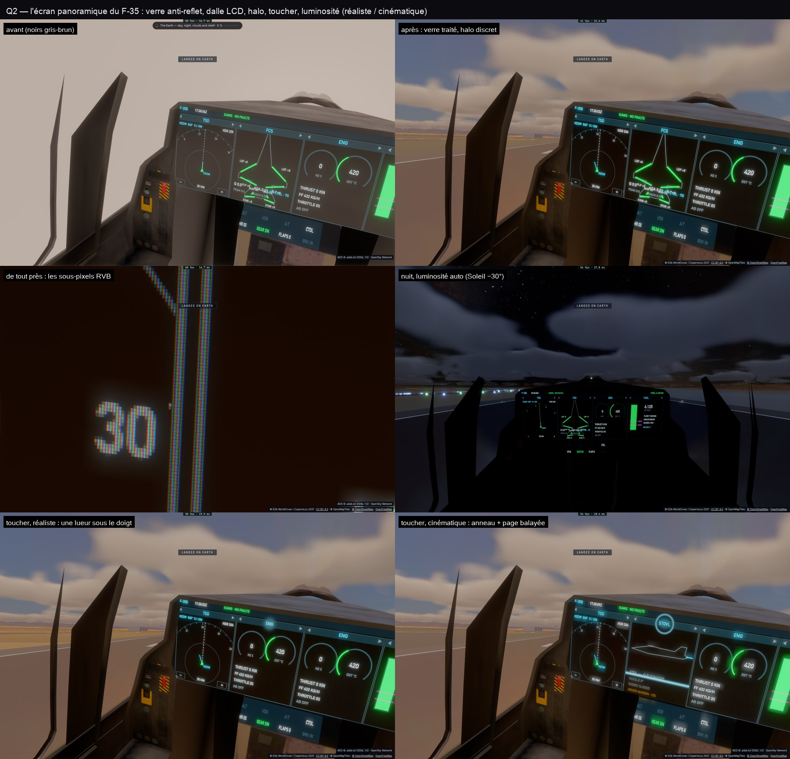

# Q2 — le verre et la dalle

Dans `ship.wgsl` (matériau 36, `pcdLight`) — rien qu'aux pixels de l'écran :

- **Verre traité anti-reflet** : F0 0,6 % (au lieu de 4 %) et 0,4 % de diffus (au lieu de 1 %) — le noir du cockpit
  gardé (gris-brun avant : le désert réfléchi) ; le ciel ne s'y voit qu'en rasant ; le soleil direct délave encore.
- **La dalle LCD** : de près, chaque pixel trois bandes rouge, verte, bleue dans une matrice noire — fondues dès
  qu'elles passent sous ~3 pixels d'écran (pas de moiré) ; vu de biais, moins de contraste et la lueur bleutée des
  noirs (IPS).
- **Le halo** : l'image 8× plus grossière (16× en cinématique) ajoutée faiblement — la lumière diffusée dans le verre.
- **Le toucher** : une lueur douce sous le doigt ; en cinématique un anneau qui s'étend, et la nouvelle page balayée
  depuis son haut (0,3 s).
- **La luminosité** (réglage *Luminosité de l'écran*) : automatique — pleine au-dessus de +5° de Soleil, au 40 % sous
  le crépuscule civil (−6°), comme un pilote la baisse —, ou JOUR, NUIT, JVN.
- **Le style** (réglage *Écran du cockpit*) : réaliste ou cinématique.

Coût : `pcdLight` = deux lectures filtrées de la texture (l'image, le halo), une lecture directe de très près,
~40 opérations, sur les seuls pixels de l'écran. Les horodatages par passe du M1 Max varient de 7 à 14 ms d'une
mesure à l'autre (passes qui se chevauchent) : l'A/B ancien / nouveau n'y voit aucune différence, l'estimation est
de l'ordre du millième de ms. Le CPU : un objet par image (`Pcd.look`).

Pour les captures et les tests : `__bh.pcd.pcd.ageHeld` fige l'âge du toucher et du changement de page.
