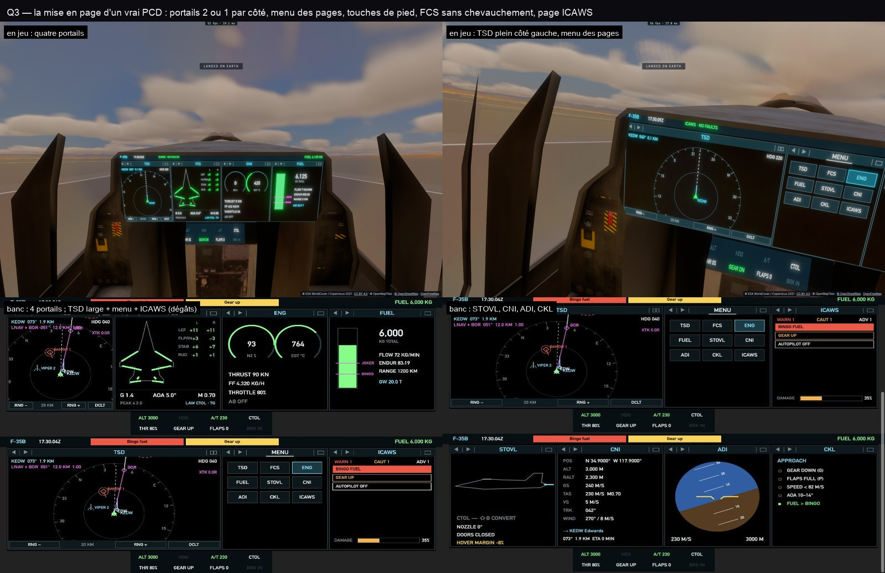

# Q3 — la mise en page d'un vrai PCD

- **Chaque côté en deux portails ou en un** (le coin du titre) : un portail double largeur montre sa carte en grand
  (TSD), une page étroite y reste centrée.
- **Le titre ouvre le menu des pages** (neuf boutons, la page affichée allumée) ; ses flèches, à gauche du titre,
  passent à la précédente ou à la suivante.
- **Les touches au pied du portail**, propres à la page : sur le TSD, la portée (− / +) et le désencombrement (DCLT :
  noms des terrains, des points et des pistes cachés, sauf le point actif et la piste verrouillée).
- **FCS** refait : la silhouette à gauche, un tableau des gouvernes (gauche, droite, en degrés, ambre au-delà de 85 %
  de leur débattement) à droite, la charge, l'incidence, le Mach, le pic et la loi en bas — plus rien ne se chevauche.
- **ICAWS** : les alertes comptées (WARN, CAUT, ADV), listées de la plus grave à la moindre (avertissement sur fond
  rouge, précaution ambre, avis blanc) ; en combat, les dégâts subis.
- L'ordonnancement de Q1 suit la mise en page : les zones sont celles des portails montrés, un portail touché est
  redessiné à l'image même.

Vérifié : `tests/pcd.test.ts` (les touchers : flèches, menu, côté simple / double, touches du TSD ; le dessin une
zone par image au plus), en jeu (Edwards) et sur un banc (données factices).
