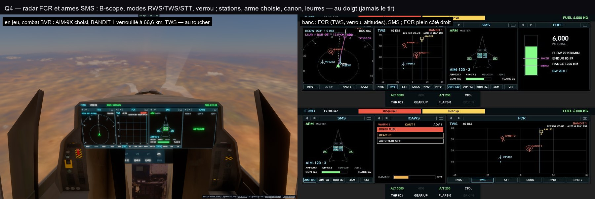

# Q4 — le radar (FCR) et les armes (SMS)

- **FCR** : un B-scope — l'azimut en travers (±60°), la distance vers le haut, sa grille —, le faisceau qui balaie ;
  les contacts en briques en RWS (sans cap), en pistes en TWS (forme OTAN de l'IFF, leur cap en bâton, leur altitude
  en milliers), seul le verrou vif en STT ; le verrou entouré, ses chiffres (distance, vitesse de rapprochement,
  altitude, cap, vitesse sol). Une carte : il prend toute la largeur d'un portail double. Touches : RWS, TWS, STT,
  LOCK (la piste suivante), la portée (10 à 160).
- **SMS** : l'avion vu de dessous et ses stations — AIM-9X en bout d'aile, AIM-120 et GBU-32 (ou JSM) en soute —,
  allumées quand chargées, l'arme choisie entourée ; MASTER ARM (ARM en combat, SAFE sinon), l'arme choisie et son
  compte (LOCK REQUIRED pour l'AIM-120 sans verrou), chaque emport, les obus du canon en barre, les leurres. Touches :
  AIM-120, AIM-9X, GBU-32, JSM, CM (leurres). **Jamais le tir** : il reste au pilote.
- Les touches passent par les appels du contrôleur, ceux du siège arrière de l'équipage (`weaponSelect`,
  `radarModeSet`, `lockOnName`, `combatTrigger("cm")`) : leurs refus dits tels quels (pas de combat, plus d'emport…).
- Pages par défaut : TSD, FCR, SMS, FUEL. La page ICAWS montre les dégâts au vrai taux (0–100 % ; Q3 les divisait mal).

Vérifié en jeu, combat BVR (outil `f35` du jeu, `fly bvr`) : au toucher, « Weapon: AIM-9X (2 left) », « Locked:
BANDIT 1 · 66.6 km », « Radar: TWS » — le contrôleur dans l'état demandé. `tests/pcd.test.ts` : les touches
demandent ce qu'elles doivent.
