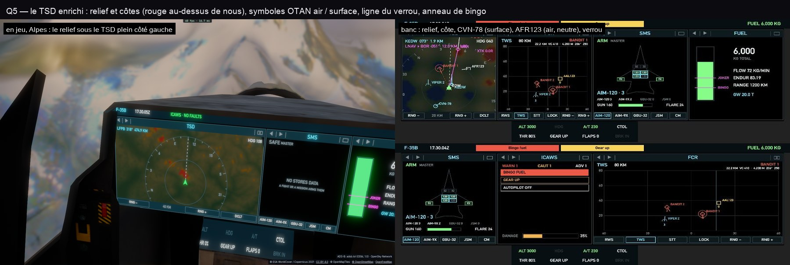

# Q5 — le TSD enrichi

- **Le relief et les côtes** sous la carte, nord en haut puis tourné cap en haut : la mer bleu nuit, la terre sombre
  et plus claire en montant, ambre sombre à moins de 300 m sous nous, rouge sombre au-dessus de nous. Une image de
  96² cellules sur ±2 portées, construite **quelques rangées par image dans un budget de 0,25 ms** (double tampon :
  l'ancienne reste affichée), redemandée quand on a parcouru un huitième de sa demi-largeur, changé de portée ou
  d'altitude. La hauteur du sol : celle des protections (GCAS, `controller/gcas.ts ground`, sa grille de 250 m en
  cache).
- **Les symboles OTAN** distinguent l'air de la surface : un aéronef ouvert en bas (arc ami, chevron hostile, boîte
  neutre ou inconnue), un navire entier (cercle, losange, carré) — le trafic réel, les navires AIS, les porte-avions,
  les ailiers par la liaison (tirets), tous venus des sources du radar.
- **Le verrou** relié à nous par une ligne pointillée ; **l'anneau de bingo** : jusqu'où l'on vole avant que le
  carburant restant soit le bingo, à ce débit et cette vitesse sol.

Coût mesuré en vol dans les Alpes (`FLY=45.85,6.75,2500,110,200 bun scripts/pcd-perf.ts 8 3`) : **0,21–0,35 ms par
image, pire image 1,4 ms** — relief compris, toujours sous la référence d'avant Q1 (0,70 ms).
