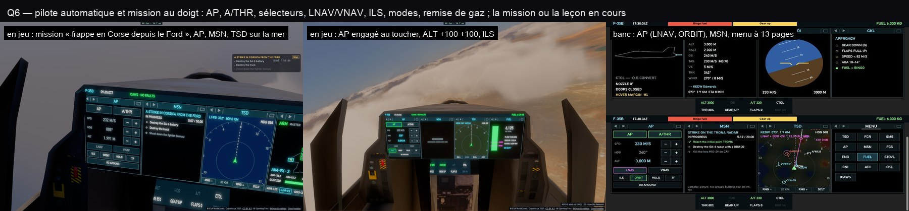

# Q6 — le pilote automatique et la mission au doigt

- **AP** (comme le MCP de la console équipage) : AP et A/THR (allumés en vert), la vitesse, le cap et l'altitude —
  la valeur tenue en cyan, sinon celle qu'il prendrait —, chacun avec − et + (5 unités de vitesse, 5°, 100 m ou 500 ft ;
  un sélecteur touché engage son système ; deux touchers rapides partent de la valeur qu'on vient de choisir, gardée
  1,5 s pendant que l'avion rattrape) ; LNAV et VNAV (en magenta, s'il y a un plan de vol) ; l'ILS (le terrain le plus
  proche) ou son annulation, une orbite ici, un hippodrome, le suivi de terrain à 150 m, les modes coupés ; la remise
  de gaz (en vol). Les sélecteurs par les appels du contrôleur (`apSet`, `navSet`), les modes par les outils du jeu
  (`approach`, `jet_mode`, `flight_action`) — exactement ceux de la console équipage —, leur réponse en toast.
- **MSN** : la mission en cours — son titre, IN PROGRESS / COMPLETE / FAILED, son chrono et sa limite, ses objectifs
  (◇ à faire, ✓ fait, ✗ manqué ; les bonus et ceux d'un autre rôle en gris), ses derniers mots — ; sinon la leçon en
  cours — ses étapes (TARS ou toi), l'actuelle, les mots de l'instructeur.
- Des boutons dans la page (pas seulement en pied de portail) : enregistrés à chaque dessin, touchés là où ils sont.

Vérifié en jeu : au-dessus du désert, AP engagé au toucher (« Autopilot: altitude 2890 m, heading 220° »), ALT + deux
fois (2 990 puis 3 090 m), l'ILS engagé ; la mission « A strike in Corsica from the Ford » suivie sur MSN.
`tests/pcd.test.ts` : les boutons AP.
