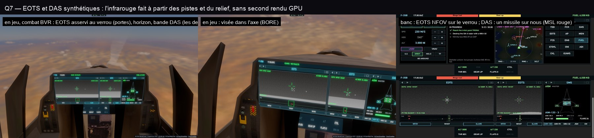

# Q7 — l'EOTS et le DAS, synthétiques

**Aucun second rendu GPU** : l'image infrarouge est dessinée sur le canvas de l'écran, à partir de ce que le jeu sait.

- **EOTS** (la caméra de visée) : le ciel froid, le sol chaud sous la crête du relief (la plus haute élévation du terrain
  le long de chaque gisement, un demi-degré, tout autour, l'horizon géométrique au-delà des 50 km échantillonnés,
  courbure de la Terre comprise), les pistes en points chauds (un avion petit et vif avec la lueur de sa tuyère, un
  navire long), le verrou dans ses portes de poursuite, le réticule, le grain d'un vrai capteur. Champ large (30°) ou
  étroit (6°), blanc chaud ou noir chaud, asservi au verrou (PT TRK, sa distance) ou dans l'axe (BORESIGHT).
- **La bande DAS** dessous, tout autour (le nez au milieu) : l'horizon, les pistes, **les missiles en vol** — en rouge
  marqués MSL ceux tirés sur nous —, le champ de l'EOTS.
- La crête échantillonnée par petits paquets dans le budget de 0,25 ms par image (le champ de l'EOTS d'abord, puis le
  tour complet), reprise quand on a bougé de 500 m ou de 100 m en hauteur.

Coût mesuré en vol (Alpes, `pcd-perf.ts`) : **0,33–0,40 ms par image, pire image 2,2 ms**, toujours sous les 0,70 ms
d'avant Q1. Vérifié en jeu (combat BVR : EOTS asservi au verrou, les deux bandits dans le DAS) et sur le banc.
