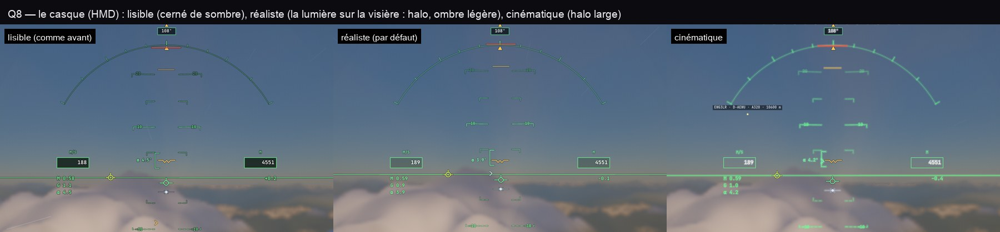

# Q8 — le casque (HMD)

Réglage **Aspect du casque** (`f35HmdLook`), en vue cockpit seulement (en vue extérieure, le HUD reste celui du jeu) :

- **Lisible** : comme avant — chaque trait et chaque texte cernés de noir à 42 %, les valeurs sur des pavés sombres.
  Le plus lisible sur un ciel blanc.
- **Réaliste** (par défaut) : la lumière qu'une visière montre — le halo du trait dans sa propre couleur, une ombre
  vert sombre très légère dessous (la teinte de la visière : la symbologie reste lisible sur un nuage), les pavés des
  valeurs à peine ombrés (une visière ne dessine pas de noir).
- **Cinématique** : un halo plus large et plus vif, les textes rayonnants, les pavés ouverts.

**Aucun trait de plus** : la passe qui dessinait le contour sombre dessine désormais le halo (même nombre de
`stroke` / `strokeText`) ; pas de flou (`shadowBlur`), pas de fusion CSS (le compositeur n'a rien de plus à faire).
Mesuré en vol (Alpes, section « HUD: markers & tapes » du profileur CPU), lisible et réaliste alternés : 0,9–1,6 ms
contre 0,6–1,4 ms — le bruit d'une passe à l'autre (0,9 à 1,4 ms pour le même aspect) couvre tout écart.
