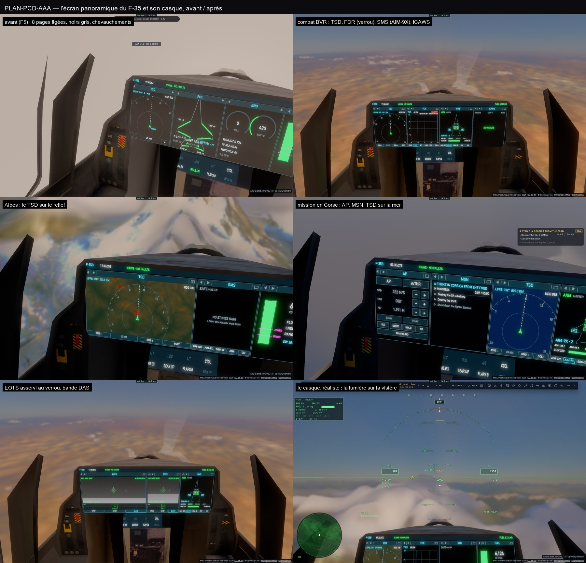

# Q9 — clôture : la documentation, l'e2e, la planche finale

- **e2e** `tests/e2e/f35-pcd.e2e.test.ts` (vrais événements souris CDP, F-35 en vol, vue cockpit) : un titre ouvre le
  menu des pages, SMS y est choisi ; le coin montre un côté en un portail puis en deux ; le bouton AP engage le pilote
  automatique, le + de l'altitude en sélectionne 100 m de plus ; le coût CPU de l'écran sous 0,70 ms par image (celui
  d'avant Q1), aucune image au-dessus de 8 ms. Le point à cliquer trouvé par la visée du cockpit lui-même
  (`renderer.ship.jetPick`). 3/3.
- **Les envois regroupés** : les zones dessinées partent ensemble vers la texture toutes les 66 ms (l'union en une
  copie, une passe de mips ; à l'image même après un toucher) — un tiers des envois. Le relief du TSD en 64² cellules,
  son budget 0,15 ms par image ; la hauteur du Soleil gardée 5 s.
- **Mesure A/B honnête** : l'ancien code (dd2e453c, le seul compteur ajouté, worktree temporaire) contre le nouveau,
  alternés, au-dessus du Mojave (trafic réel de Los Angeles), `FLY=34.6,-117.6,2000,220,200 bun scripts/pcd-perf.ts` :

| | moyenne par image | dont envoi | dont données |
|---|---|---|---|
| avant (F5, 8 pages) | 0,46–0,74 ms | 0,05–0,08 | 0,35–0,57 |
| après (14 pages, relief, EOTS, AP…) | **0,21–0,45 ms** | 0,05–0,07 | 0,06–0,09 |

- `docs/F35.md` / `F35.fr.md` (le PCD, le HMD, les réglages), `docs/E2E-CATALOGUE.md`.
