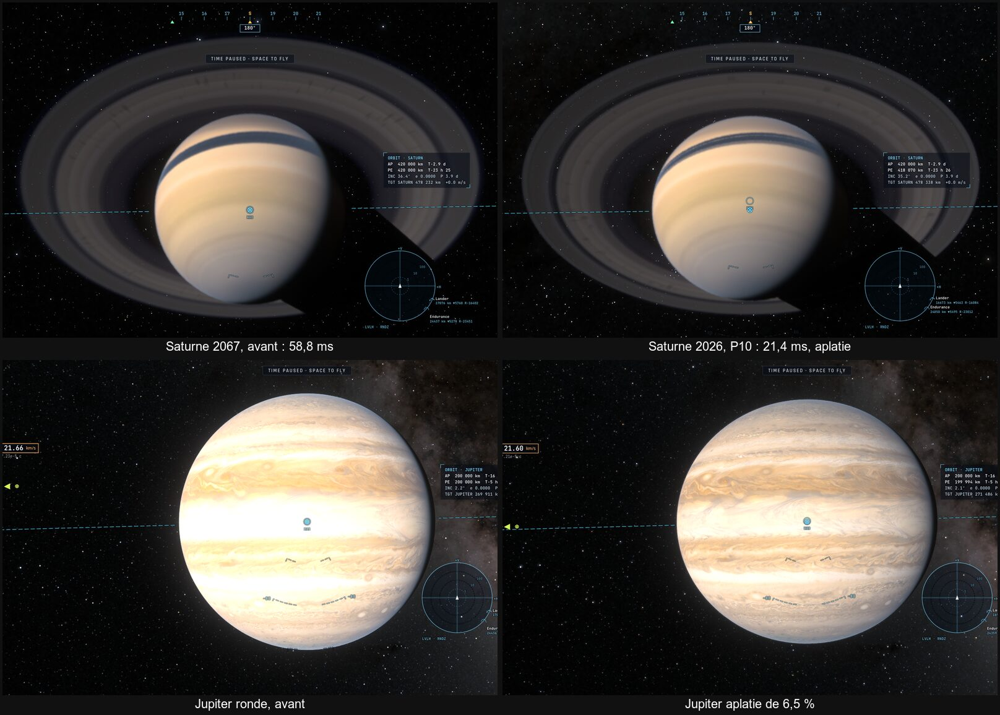

# P10 — Saturne : belle, juste, au budget de la Terre

31 octobre 2026, ce Mac et kerr-mini. Plan : [PLAN-PLANETES-AAA.md](../../PLAN-PLANETES-AAA.md). La demande : « Elle doit
être hyper belle, AAA, performance ». Décisions : Jupiter et Saturne aplaties **au rendu et au vol** ; les vues de Saturne
**en 2026** (juste, une époque du jeu).

## Le constat

- Saturne en orbite coûtait **58,8 ms** sur kerr-mini, 2,8 fois la Terre (20,1), sa vitrine à contre-jour 63,3 ms.
- Le coût n'était **pas ses anneaux** : les couper (`TUNE_SKIP 64`) ne changeait rien. Ni l'ombrage de la planète : ses
  cinq parties coupées ensemble (la lumière des anneaux sur la nuit, leur ombre, les nuages animés, les ombres des lunes,
  la normale fine) ne gagnaient que 9 %.
- La vue des coûts (`costView 15`, `costStats`) l'a montré : **91 % des pixels faisaient ~54 pas** dans la boucle
  principale, contre 1 pas sur 0,5 % des pixels pour Jupiter. La bouche du trou de ver est sur l'orbite de Saturne, à
  0,7 UA derrière elle, et sa région de Dneg fait 100 ρ de rayon — ~5 UA avec la masse de Gargantua. La caméra près de
  Saturne y est toujours : chaque rayon y était intégré pas à pas, jusqu'à en sortir.
- Saturne et Jupiter étaient des **sphères** ; la vraie Saturne est aplatie de 9,8 %, Jupiter de 6,5 %.
- En 2067, la date des scènes, Saturne est près de son équinoxe (2068) : le Soleil rase ses anneaux.

## Ce qui est fait

- **S1 — les rayons droits dans la région du trou de ver** (`trace.wgsl traceLook`). Hors de la région, un rayon qui passe
  loin de la bouche était déjà tracé droit, courbé par la lentille faible de la bouche,
  α = (M/b)(1 − s₀/√(s₀² + b²)) (mesurée contre l'intégrateur : sous le quart de pixel au-delà de √(0,26 M / pixel)). La
  formule suit la caméra le long du rayon, dedans comme dehors : le même raccourci vaut maintenant quand la caméra est dans
  la région. La distance prise est la plus courte que le rayon atteint vraiment (la caméra elle-même pour un rayon qui
  s'éloigne de la bouche), avec la moitié de l'erreur pour une demi-passe. Plus aucun rayon intégré en orbite ; à
  contre-jour, 4 % (ceux qui passent près de la bouche, par où l'on voit Gargantua).
- **S1 — les vues de Saturne au 4 octobre 2026** (son opposition) : `settings.ts SATURN_2026`. Le Soleil est ~7° sous le
  plan des anneaux, leur face sud éclairée, la caméra de ce côté.
- **S2 — Jupiter et Saturne aplaties** (comme WGS84 pour la Terre), à 1 bar (IAU) : 71 492 / 66 854 km et
  60 268 / 54 364 km. Leur rayon dans le jeu est l'équatorial (`solar.ts`) ; `ellipsoid.ts flatteningOf` les donne.
  - Le traceur : `squashOf` (leur carte 4, 5) — le disque, son air et la vue de près sur leurs axes écrasés —, la
    normale de l'ellipsoïde, l'ombre des anneaux depuis le point, celle de la planète sur les anneaux par l'ellipsoïde.
  - Les cartes sont planétographiques (la Grande Tache à 22° S, sa latitude planétographique) : lues à la normale.
  - Le vol : la caméra proche écrasée pour tout corps (`renderer.ts`), les hauteurs au-dessus des géantes par
    `altitudeOver` (le vent, l'aérodynamique, l'état du vol : `piloting.ts`).
- **S3 — le profil de Cassini à toute distance.** Il ne s'allumait que sous 35 km par pixel ; depuis l'orbite, c'était la
  carte de 2 048 texels, douce. Une table des sommes de son opacité, kilomètre par kilomètre (`gpu-tables.ts
  TABLE_RINGSUM`, `ring-profile.ts ringOpacitySums`), donne sa moyenne sur l'empreinte du pixel en deux lectures
  (`ringTauFine`) : les annelets dans l'ombre des anneaux sur la planète. L'empreinte prise le long du rayon seulement
  (`ringFoot`) — la carte n'a que cet axe : aux anses, elle était lue deux niveaux trop flous.
- L'air des géantes sur leur rayon équatorial (`setAir`).
- **S4 — la lentille du trou de ver corrigée, ses vues proches au budget.** Les vues proches des anneaux (les blocs de
  glace, au-dessus des anneaux) regardent du côté de la bouche, à 0,7 UA : chaque rayon de ce côté y passe à moins de
  0,9 UA, où la formule de la lentille faible s'écartait de plus d'un quart de pixel — intégrés, ~80 pas, 47 à 73 ms. La
  formule comparée aux rayons exacts (`wormhole.ts traceDneg`, 236 rayons, la caméra de 6 à 90 ρ) : elle sous-estime la
  déviation, son rapport à l'exacte ≈ 1 + 0,7 ρ/b — la bouche de Dneg n'est pas une masse ponctuelle de près. Corrigée par
  un ajustement, 1 + x (0,6255 + 0,5964 x − 0,0024 s + 0,3956 x s) (x = ρ/b, s le cosinus de la caméra le long du rayon),
  son erreur reste sous le quart de pixel dès ~6 ρ (sans elle : ~20 ρ). Les coefficients ne dépendent que du rapport
  largeur de lentille / gorge, le même (0,05) dans toutes les scènes du jeu ; ailleurs, l'ancienne règle.

## Mesures (kerr-mini, A/B en alternance, deux tours, médianes)

| Vue | Avant | S1 | S2 | S3 | La Terre, même vue |
|---|---|---|---|---|---|
| Saturne en orbite | 58,8 ms | 21,6 ms | 21,4 ms | 21,3 ms | 20,1 ms |
| Saturne à contre-jour | 63,3 ms | 26,0 ms | 26,0 ms | 25,8 ms | 41,6 ms |
| Jupiter en orbite | 20,8 ms | 20,7 ms | 20,6 ms | 20,6 ms | — |

Les vues proches des anneaux (S4, kerr-mini, la même session, la correction coupée puis rétablie) :

| Vue | Avant S4 | S4 | La Terre en vol bas |
|---|---|---|---|
| Parmi les blocs, le long du plan | 58,1 ms | 22,8 ms | 31 à 40 ms |
| Sous les blocs, en levant les yeux | 73,1 ms | 40,1 ms | |
| Les blocs, rasant | 48,1 ms | 24,0 ms | |
| Au-dessus des anneaux (7 000 km) | 46,5 ms | 21,0 ms | |

Chaque colonne contre la précédente ; la Terre et Jupiter inchangées (±1 %) à chaque étape.

## Limites

- **Les anneaux sous un Soleil rasant** : à 7°, même un anneau mince renvoie presque toute la lumière qu'il reçoit —
  leur face éclairée paraît uniforme, seule leur couleur (la carte, douce) varie. C'est la physique de 2026 ; leur
  structure se voit dans leur ombre sur la planète et par transparence.
- Le bord intérieur de l'anneau C (69 800 – 72 761 km) n'a pas de mesure de Cassini : la carte y reste.
- Sous les blocs, la vue regarde la bouche elle-même : un cinquième de ses rayons y reste intégré (40 ms, au bord du
  budget).
- Deux budgets de noyaux relevés d'un cheveu (« moon main » 71 000 → 71 200, « general lut » 136 000 → 136 200 : +0,03 et
  +0,05 %, le code des géantes aplaties et du profil).
- `giants-flow` : le retour à la même date de la Grande Tache (0,30/255 contre 0,08 exigé) échoue aussi sans P10 —
  instable, pas une régression.

---

## In English (summary)

Saturn's orbit view cost 58.8 ms on kerr-mini, 2.8× the Earth's; now 21.3 ms. Not its rings, nor the planet's shading: the camera sits
inside the wormhole mouth's Dneg region (100 ρ, ~5 AU — the mouth is on Saturn's orbit, 0.7 AU behind it), where every ray
was integrated step by step (~54 steps, 91 % of the pixels). The weak-lens straight-ray shortcut, already used outside the
region, now applies inside it too (the ray's true nearest approach, half the error bound for an outgoing ray): 21.4 ms
(Earth 20.1), the backlit showcase 63 → 26 ms. Jupiter and Saturn are now oblate ellipsoids at 1 bar (IAU radii), in
rendering and in flight, like WGS84 for the Earth: per-body squash in the tracer, ellipsoidal ring shadows both ways, the
giants' equatorial radius in the game, `flatteningOf` for heights. Cassini's 1 km ring profile is now read at any distance
through a prefix-sum table of its opacity (two reads per footprint), with the footprint taken along the ring's radius only.
Close views facing the mouth (0.7 AU off) were still integrated: the weak-lens formula, compared with exact rays, underestimates the deflection (ratio ≈ 1 + 0.7 ρ/b); a fitted correction keeps its error under a quarter pixel from ~6 ρ instead of ~20 ρ — the ring close-ups 47–73 → 21–40 ms. Saturn's views are dated October 2026 (the user's choice: physically right; the Sun ~7° below the rings, their south face
lit — under such a grazing Sun the lit face looks uniform).
