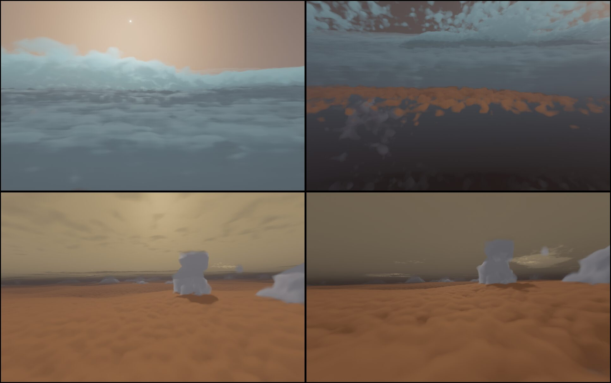
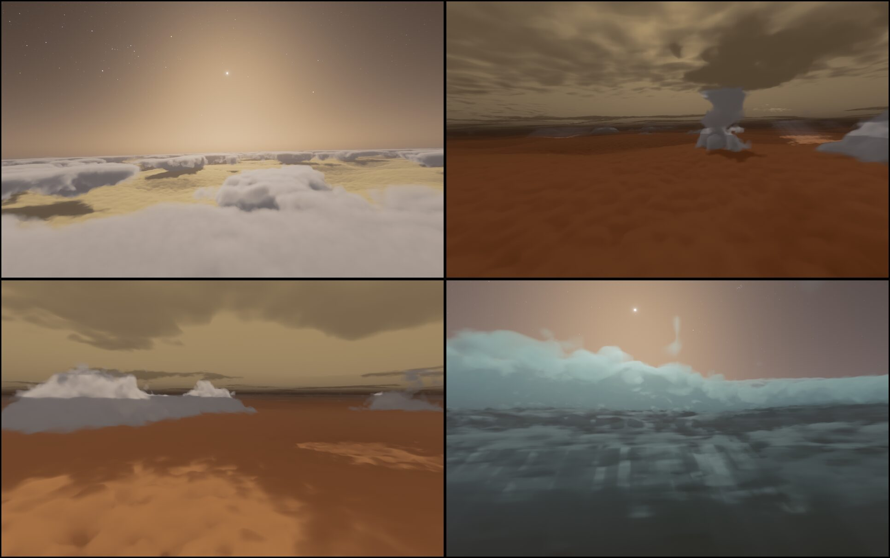
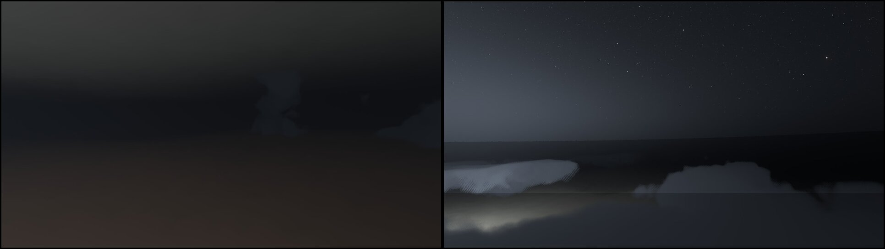

# P11 — La descente dans les géantes

31 octobre 2026, ce Mac. Plan : [PLAN-PLANETES-AAA.md](../../PLAN-PLANETES-AAA.md), section P11.

## D0 — les données

- **Jupiter** (la sonde Galileo, Seiff et al. 1998, JGR 103, 22 857) : mesurée de 1 029 km au-dessus à 133 km sous le
  niveau de 1 bar ; 166 K à 1 bar ; la tropopause ~112 K vers 260 mbar ; la stratosphère ~160 K ; chauffée au-dessus de
  ~3 µbar jusqu'à 900 K au nanobar ; 429 K à 22 bar, la couche profonde proche de l'adiabatique sèche (6 à 16 bar). La
  sonde : 339 kg, 1,26 m, cône de 45°, entrée à 47,4 km/s par rapport à l'air, 8,6° sous l'horizontale, décélération
  maximale 228 g ; ~58 min de descente sous parachute jusqu'à ~22 bar.
- **Saturne** (Lindal et al. 1985, les occultations radio de Cassini) : 135 K à 1 bar, ~82 K à la tropopause (~80 mbar),
  ~140 K dans la stratosphère, une thermosphère ~400 K.
- **Les gaz** : H₂/He, masses molaires 2,22 g/mol (Jupiter, He 13,6 %) et 2,07 (Saturne), γ ≈ 1,43.

## D1a — l'air des géantes dans `aero.ts` (fait, pas encore branché)

- `aero.ts` : les modèles `jupiter` et `saturn`, un profil hydrostatique tiré des températures mesurées par pression
  (`giantT`, `GIANT_AIR`), intégré depuis 1 bar dans les deux sens (dz = −(R T / g) d ln p), de 100 bar à 10⁻¹⁰ bar : les
  hauteurs négatives sous le niveau de 1 bar existent. Les gaz `h2heJ`, `h2heS` (leur lueur, les raies de Balmer).
- `tests/aero-giants.test.ts` : 1 bar au niveau de 1 bar, les échelles de hauteur (~25 et ~52 km), 22 bar entre 120 et
  170 km sous lui à ~428 K, la tropopause sous 120 K ; **l'entrée de Galileo rejouée dans cet air : 252 g au maximum**
  (228 mesurés, +10 % : la stratosphère réelle varie, la masse perdue par le bouclier n'est pas comptée).

**Pas encore branché** (D1b) : donner cet air à Jupiter et Saturne dans `solar.ts` touche 37 lecteurs de l'atmosphère des
corps — la météo et ses couches de carte, la carte 3D, la prédiction d'orbite (la traînée), le pilotage, la descente
propulsée, le vent —, et `our-surface` borne les hauteurs à 0. Chacun sera revu (les vents des géantes : ceux de G1, pas
la météo de la Terre ; leur rendu inchangé jusqu'à D2), avec l'échauffement radiatif de la couche de choc (à 47 km/s,
l'essentiel de celui de Galileo) et l'écrasement.

### D1b — ce que la revue des lecteurs demande (31 octobre)

Les 37 lecteurs de l'atmosphère d'un corps passés en revue ; avant de donner un air aux géantes :

1. **Des hauteurs signées sous 1 bar** pour les corps sans sol : `our-surface.ts` (`airDensity`, `thinAirDensity` bornent
   à 0), les pas d'intégration (`motion.ts`, `our-coast.ts` : `max(gearHeight, 0)`), l'altitude de `ourSurfaceInfo`.
2. **« A un sol » plutôt que « a un air »** là où il faut un sol : le plafond d'accélération du temps (`plan.ts`), la
   protection au sol (`spaceguard`), la carte de descente, l'altimètre radar (`craftpanel`) — un `ground: false` pour les
   géantes ; la météo (`weatherPlace`, le vent de `piloting.ts`), la couche météo de la carte (`groundtrack`).
3. **Le rendu inchangé à cette étape** : la carte 3D (`map3d scene.ts` : son halo d'air), les paramètres `near5` du
   traceur (jamais lus pour les géantes — leur air est celui du GPU —, gardés tels quels par prudence).
4. **Des hauteurs cohérentes** : l'orbite par défaut (`place.ts airTopKm` : 12 H, sous le haut de l'air des géantes →
   `airTop` pour les profils mesurés), la décroissance sur rails (`railsDecay` : le rayon moyen, ~2 000 km sous
   l'équateur de Saturne → `altitudeOver`).
5. **Les petits pas seulement dans l'air** (`motion.ts`, `our-coast.ts` : `airy` sous `airTop`, pas dans toute la sphère
   d'influence).
6. **Les vents de G1 au CPU** (`giant-winds.ts` : un lecteur par latitude) à la place de la météo de la Terre.

Ce qui est voulu tel quel : les forces aérodynamiques du vaisseau piloté, la traînée des orbites basses et sa
prédiction, le planificateur d'entrée (`entry-env.ts`), le repère tournant sous le haut de l'air.

**Fait** (31 octobre) : les six groupes, puis l'air donné à Jupiter et Saturne (`solar.ts` : 0,161 et 0,185 kg/m³ à 1 bar,
25,1 et 51,9 km d'échelle de hauteur ; le haut de l'air, densité 10⁻¹⁰, à 794 et 1 369 km au-dessus de 1 bar). Les vents
des géantes au CPU (`giant-winds.ts giantWindAt`, le jumeau de `giantWind`), vers l'est à toute hauteur dans leur air.
L'orbite par défaut au-dessus du haut de l'air. Le rendu inchangé (la carte 3D, `near5`). Tests : `aero-giants` (la
densité sous 1 bar, les vents, l'orbite par défaut) ; les 33 fichiers de tests qui touchent l'air, les géantes, les
orbites : verts. Restent pour le jeu : l'échauffement radiatif de la couche de choc, l'écrasement (D1c) ; le rendu
dedans (D2–D4).

## D2 — les nuages dedans (31 octobre)

*En haut : l'œil du vortex polaire nord de Saturne, à 28 km sous 1 bar, le mur de nuages autour du puits clair et le Soleil
dans la brume ; à 66 km, le mur au-dessus, le pont d'hydrosulfure orange loin dessous. En bas : Jupiter près de la Grande
Tache rouge, entre l'ammoniac et l'hydrosulfure, l'après-midi ; ses colonnes d'orage d'eau.*

- **La décision de noyau** : la caméra sous le haut des nuages d'une géante prend une marche volumétrique à elle
  (`trace.wgsl giantInside`), choisie dans `trace()` par la conjonction de G9 écrite en ligne (la spécialisation la plie :
  rien dans les noyaux de la Terre, de la Lune, de Titan, de Vénus, des lunes) ; au-dessus, `earthNear` comme avant.
  A/B sur le mini (219c7446 contre ce code, A B B A) : Terre, Mars, Jupiter et Saturne vus d'orbite, bas, en cinéma
  à ±2 %. Le noyau à part des géantes (le type 8) reste à faire si leur coût le demande.
- **Les trois ponts** (`giantLayer`) : l'ammoniac (Jupiter +12 km, Saturne −18 km), l'hydrosulfure d'ammonium (−19, −89),
  l'eau (−52, −189) — leurs hauteurs, épaisseurs, échelles de bourgeonnement et extinctions ; leurs couleurs : l'ammoniac
  celle de la carte au-dessus, l'hydrosulfure brun-orange, l'eau gris clair. Le Perlin–Worley des nuages de la Terre
  (`cloudNoise`) : bancs et trous de ~80 km sur la couverture de la carte (les zones épaisses, les ceintures minces — leur
  ammoniac d'épaisseur optique quelques unités), le bourgeonnement par couche, l'érosion en fBm de Worley, et près de la
  caméra (< 15–60 km) une érosion cinq fois plus fine : des bords nets.
- **Les orages** : les tours du pont d'eau (+18 km où le grand bruit est haut) et, où il est le plus haut, les colonnes
  des orages humides (les cellules à éclairs de Galileo et Juno) jusqu'à l'ammoniac, leur contour et leurs tourelles
  bosselés par un bruit de ~20 km.
- **L'œil** (`giantEye`) : le vortex polaire nord de Saturne (Cassini 2012 : ~2 000 km, son mur 30 à 75 km au-dessus de
  l'ammoniac) et le cyclone polaire central de Jupiter (Juno) : le puits clair, puis un mur en gradins — sa face intérieure
  raide, son flanc extérieur descendant sur une demi-largeur d'œil —, du pont d'eau jusqu'à ~55 km au-dessus de
  l'ammoniac, étiré en stries le long du cercle par les vents (un bruit dans le repère de l'œil, ~5 km en travers,
  ~40 km le long, enroulé en spirale lente, sans couture : 160 unités par tour, cinq périodes de la texture).
- **La marche** : jusqu'à 1 500 km, ses pas croissant avec la distance (6 %, 350 m au moins) dans le clair, courts dans un
  nuage (1,5 %, 150 m au moins — plus longs, la gigue moyennait les bourgeons en flou) ; vers le Soleil 3 pas dans un
  nuage (1,5 à 24 km : les trous d'un plafond, les ombres des bourgeons), 1 dans le clair (les rayons dans la brume), la
  colonne au-delà par la part moyenne des couches ; les octaves de Wrenninge ; la lumière du ciel par la transmission
  diffuse de toute la colonne au-dessus (μ₀/π ; un pont d'épaisseur 10 en laisse passer un quart : la lumière d'un ciel
  couvert) ; l'air : le Rayleigh de l'hydrogène, la brume profonde chaude, la brume haute au-dessus de l'ammoniac
  (épaisseur ~¼ : le ciel ocre vu d'en dessous).
- **La caméra** : son plancher sur les géantes suit l'ellipsoïde à 1 % du rayon sous 1 bar (`rig.ts`) — avant, la sphère
  la bloquait à 171 km au-dessus à l'équateur de Jupiter et 4 195 km au pôle de Saturne.
- **Coût** (ce Mac, 1 600 × 1 000, temps réel) : 12 à 17 ms dans ces vues.

## Les orages de Jupiter et D3 — la lumière (31 octobre)

- **Les orages** (`giantSigma`) : une cellule à part des ponts — une colonne née au pont d'eau où le grand bruit est le plus
  haut, son contour et ses tourelles bosselés par des bruits de ~18 et ~4 km, qui traverse les ponts jusqu'à ~25 km
  au-dessus du niveau de l'ammoniac et s'y étale en enclume (le seuil de son contour baisse en haut), plate sauf le dôme
  au-dessus du cœur ; de la glace d'ammoniac fraîche, blanche, dense (2·10⁻³ m⁻¹). Aucun dans le puits d'un œil ni dans son
  mur ; ceux de Saturne plus rares (ses grandes taches blanches : quelques-unes par siècle). La première version — les
  colonnes du pont d'eau relevées de 25 km — faisait des monolithes au sommet plat (coupés par le profil de la couche).
- **Le mode « dedans »** monte jusqu'au-dessus des enclumes (30 km de plus) : de 40 km au-dessus de 1 bar, la mer des
  nuages éclairée, ses trous jusqu'au pont jaune dessous. La brume profonde s'amincit vite au-dessus de l'ammoniac (son
  échelle de hauteur 0,4 de celle de l'air : les sommets nets vus d'en haut) ; la brume stratosphérique à ~45 km au-dessus
  (épaisseur ~0,15) — à 20 km, la première version noyait tout.
- **D3, la lumière** :
  - **les ombres des plafonds lues** : au-delà des 3 pas de la marche vers le Soleil, le pont le plus proche entièrement
    au-dessus est lu là où la lumière le traverse — ses trous la laissent passer : des rayons dans la brume, les bancs du
    plafond qui tachettent les ponts dessous ; les autres par leur part moyenne. Un pont dans lequel est le point reste à sa
    moyenne (lu, il était compté deux fois : un nuage noir) ; le mur d'un œil lu à moitié (ses stries rayaient le fond).
  - **la lumière roussie** : les chromophores des brumes prennent le bleu le long du chemin vers le Soleil (épaisseur des
    brumes au-dessus du point, `giantHazeCol`, par 0,7 / 1 / 1,5 en R / V / B) — orange sous les ponts ; la lumière du
    ciel aussi.
  - **les ombres de la brume adoucies** : sa lumière diffusée plusieurs fois les remplit (60 % de la lumière lue, 40 % de
    la moyenne) — sans, le mur de l'œil taillait des coins noirs nets dans la brume.
  - **dans un nuage**, la lumière du ciel un peu moindre au cœur (par la profondeur optique vers le Soleil) : un bourgeon
    à l'ombre garde sa forme.
  - **la marche gigue chaque pas** (l'échantillon n'importe où dans son pas) : la seule gigue du départ laissait les
    échantillons lointains au même endroit d'une passe à l'autre — des stries.
- **Les images fixes** attendent la cascade entière du noyau d'affinage (`q` puis sa LUT, `qBusy`) avant le rendu hors
  ligne et la mesure de la vue suivante.
- **La vue « inside »** de Jupiter et de Saturne dans `tests/e2e/lib/planet-views.ts` (pour planets-ab, planets-baseline :
  `VIEWS=inside`).

## D4 — les éclairs (31 octobre)

- **Fonction de l'horloge seule** (`trace.wgsl giantFlashes`) : les mêmes éclairs pour tous les joueurs, toutes les
  sauvegardes, sans état au CPU. Quatre flux de créneaux d'une demi-seconde ; le hachage de chaque créneau tire un candidat
  à moins de ~300 km de la caméra (uniforme en distance : un orage voisin clignote souvent), en essaie quatre points à ~40 km
  les uns des autres et garde le plus orageux (le grand bruit de `giantSigma` au-dessus de 0,7 ; jamais dans un œil) — sans
  ces essais, les colonnes d'orage sont trop rares pour qu'un tirage y tombe ; au sommet du pont d'eau (un sixième peu
  profonds, dans l'ammoniac : ceux de Juno, plus faibles). Deux ou trois coups de ~35 ms à ~0,1 s d'écart.
- **Leur lumière** (`giantFlashGlow`) : un cœur brillant ~5 km autour du canal, un halo ~30 km, la distance verticale comptée
  au tiers (la lumière monte dans la colonne de nuages : vus d'en haut, des taches de dizaines de km comme sur les images
  nocturnes de Galileo et Juno), diffusée par les nuages et la brume, teinte blanc bleuté (`FLASH_TINT` de la Terre).
- **L'horloge en secondes** : `Params.zamo2.z`, le temps de la scène en secondes modulo 4 096, calculé en float64 au CPU
  (`renderer.ts`) — le M en float32 est trop grossier (~30 s) après des décennies de jeu ; vérifiée dans la page à la
  milliseconde.
- **La vidéo** (720p, 30 images/s, image par image : le monde gelé et avancé d'1/30 s — `animate` allumé sous le gel, sinon
  `step` n'avance pas l'horloge —, chaque image redessinée en entier avant la prise ; l'exposition automatique tenue image par
  image par `renderer.autoExposureEV`, deux diaphs au-dessus de celle du jour : une exposition manuelle faisait du ciel de
  fond un blanc) : 7 s dans l'orage, 7 s au-dessus des nuages ; l'analyse de la luminosité image par image compte 10 et
  13 éclairs (1,4 et 1,9 par seconde), du noir (moyenne < 0,001) à 0,15 au plus fort.
- **Un seul éclair à la fois** (le plus brillant des quatre flux) : quatre tenus le long de la marche coûtaient ~4 ms en
  registres. A/B sur kerr-mini contre D2 (fd18b555, A B B A, deux tours) : Jupiter dedans 26,6 → 38,6 ms, Saturne dans
  l'œil 31,0 → 37,4 ms (orages, D3 et D4 ensemble ; D4 seul ~1,5–2 ms) — sous le budget de la Terre en vol bas dans ses
  nuages (40,7 ms) ; la Terre, Mars, les géantes d'orbite et de près inchangées (±2 %).

Reste : D1c (l'échauffement radiatif, l'écrasement), D5 (le cockpit, les instruments, les annonces ; le tonnerre — l'horloge
des éclairs est reproductible au CPU), D6 ; le dessous des orages encore plat sous le plafond, les rayons de la brume un peu
striés au fond de l'œil de Saturne, les éclairs lointains un voile gris.

---

## In English (summary)

P11, the descent into the giants. D0: Galileo's measured Jovian profile (166 K at 1 bar, ~112 K tropopause near 260 mbar,
~160 K stratosphere, 900 K at 1 nbar, 429 K at 22 bar) and Saturn's (Lindal 1985, Cassini). D1a: `aero.ts` gets the giants'
air as hydrostatic profiles built from those temperatures, integrated from 1 bar both ways (negative heights below the
1 bar level exist), with H₂/He gases; tests replay Galileo's entry through it — 252 g peak against 228 measured. Not yet
attached to the bodies (D1b): 37 readers of a body's atmosphere have to be reviewed first.

D2 (31 October): the camera under a giant's cloud tops gets a volumetric march of its own (`giantInside`, selected in
`trace()` by G9's inline conjunction: other worlds' kernels unchanged, A/B on the mini within ±2 %). Three decks (NH₃, NH₄SH,
H₂O) with Galileo/Cassini heights, the Earth clouds' Perlin–Worley over the map's cover, a five-times-finer erosion near the
camera; water towers and moist-storm columns; a cyclone's eye (Saturn's north polar vortex, Jupiter's central polar cyclone)
with a terraced, wind-streaked wall; an adaptive march (short steps inside clouds — long ones blurred the billows), a
3-step sun march, sky light by the column's diffuse transmission, H₂ Rayleigh and deep and upper hazes. The camera's floor on
the giants follows the ellipsoid. 12–17 ms per frame here. Next: D3 light, D4 lightning, better Jovian storms.

Jovian storms and D3 (31 October): storm cells of their own — a column from the water deck through the decks to ~25 km over
the ammonia, spreading into an anvil, white dense ammonia ice; none in an eye; Saturn's rarer. The inside mode reaches over
the anvils (a sunlit sea of clouds from 40 km up); the hazes thin over the ammonia. D3: the nearest deck wholly above read
where the sunlight crosses it (beams in the haze, dappled decks), sunlight and sky light reddened by the hazes'
chromophores, the haze's shadows filled by its multiple scattering, per-step jitter (no streaks). Stills wait for the whole
refining-kernel cascade. An "inside" view for Jupiter and Saturn in planet-views.

D4 (31 October): the giants' lightning as a function of the clock alone (the same for every player and save): four streams
of half-second slots, each hashing a candidate within ~300 km that seeks the stormiest of four nearby points; two or three
~35 ms strokes; a bright ~5 km core and a ~30 km halo climbing the cloud column (wide spots from above, as in Galileo's and
Juno's night images); the brightest one only (four cost ~4 ms in registers). A seconds clock (scene time mod 4 096 s,
float64 on the CPU) in Params.zamo2.z. A 720p film, frame by frame, 10 and 13 flashes in two 7 s shots. Cost on kerr-mini
against D2: Jupiter inside 26.6 → 38.6 ms, Saturn's eye 31.0 → 37.4 (storms, D3, D4 together), under the Earth's low-flight
budget (40.7); every other view unchanged.

