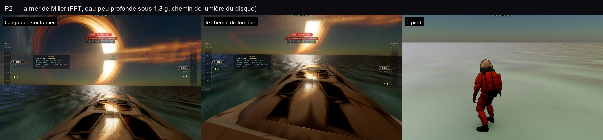

# P2 — la mer de Miller

30 octobre 2026, ce Mac. Plan : [PLAN-PLANETES-AAA.md](../../PLAN-PLANETES-AAA.md).

## Ce qui est fait

- **La mer FFT de la Terre, sur Miller.** Les trois cascades de `sea/fft-gpu.ts`, avec la physique de l'eau de Miller
  (`sea/spectrum.ts MILLER_SEA`) :
  - la gravité de Miller, **1,3 g** ;
  - une eau **peu profonde, 0,5 m** : la dispersion devient ω² = g·k·tanh(k·d), les longues vagues sont tenues à
    √(g·d) ≈ 2,5 m/s ;
  - un clapot limité par la profondeur (Hs ≤ 0,78·d) sous un vent fixe de 9 m/s (`MILLER_WIND`).
  Le spectre (`seaSpectrum`) et le noyau FFT (`seafft.wgsl`) prennent la gravité et la profondeur en paramètres. La
  Terre garde g et une eau profonde : son spectre est inchangé.
- **Les axes des vagues sur Miller** (`renderer.millerSeaParams`) : même format que ceux de la Terre (`P.sea`), sur la
  sphère sous la caméra, avec une ancre gardée sur 50 km.
- **L'eau de Miller** (`trace.wgsl shadeNear`), dans le raster comme dans le tracé :
  - les normales FFT par-dessus les pentes des méga-vagues ;
  - l'écume des crêtes, là où le jacobien passe sous le seuil, et celle qu'elles laissent ;
  - **le reflet de la lumière dominante** (GGX, rugueux selon les pentes que le pixel ne résout pas, Fresnel au demi-vecteur) :
    c'est le chemin de lumière du disque de Gargantua sur l'eau, comme dans le film ;
  - **des caustiques** sur le fond pâle, sous l'eau peu profonde.

## Trois défauts corrigés en route

| Défaut | Cause | Correction |
|---|---|---|
| Les sondes de lumière effaçaient l'état de mer de l'image | Leur caméra au centre de la planète, sans patch proche | `seaParams` ne touche plus l'état de mer pour une sonde |
| La FFT s'arrêtait au bout de quelques images | La passe d'eau du raster de la Terre (`rasterWaterNow`) restait allumée ; « aucune mer de la Terre vue » arrêtait la FFT | Cette passe est réservée à la Terre |
| La mer coupée près de Miller | L'altitude tirée du patch local relativiste (0,93 à 1,07 rayon à quelques mètres du sol) | Les vagues sont allumées jusqu'à un demi-rayon ; le shader les estompe avec l'empreinte des pixels |

## Test

`tests/e2e/miller-sea.e2e.test.ts` : Gargantua au-dessus de la mer, regard vers l'eau, à pied. Le test vérifie que la
FFT tourne pour Miller (ses passes comptées, l'horloge arrêtée puis en marche) et qu'il n'y a aucune erreur GPU.
3 vues sur 3 passent.

## Reste (P3)

La méga-vague : ressentie (hauteur CPU = GPU, déferlement, danger) et spectaculaire (lèvre, embruns, translucidité de la crête).
