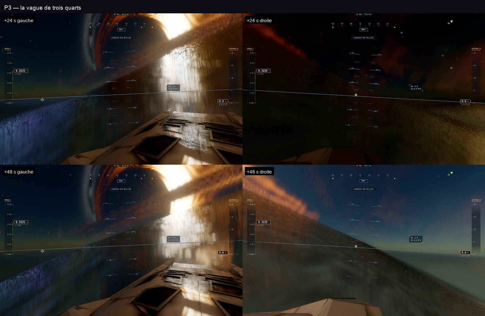

# P3 — la méga-vague de Miller

30 octobre 2026, ce Mac. Plan : [PLAN-PLANETES-AAA.md](../../PLAN-PLANETES-AAA.md).

## La vague

Le même profil des deux côtés : `terrain.ts millerWave` / `millerTrains` et `trace.wgsl millerWave`, dont les constantes
`MW_*` sont vérifiées identiques par `tests/miller-wave.test.ts`.

- **Trois trains** de crêtes, espacés d'environ 3 700 km, qui avancent à 24–35 m/s.
- **Chaque crête est un mur** d'environ 1,2 km, sa hauteur variant le long de la crête :
  - une face avant raide : 2,5 km du sommet à la mer, jusqu'à ~35° (une cubique d'Hermite) ;
  - un dos long : 18 km (une gaussienne).
- Elle remplace les anciennes bosses `pow(sin, 40)`, larges de ~180 km, que l'on voyait mais ne sentait pas.

## Ressentie

- `PlanetFrame` porte l'horloge de la scène (`tSec`). `groundR`, le sol de toute la physique (contact, altitude, vol),
  est la mer avec ses vagues : voler dans la face, c'est s'écraser.
- **Le vaisseau à flot** (`landing.ts stepLocal`) suit la surface : il monte avec l'eau. Si la lèvre déferle sur lui (les
  400 premiers mètres devant la crête d'un mur de plus de la moitié de sa hauteur), il est emporté : « swept away by Miller's
  giant wave ».
- **Le marcheur** (`controller/character.ts`) monte lui aussi avec l'eau.
- **`__bh.game.waveIn(s)`** pose le vaisseau, le long du chemin d'une vague, là où sa crête est à `s` secondes. L'horloge
  ne bouge pas. Usages : TARS (« la vague arrive dans… »), les missions, les tests.

## Spectaculaire

Dans `trace.wgsl shadeNear`, en plus de la mer FFT et du chemin de lumière de P2 :

- la **lèvre** qui déferle en blanc le long de la crête, avec son écume qui bouillonne ;
- l'**écume en traînées** sur la face ;
- la **lumière à travers la crête**, verte, quand la lumière vient de derrière ;
- le chemin de lumière du disque qui ruisselle sur la face.

## Un défaut ancien corrigé

Les scènes posées au sol des mondes de Gargantua (« Miller: Gargantua over the sea », …) perdaient le vaisseau dès leur
chargement :
- sur P0, « broke up under 11.7 g » ;
- après la vague, « crashed on Miller at 346 m/s ».

La pose était donnée au vol, qui en déduisait un état non posé, avec une vitesse fausse de quelques centièmes de seconde à
0,32 c. `applyPreset` (`main.ts`) pose maintenant le vaisseau au repos sur le sol, comme `placeAt`.

## Tests

| Test | Ce qu'il vérifie |
|---|---|
| `tests/miller-wave.test.ts` | Le profil (crête, face, dos), le sol ressenti, le vaisseau porté sur le dos, emporté sous la lèvre |
| `tests/e2e/miller-wave.e2e.test.ts` | La vague trouvée à 90 s, le Ranger qui monte (2 → 815 m), puis emporté ; vues de face et de trois quarts |
| `worlds`, `gargantua-ground` | Sans régression (7/7) |

## Reste

- Les traînées d'écume de la face sont trop verticales et raides : il faut les orienter le long de la pente.
- Ni embruns en particules ni grondement sonore (audio M6) : ce sera un prochain passage.
- Coût du rendu avec l'horloge en marche (×4) : 70 à 85 ms par image. Il faudra mesurer contre le budget, en A/B.
