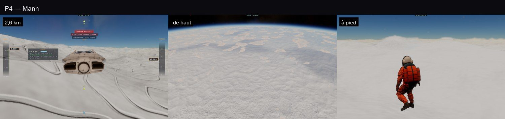

# P4 — Mann : crevasses et nuages gelés

30 octobre 2026, ce Mac. Plan : [PLAN-PLANETES-AAA.md](../../PLAN-PLANETES-AAA.md).

## Ce qui est fait

- **Crevasses** (`terrain.ts mannCrevasse` = `trace.wgsl mannCrevasse`) dans les glaciers, c'est-à-dire les bas des
  continents de glace :
  - un réseau de fissures d'environ 4 m de large et 14 m de profondeur, espacées d'environ 160 m (là où un bruit
    s'annule) ;
  - dessinées dès que l'empreinte d'un pixel descend sous ~40 m ;
  - ressenties : le relief du marcheur et du vaisseau les contient, un marcheur peut y tomber ;
  - en ombrage, une glace bleu profond à l'intérieur, plus sombre vers le fond.
- **Nuages gelés** (`terrain.ts mannCloud` = `trace.wgsl mannCloud`), ceux du film :
  - des dalles de glace vers 1,8 à 2,2 km, en plaques de dizaines de kilomètres, épaisses de 150 à 500 m en leur milieu et
    amincies vers leur bord ;
  - dessinées par le raster des corps comme une seconde couche (`bodyCloudVs`, le dessous et le dessus sur la même grille,
    les bords découpés par le masque, la marque `a = 1.5`) ;
  - ombrées par `bodyCloudLite` : une normale tirée des distances voisines, une glace blanche bleuissant avec
    l'épaisseur, la lumière qui traverse les bords fins, l'air devant ;
  - **heurtées** : un vaisseau qui entre dans une dalle s'écrase (« struck one of Mann's frozen clouds »).

## Tests

- `tests/mann-ice.test.ts` : constantes et échelles identiques au traceur, des fissures de quelques pour cent de la ligne
  sur ~14 m, des dalles vers 2 km, un vaisseau à 100 m/s dedans heurté.
- `tests/e2e/mann-ice.e2e.test.ts` : vue en chasse à 2,6 km, vue de haut, à pied ; 3 sur 3, sans erreur GPU.

## Limites

- Les nuages gelés n'existent que pour le raster : pas d'ombre portée sur le sol, et le traceur ne les dessine pas
  (orbite lointaine, mode tracé).
- Les crevasses à grande échelle ressemblent à des sillons sinueux, pas à des champs de fractures parallèles : il faudra
  les orienter selon l'écoulement de la glace.
- Ni sastrugis ni neige soufflée.
