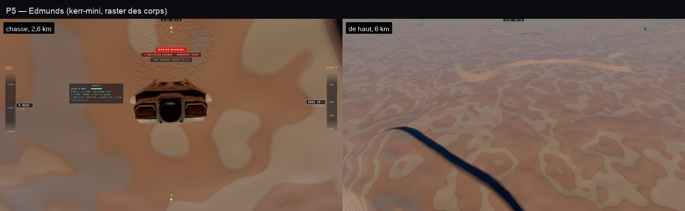

# P5 — Edmunds, et le marcheur qui tremblait

30 octobre 2026, ce Mac et kerr-mini. Plan : [PLAN-PLANETES-AAA.md](../../PLAN-PLANETES-AAA.md).

## Ce qui est fait

- **Relief d'Edmunds** (`terrain.ts relief` = `trace.wgsl reliefBase`, surface 2) :
  - des mesas aux flancs raides et aux sommets plats. Les gradins taillés dans le relief sont retirés : sur un flanc doux,
    ils se dessinaient en lignes de niveau noires dans l'ombre ;
  - des canyons creusés dans les hauts plateaux, des gorges d'environ 200 m aux parois raides ;
  - des dunes asymétriques, avec une longue pente au vent et une face d'avalanche raide sous le vent (un cinquième de
    leur longueur d'onde).
- **Strates** : des bandes rouille, crème et gris tous les ~23 m de hauteur, lues sur les falaises et les parois de
  canyon (`planetAlbedo`, `EDM_H`).
- **Lumière dans l'ombre** : un monde avec de l'air y reçoit celle de son ciel, environ un sixième. Ses canyons étaient
  noirs.
- **Pic d'opposition de la Lune** (début de P6) : la poussière s'éclaire quand la lumière vient de derrière l'œil
  (Hapke, B₀ 1, largeur 0,06). C'est l'éclat de la pleine Lune et le halo autour de l'ombre d'un marcheur.

## Le marcheur qui tremblait (kerr-mini)

Sur le mini, l'astronaute debout tremblait sur le sol. Trois causes, trouvées une à une :

1. **Le jitter de Halton du raster** décalait d'une fraction de pixel, à chaque image, la profondeur du sol contre
   laquelle l'astronaute est composé. Il est coupé quand on marche sur un autre monde. Le taux du raster des corps est
   aussi plafonné à 1 pixel sur 4 : à 1 sur 16, les pixels reconstruits scintillaient autour de lui.
2. **Sa place relue par le rig** : l'astronaute était placé par rapport à la caméra relue dans les coordonnées du rig
   (Boyer-Lindquist près de Gargantua). Chaque aller-retour perdait 1 à 3 mm par image, soit environ un pixel à 4,5 m.
   `character.ts` garde désormais l'œil exact qu'il a posé (`placed`) et s'en sert tant que la vue n'a pas bougé.
   Sur une capture image par image (screencast, environ 24 images/s) sur Mann :

   | | casque déplacé d'une image à l'autre, avant | après |
   |---|---|---|
   | raster des corps | 17 images sur 67, ≤ 1 px | 0 sur 77 |
   | tracé | 20 sur 60, jusqu'à 2,2 px | 9 sur 62, ≤ 1 px (la respiration de l'idle qui franchit un pixel) |

   La Lune ne sautait pas : près de nous, les coordonnées ne perdent pas ces millimètres.
3. **La mesure elle-même** : le premier e2e prenait le barycentre des pixels orange de toute l'image. Il comptait le HUD
   (l'horloge, les FPS) et la respiration du clip idle (~1,5 cm en 2 s), sur des captures espacées de 300 ms. Le
   nouvel `walker-jitter.e2e.test.ts` filme 3 s image par image et suit le casque par correspondance de blocs. Il
   échoue si le casque saute de plus d'un pixel et demi entre deux images.

## Tests

- `tests/mann-ice.test.ts` : l'échelle des canyons est celle du traceur, et le relief reste sous sa borne (1 800 m).
- `tests/e2e/edmunds.e2e.test.ts` : chasse à 2,6 km, vue de haut, à pied. 3 sur 3, sans erreur GPU.
- `tests/e2e/walker-jitter.e2e.test.ts` : Mann, la Lune, Edmunds, raster des corps allumé et éteint.

## Limites

- Edmunds vu de haut reste une carte de taches d'albédo. Les mesas manquent de volume sous un soleil haut, et un canyon
  dans l'ombre reste très sombre. Il faudra de l'occlusion ambiante et une lumière de ciel directionnelle.
- À 10° N, 0° E à l'heure de la scène, Edmunds est de nuit : le test du marcheur l'annonce et ne le mesure pas.
- Sur Mann, la combinaison est striée sous la lumière rasante. Ce n'est aucune ombre : l'ombre propre, celle du
  vaisseau et celle du décor ont été coupées une à une sans effet. Ce sont la carte de normales du tissu et l'éclairage
  rasant. À reprendre avec l'éclairage de la combinaison.
- Le clip idle fait glisser les pieds d'environ 1,4 cm sur son cycle : l'IK ne les plante pas à l'arrêt.
