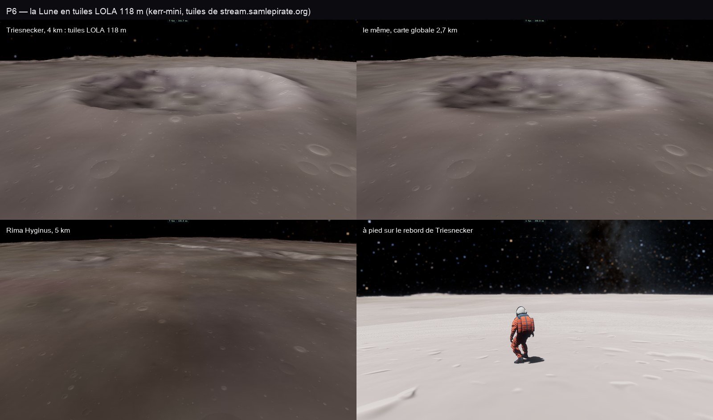

# P6 — La Lune en tuiles : relief LOLA 118 m, albédo Clementine

30 octobre 2026, ce Mac, kerr-mini et le serveur. Plan : [PLAN-PLANETES-AAA.md](../../PLAN-PLANETES-AAA.md).

## Les données, et pourquoi le serveur les fabrique

- **Relief.** Aucune copie du modèle LOLA global ne se lit en morceaux depuis une page :
  - le GeoTIFF 118 m de l'USGS sur AWS fait 8,5 Go, en une bande par ligne, sans tuiles internes ;
  - Moon Trek ne sert que des ombrages, ou des hauteurs étirées sur 8 bits (des marches de 80 m) ;
  - le STAC de l'USGS n'a que les tirs LOLA ;
  - les COG de PGDA ne couvrent que le pôle sud.

  Décision : le serveur de salles les fabrique une fois (`server/moon-tiles.ts`, service `moon-tiles` de la stack) :
  - il lit 256 lignes par requête HTTP (47 Mo) et découpe le tout en tuiles 256² ;
  - quatre niveaux : z 0 à 1° par tuile, soit 118 m par texel, jusqu'à z 3 à 8°, soit 948 m ;
  - format (`src/system/lola-codec.ts`) : demi-mètres, prédicteur 2D, gzip ; environ 41 Ko par tuile et 3 à 4 Go en
    tout ;
  - le serveur de salles les sert sous `stream.samlepirate.org/svc/v1/moon/lola/…` (CORS, immuables), avec l'état de
    la fabrication en `/status` ;
  - toute la fabrication a pris 45 minutes sur le serveur (2 h 04 à 2 h 49 UTC) : z 0 en 40 minutes, les trois
    niveaux grossiers en 5.
- **Albédo.** La mosaïque Clementine UVVIS 750 nm de Moon Trek (CORS ouvert). Elle a été prise Soleil haut, donc sans
  ombres, contrairement à la mosaïque WAC de LROC dont les ombres du matin sont figées dans l'image. Sa résolution va
  jusqu'à 333 m (91 pixels par degré).

## Ce qui est fait

- **Le client** (`src/system/moon-tiles.ts`), le jumeau équirectangulaire des tuiles de la Terre :
  - quatre niveaux, chacun une fenêtre de 4 × 4 tuiles autour de la caméra, toroïdale, dans un tableau rg32uint
    1024² ;
  - le traceur la lit par la liaison et les paramètres des tuiles de la Terre : liaison 28, `P.tiles` / `P.tileL`, et
    `P.tiles.w` à −1 pour la Lune ;
  - les tuiles de la Terre sont éteintes tant que la Lune est le corps proche : pas de texture de plus dans le traceur ;
  - une tuile que le serveur n'a pas encore (404) est remplie par la carte globale et redemandée plus tard ;
  - en local, le serveur de dev sert une zone construite dans `data/moon/lola` ; sans elle, les tuiles viennent du
    serveur.
- **Le traceur** (`trace.wgsl`) :
  - `moonH` reprend la boucle d'`earthH` en équirectangulaire. L'écart de latitude est pris par atan2 depuis la
    référence, sans annulation en float32 ;
  - `moonSample` interpole par une cubique monotone (un rebord de cratère reste net), en bilinéaire pour les pas de
    marche ;
  - `demFine` pose les tuiles sur la carte globale dans `relief`, `reliefStep` et la marche des ombres ;
  - `demTop` borne la marche par le plus haut point des fenêtres, car les pics à 118 m dépassent les moyennes de la
    carte.
- **L'éclairage du sol proche.** La normale fine (`moonNormal`, pas de 59 m) et le détail d'albédo de Clementine
  (`moonDetail` : le niveau fin rapporté au niveau 8°, en facteur sur la couleur calibrée) sont pris une seule fois
  dans `shadeNear`.
  - Avant ce changement, `demNormal` dérivait la normale à 1,3 km au moins : le relief fin était dans la géométrie mais
    pas dans la lumière.
  - Les noyaux restent au budget (« moon main » : 67k lignes inlinées, comme avant P6). La première version, recopiée
    dans chaque appel de `relief`, de `planetAlbedo` et de `planetShade`, ajoutait 6k lignes.
- **Les mêmes hauteurs au CPU.** `heightAt` utilise la même cubique et passe par `setGroundHeights("moon")`. Le marcheur
  se tient à 1,2 cm du sol des tuiles, comme prévu (e2e).
- **Le raster des corps** lit la liaison 28 et refait ses hauteurs quand une tuile arrive (le « stamp »).
- **Le pic d'opposition de Hapke** est déjà fait (commit P5) : la poussière s'éclaire quand le Soleil est dans le dos.

## Mesures

- **e2e `moon-tiles` sur kerr-mini**, une fois les quatre niveaux faits sur le serveur (Triesnecker à 4 km, avec puis
  sans tuiles ; Rima Hyginus à 5 km ; marcheur sur le rebord) : 3 sur 3.
  - Les tuiles viennent de stream.samlepirate.org : 149 chargées, aucune en échec, aucune erreur GPU.
  - Le marcheur se tient à 1,2 cm du sol des tuiles.
  - Triesnecker gagne un rebord net et des parois (planche ci-dessus).
  - Leçon : un run fait quand le serveur n'avait que z 0 montrait à peine la différence. Au-delà d'environ 30 km, en
    incidence rasante, l'empreinte passe aux niveaux z 1 à 3, alors remplis par la carte globale.
- **Sur ce Mac**, avec une zone locale complète (z 0 à 3), Triesnecker passe d'un creux flou à un cratère à rebord net
  et parois.
- **A/B P5 (1edece75) contre P6 (7af7d967)**, ce Mac, qualité fixe, A B B A sur deux tours, médianes en ms :

  | Vue | P5 | P6 | Lecture |
  |---|---|---|---|
  | Terre basse | 16,8 | 16,9 | inchangée |
  | Terre ciné | 14,8 | 16,4 | bruit : le code de la Terre n'a pas changé |
  | Lune basse | 12,1 | 13,3 | +10 %, dans le bruit mais plausible (les tuiles dans la marche) |
  | Lune ciné | 21,4 | 16,7 | bruit : un tour à 33 ms côté P5 |

  - Le bruit est fort : la Terre basse va de 11,6 à 18,0 ms côté P5, sans le relevé thermique (le collecteur était
    arrêté).
  - La vue basse de la Lune reste sous le budget de la Terre (13,3 contre 16,9 ms), la règle du plan.

## Limites

- **L'albédo de Clementine** n'apporte qu'un détail modeste à 333 m. Il ne remplace pas une imagerie fine : NAC à
  0,5 m, à prendre zone par zone.
- **Ni rochers ni traces de pas** au pied : reportés.
