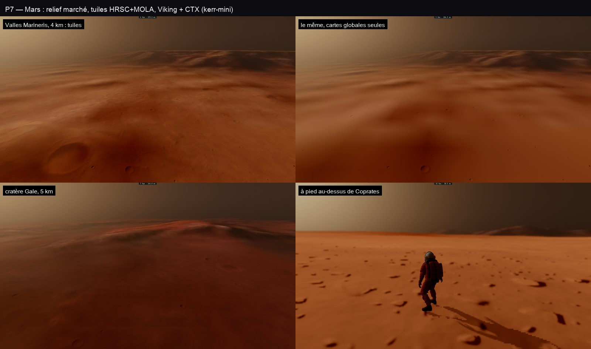
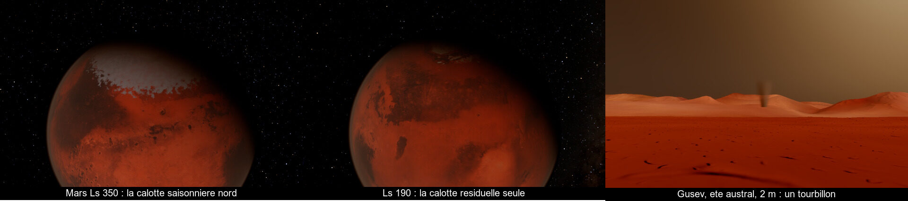

# P7 — Mars : un vrai sol (relief marché, tuiles HRSC+MOLA, Viking, CTX)

30 octobre 2026, ce Mac, kerr-mini et le serveur. Plan : [PLAN-PLANETES-AAA.md](../../PLAN-PLANETES-AAA.md).

## Le constat de départ

En P0, Mars vu à 3 km et à pied n'était qu'un brouillard orange uniforme. Ce n'était pas l'air : la poussière du
traceur est juste (τ ≈ 0,4, des dizaines de kilomètres de visibilité). La cause était ailleurs :

- un monde avec air autre que la Terre était touché comme **une sphère** (`earthNear` : `unitHit`), sans aucun relief
  marché ;
- seule une carte de normales l'ombrait, avec des cartes globales de ~5 km par texel ;
- il n'avait aucun détail en dessous, ni cratères, ni sol fin, contrairement à la Lune.

## Ce qui est fait

- **Le relief marché.** Dans le noyau des mondes avec air (NEAR_KIND 2), `earthNear` marche le relief de Mars avec la
  marche des mondes sans air (`nearMarch`) au lieu de la sphère. Les noyaux de la Terre et le noyau général n'en portent
  pas de copie. `otherGround` reçoit d'`earthNear`, par variables privées :
  - l'ombre du relief (`nearShadow`) ;
  - la normale fine (tuiles + cratères + sol fin) ;
  - le détail d'imagerie.
- **Les cratères de Mars.** Ceux des mondes sans air, à densité 0,35 (plus vieux, moins nombreux sous la poussière),
  au GPU et au CPU (`cratered`, `craterDensity`). Le marcheur tient dessus.
- **Le sol fin** (`fineGround` : cailloux, pierres, ombrage seul) étendu à Mars.
- **Les tuiles de relief.** Le MNT mélangé HRSC et MOLA de l'USGS (200 m, 11,4 Go) est :
  - fabriqué une fois sur le serveur ;
  - rééchantillonné à 256 pixels par degré, en bilinéaire, sans les « pas de donnée » ;
  - stocké en mètres entiers : ses 29 km de relief ne tiennent pas en demi-mètres sur 16 bits, d'où un octet d'unité
    dans l'en-tête des tuiles ;
  - servi sous `stream.samlepirate.org/svc/v1/mars/dem`.
- **L'imagerie**, dans le même atlas que la Lune (`src/system/moon-tiles.ts`, généralisé par monde : rayon, chemin,
  niveaux), avec quatre niveaux d'imagerie seule, plus fins (jusqu'à 1/16°, ~14 m par texel) :
  - la couleur de Viking (MDIM 2.1, 232 m, Mars Trek) en rgb ;
  - le détail de CTX (mosaïque globale du Murray Lab, servie par OnMars d'Esri, jusqu'à ~10 m) en alpha.

  Le shader prend le niveau fin rapporté au niveau grossier, en facteur sur la couleur calibrée. Les trous de CTX
  (mosaïque non contrôlée) sont laissés à un niveau plus grossier. Ses chargements sont limités à 4 à la fois et
  réessayés : en rafale, le service renvoyait des 500.

- **Le sol dessiné par le raster des corps** (le report de P1) :
  - `bodyLiteAir` ombre ses pixels par `earthNear` à la distance du raster (`NEAR_T`), sans sa marche ;
  - les rayons que le raster n'a pas rencontrés (le ciel, le sol au-delà de sa portée) commencent leur marche à la
    moitié de cette portée. Avant, depuis une caméra à 2 m, ils faisaient ~200 pas dans la coquille de 21 km du relief.
- **La marche de Mars allégée** :
  - son pas minimal passe à 5 % de la distance et sa portée s'arrête à 120 km, au-delà desquels la poussière ne laisse
    que la brume ;
  - ses pas prennent le relief au quart de la finesse du pixel, avec 6 bissections ;
  - ses ombres de relief sont prises dans les 25 km. Leur marche part de 8 m, à pas 1,4 fois plus longs : un Soleil bas
    faisait faire ses 56 pas à chaque pixel éclairé, dont ~37 dans le premier kilomètre. C'était le tiers de l'image au
    coucher (36 → 27 ms sur ce Mac), pour une image identique à l'œil : le relief n'a pas d'occultant de quelques mètres ;
  - sa borne sur les tuiles est leur dépassement de la carte globale (quelques centaines de mètres), et non plus le
    plus haut point des fenêtres : Tharsis à 20 km faisait marcher chaque rayon pas à pas.
- **Le sol revenu sous le marcheur.** Le raster des corps jugeait la caméra hors de portée à plus de 500 m sous la sphère
  (le relief procédural). Il ignorait le relief mesuré : le plateau de Coprates est à des kilomètres sous la sphère de
  Mars. Il prend maintenant la hauteur au-dessus du sol sous la caméra. Et sa portée ne va au traceur que les images où il
  dessine : gardée d'une image passée, elle envoyait les rayons au-delà du sol, et le marcheur flottait dans la brume.

## Mesures

- **e2e `mars-tiles` sur kerr-mini** (tuiles de stream.samlepirate.org, 3eb9ae2e moins le correctif audio) : 3 sur 3.
  - Valles Marineris à 4 km, avec puis sans tuiles ; le cratère Gale à 5 km ; le marcheur au-dessus de Coprates.
  - 192 tuiles de relief et 384 d'imagerie chargées sur les trois vues, aucune en échec, aucune erreur GPU.
  - Le raster des corps dessine les trois vues (sa portée : 257, 276 et 92 km).
  - Le marcheur se tient à 1,2 cm du sol.
- **A/B P6 (8ba92109) contre P7 (3eb9ae2e)**, ce Mac, qualité fixe, A B B A sur deux tours, médianes en ms. Seules les
  colonnes d'un même run se comparent : la machine chauffe d'un run à l'autre.

  | Vue | P6 | P7 | Terre, même run | Lecture |
  |---|---|---|---|---|
  | Mars basse | 7,8 | 10,9 | 16,5–17,0 | sous le budget de la Terre |
  | Mars ciné, coucher bleu depuis le cockpit | 9,3 | 11,7 | 12,0–12,5 | **sous le budget**, de peu |

  - P6 dessinait une sphère : ni relief, ni ombres, ni imagerie.
  - Avant l'allègement des ombres, la vue ciné dépassait le budget de la Terre de 10 à 17 %.
  - La Terre n'a pas bougé : ±4 % d'un côté à l'autre, dans le bruit (un de ses tours est passé de 11,5 à 27,5 ms).
  - Noyaux : « mars main » passe de 67k à 77k lignes inlinées, et le nouveau « mars shadeLite » compte 32k lignes. Les
    deux sont dans les budgets.

## Limites

- **La vue ciné de Mars est au budget de la Terre, sans marge.** La route AAA pour ses ombres serait celle de la
  Terre : une carte d'ombre vue du Soleil, tirée du raster des corps, plutôt que la marche par pixel. À faire avec les
  autres corps (P8).
- **Pas encore fait** : le réglage du ciel ocre (le givre et les tourbillons sont faits, ci-dessous).
- **Les tuiles de relief couvrent tout le globe** (180 rangées, trois niveaux plus grossiers, finies le 30 octobre à
  04 h 35 UTC) ; les pôles au-delà des données du MNT gardent la carte globale.
- **Les trous de CTX** (mosaïque non contrôlée d'Esri) laissent par endroits le détail le plus fin à un niveau plus
  grossier.

## Le givre et les tourbillons de poussière (1er novembre, après P11)

- **La saison** (`src/system/mars-season.ts`) : la longitude solaire Ls de Mars à la date de la scène, tirée des
  éphémérides du jeu (la direction du Soleil vue de Mars dans le plan de son orbite, depuis son équinoxe de printemps
  nord). Le renderer la relit toutes les demi-unités M (~4 minutes de scène : Ls avance d'un demi-degré par jour) et passe
  au traceur, dans `Params.mars`, les bords des deux calottes et la saison des tourbillons au nord et au sud.
- **Les calottes saisonnières de CO₂** : leurs bords par Ls, tous les 30°, tirés des relevés des orbiteurs. Pour le sud,
  TES (Kieffer et al. 2000 ; Piqueux et al. 2015, huit années martiennes) : ~50° S au plus large en hiver austral, en
  recul dès Ls 180, disparue vers Ls 300 sauf la calotte résiduelle de la carte. Pour le nord, MOC et TES (James & Cantor
  2001) : 55 à 58° N en hiver, absente de Ls 120 à 180. Le bord est déchiqueté par un bruit de ~200 km et plus fin
  (±4°), et descend plus bas sur les pentes tournées vers le pôle (+3° sur une pente de 30°). L'albédo est celui d'un
  givre poussiéreux (~0,55, à peine bleuté).
- **Le givre d'eau des matins d'hiver** aux latitudes moyennes, comme celui de Viking 2 à 48° N : mince, en taches, il
  disparaît quand le Soleil monte.
- **Où** : `marsFrost`, dans `otherGround`, de près comme d'orbite. Loin des bords des deux calottes et hors d'un matin
  d'hiver, la fonction rend la main avant de lire le moindre bruit : la vue basse n'en paie presque rien.
- **Les tourbillons** (`marsDevils`, Cantor et al. 2006, Greeley et al. 2006 pour ceux de Spirit à Gusev) : des colonnes
  de poussière de 20 à 120 m à leur pied, qui s'évasent jusqu'à 0,5 à 3 km de haut et dérivent de 2 à 7 m/s avec le vent,
  les après-midi du printemps et de l'été de chaque hémisphère (l'été austral, Mars au périhélie, est le plus actif).
  - Une fonction pure de l'horloge de la scène : les mêmes tourbillons pour chaque joueur et chaque sauvegarde. Un réseau
    de cellules de 8 km, chacune avec au plus un tourbillon qui vit un créneau de 512 s, décalé par son propre hachage ;
    les 3 × 3 cellules autour de la caméra.
  - Chacun est intégré le long du rayon en 6 pas sur son cylindre évasé : sa profondeur optique, la lumière du Soleil
    qu'il diffuse vers l'avant (Henyey–Greenstein 0,6, albédo de diffusion simple 0,9, celui de Pathfinder et des MER),
    son côté à l'ombre, la lumière du ciel. Ils sont tracés dans le ciel aussi : le noyau allégé du raster trace le ciel
    au-dessus de l'horizon.
  - La hauteur de la caméra au-dessus du sol de Mars, que le traceur ne connaît pas, vient du CPU (`heightOverGround`,
    dans `zamo2.w`).
  - Le bit 4096 de `liteSkip` les coupe, pour les A/B.
- **Tests** : `tests/mars-season.test.ts` (Ls à des dates connues, les calottes au fil des saisons, la saison des
  tourbillons, les constantes du WGSL identiques à celles du module) ; l'e2e `world-details` (le haut du disque nord plus
  clair à Ls 350 qu'à Ls 190, 32,7 contre 23,4 ; un tourbillon devant les dunes de Gusev, l'été austral).
- **A/B sur kerr-mini** contre `0eed0272` (A B B A, médianes, qualité fixe, les quatre ajouts ensemble) : la Terre ne
  bouge pas (±1 %) ; la Lune en orbite 0 %, basse −1 %, ciné 32,9 → 34,0 ms (+3 %) ; Mars en orbite +1 %, basse 36,2 → 38,2
  (+6 %, +11 % avant que le givre ne rende la main loin des calottes), ciné +2 % ; Jupiter ±2 %.
- **Limites** : les tourbillons ne projettent pas d'ombre au sol et ne laissent pas de traces sombres vues d'orbite ; leur
  colonne s'efface vite vers le haut. Le givre d'eau ne se voit qu'au lever du jour.
