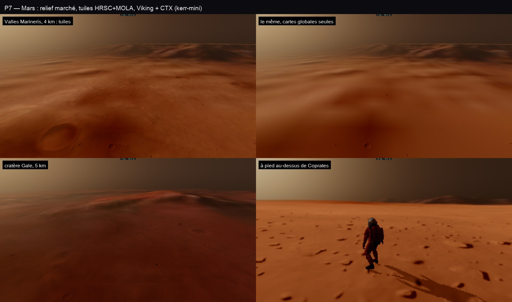

# P7 — Mars : un vrai sol (relief marché, tuiles HRSC+MOLA, Viking, CTX)

30 octobre 2026, ce Mac, kerr-mini et le serveur. Plan : [PLAN-PLANETES-AAA.md](../../PLAN-PLANETES-AAA.md).

## Le constat de départ

En P0, Mars vu à 3 km et à pied n'était qu'un brouillard orange uniforme. Ce n'était pas l'air : la poussière du
traceur est juste (τ ≈ 0,4, des dizaines de kilomètres de visibilité). La cause était ailleurs :

- un monde avec air autre que la Terre était touché comme **une sphère** (`earthNear` : `unitHit`), sans aucun relief
  marché ;
- seule une carte de normales l'ombrait, avec des cartes globales de ~5 km par texel ;
- il n'avait aucun détail en dessous, ni cratères, ni sol fin, contrairement à la Lune.

## Ce qui est fait

- **Le relief marché.** Dans le noyau des mondes avec air (NEAR_KIND 2), `earthNear` marche le relief de Mars avec la
  marche des mondes sans air (`nearMarch`) au lieu de la sphère. Les noyaux de la Terre et le noyau général n'en portent
  pas de copie. `otherGround` reçoit d'`earthNear`, par variables privées :
  - l'ombre du relief (`nearShadow`) ;
  - la normale fine (tuiles + cratères + sol fin) ;
  - le détail d'imagerie.
- **Les cratères de Mars.** Ceux des mondes sans air, à densité 0,35 (plus vieux, moins nombreux sous la poussière),
  au GPU et au CPU (`cratered`, `craterDensity`). Le marcheur tient dessus.
- **Le sol fin** (`fineGround` : cailloux, pierres, ombrage seul) étendu à Mars.
- **Les tuiles de relief.** Le MNT mélangé HRSC et MOLA de l'USGS (200 m, 11,4 Go) est :
  - fabriqué une fois sur le serveur ;
  - rééchantillonné à 256 pixels par degré, en bilinéaire, sans les « pas de donnée » ;
  - stocké en mètres entiers : ses 29 km de relief ne tiennent pas en demi-mètres sur 16 bits, d'où un octet d'unité
    dans l'en-tête des tuiles ;
  - servi sous `stream.samlepirate.org/svc/v1/mars/dem`.
- **L'imagerie**, dans le même atlas que la Lune (`src/system/moon-tiles.ts`, généralisé par monde : rayon, chemin,
  niveaux), avec quatre niveaux d'imagerie seule, plus fins (jusqu'à 1/16°, ~14 m par texel) :
  - la couleur de Viking (MDIM 2.1, 232 m, Mars Trek) en rgb ;
  - le détail de CTX (mosaïque globale du Murray Lab, servie par OnMars d'Esri, jusqu'à ~10 m) en alpha.

  Le shader prend le niveau fin rapporté au niveau grossier, en facteur sur la couleur calibrée. Les trous de CTX
  (mosaïque non contrôlée) sont laissés à un niveau plus grossier. Ses chargements sont limités à 4 à la fois et
  réessayés : en rafale, le service renvoyait des 500.

- **Le sol dessiné par le raster des corps** (le report de P1) :
  - `bodyLiteAir` ombre ses pixels par `earthNear` à la distance du raster (`NEAR_T`), sans sa marche ;
  - les rayons que le raster n'a pas rencontrés (le ciel, le sol au-delà de sa portée) commencent leur marche à la
    moitié de cette portée. Avant, depuis une caméra à 2 m, ils faisaient ~200 pas dans la coquille de 21 km du relief.
- **La marche de Mars allégée** :
  - son pas minimal passe à 5 % de la distance et sa portée s'arrête à 120 km, au-delà desquels la poussière ne laisse
    que la brume ;
  - ses pas prennent le relief au quart de la finesse du pixel, avec 6 bissections ;
  - ses ombres de relief sont prises dans les 25 km ;
  - sa borne sur les tuiles est leur dépassement de la carte globale (quelques centaines de mètres), et non plus le
    plus haut point des fenêtres : Tharsis à 20 km faisait marcher chaque rayon pas à pas.

## Mesures

- **e2e `mars-tiles` sur kerr-mini** (tuiles de stream.samlepirate.org) : 3 sur 3.
  - Valles Marineris à 4 km, avec puis sans tuiles ; le cratère Gale à 5 km ; le marcheur au-dessus de Coprates.
  - 48 tuiles de relief et 384 d'imagerie chargées, aucune en échec, aucune erreur GPU.
  - Le marcheur se tient à 1,2 cm du sol.
- **A/B P6 (8ba92109) contre P7**, ce Mac, qualité fixe, A B B A sur deux tours, médianes en ms. La machine chauffait
  d'un run à l'autre : seules les colonnes d'un même run se comparent.

  | Vue | P6 | P7 | Terre, même run | Lecture |
  |---|---|---|---|---|
  | Mars basse (run frais) | 7,9 | 13,2 | 16,8 | sous le budget de la Terre |
  | Mars basse (run chaud) | 18,2 | 41,9 | 52,9 | sous le budget |
  | Mars ciné, coucher bleu depuis le cockpit | 31,7 | 48,3 | 41–44 | **au-dessus, de 10 à 17 %** |

  - P6 dessinait une sphère : ni relief, ni ombres, ni imagerie.
  - Le coût de la vue ciné n'est plus dans la marche ni dans les ombres : les couper ne changeait rien. Il est dans
    l'ombrage complet de chaque pixel du sol par `earthNear` (atmosphère, normale, imagerie) et dans le code de plus
    du noyau Mars : le traceur est limité par ses registres.
  - Noyaux : « mars main » passe de 67k à 77k lignes inlinées, et le nouveau « mars shadeLite » compte 32k lignes. Les
    deux sont dans les budgets.

## Limites

- **La vue ciné de Mars dépasse encore le budget de la Terre** de 10 à 17 %. Pistes : une table de perspective
  aérienne pour Mars, comme celle de la Terre, plutôt que l'intégration par pixel ; un variant de noyau pour le raster,
  sans la marche.
- **Pas encore faits** : les tourbillons de poussière, le givre polaire, le réglage du ciel ocre.
- **Les tuiles de relief couvrent tout le globe** (180 rangées, trois niveaux plus grossiers, finies le 30 octobre à
  04 h 35 UTC) ; les pôles au-delà des données du MNT gardent la carte globale.
- **Les trous de CTX** (mosaïque non contrôlée d'Esri) laissent par endroits le détail le plus fin à un niveau plus
  grossier.
