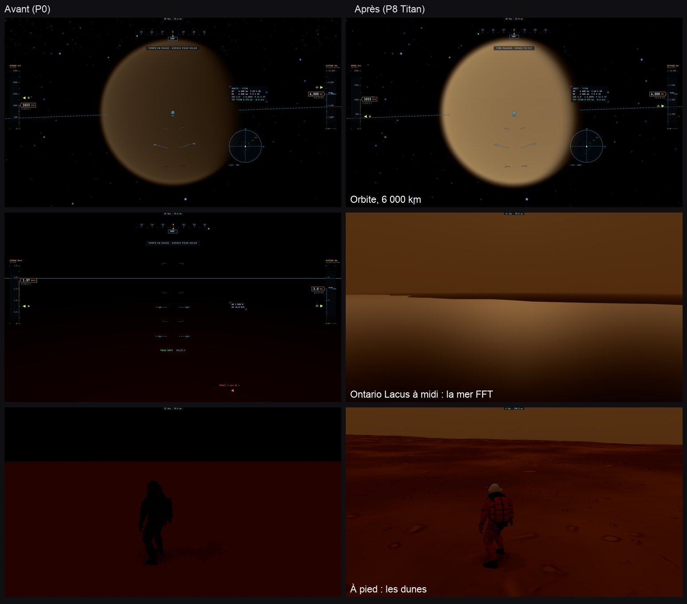
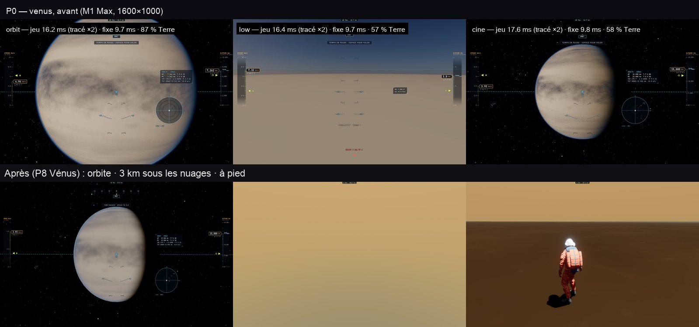

# P8 — Les autres corps solides : Titan, Vénus

30 octobre 2026, ce Mac et kerr-mini. Plan : [PLAN-PLANETES-AAA.md](../../PLAN-PLANETES-AAA.md). Ordre décidé : Titan, puis Vénus,
puis les corps sans air ; des tuiles sur le serveur là où un MNT existe ; Titan et les lunes glacées : leur mosaïque et un
relief procédural.

## Titan

### Le constat de départ

En P0, Titan était presque noir sous sa brume :

- depuis l'orbite, un disque brun terne ;
- depuis le sol, un ciel noir sur un sol rouge sombre.

La brume (épaisseur optique ≈ 4) n'était calculée qu'en diffusion simple : la lumière du Soleil s'y éteint, et rien ne
la remplaçait. Le sol était une sphère lisse, sous une carte de 1024 × 512 (~16 km le pixel), sans mers.

### Ce qui est fait

- **T1 — la lumière sous la brume.** Le terme à deux flux de la tempête de poussière de Mars (sa lumière diffusée
  plusieurs fois, moins éteinte que le faisceau) est généralisé à toute brume épaisse, et toujours actif sur Titan. Il
  est compilé dans les noyaux des mondes à air et dans ceux de tous les chemins (la table aérienne, les sondes).
  - Depuis le sol, le ciel est une lueur orange, plus claire vers l'horizon, comme sur les images de Huygens.
  - Depuis l'espace, le disque est clair, couleur caramel, comme sur les images de Cassini.
- **T2 — sa carte fine.** La mosaïque ISS de Cassini (938 nm, 4 km, globale, USGS) en 4096 × 2048, teintée de la
  couleur de sa carte grossière.
- **T3 — un sol.**
  - Un relief procédural (`titanRelief`), le même au CPU, pour que le marcheur tienne dessus :
    - une houle de hauts et de bassins (±400 m) ;
    - des collines sur les hauts (~300 m) ;
    - les dunes linéaires de la ceinture équatoriale (est–ouest, 2,5 km d'écart, ~90 m), dans leurs mers de sable ;
    - quelques mètres de rugosité.
  - Ce relief est marché comme celui de Mars et dessiné par le raster des corps, dans un noyau à lui (`NEAR_KIND 5`) : les
    chemins des mondes à air, sans le code de Mars ; Mars ne porte pas non plus celui de Titan.
  - Les conditions sont écrites en conjonctions, que `wgsl-specialise` sait plier. Avec un `||` en tête, le code de
    Titan entrait dans les noyaux de Mars (+17k lignes).
  - Sous la brume, la lumière du ciel vient d'un dôme plus clair côté Soleil (la diffusion vers l'avant de la brume) :
    les pentes et les dunes se lisent.
  - Le sol fin : des galets de glace, clairs sur un sable sombre (ceux de Huygens).
- **T4a — ses mers de méthane.**
  - Kraken, Ligeia et Punga Mare, les lacs du nord, Ontario Lacus au sud.
  - Leur masque vient de la mosaïque radar SAR/HiSAR de Cassini (351 m, servie par le WMS de l'USGS) :
    - le radar sombre, débruité ;
    - les trous des fauchées laissés à la terre, sauf ceux enclos dans une mer ;
    - au sud, la seule région d'Ontario retenue (le reste du radar sombre y est de la plaine).
  - Il est gardé comme distance signée à leurs rives (128 + 4 par km), dans le bleu, libre jusque-là, du relief de la
    carte fine. Aucune liaison de plus pour le traceur, qui est à sa limite de textures.
  - Le CPU lit la même carte : le marcheur et le train d'atterrissage se tiennent sur leur surface, sans nage.
  - Leurs fonds descendent jusqu'à ~180 m, et la terre autour reste au-dessus de leur niveau.
  - La rive est la ligne de zéro de la carte (lisse), non le croisement des mailles du sol avec le niveau.
  - Leur surface est un miroir sombre :
    - Fresnel du méthane (n 1,29) ;
    - le ciel orange reflété, plus clair bas et vers le Soleil ;
    - le reflet du Soleil à travers la brume ;
    - des rides de quelques centimètres.
- **T4b — leurs vagues par la FFT de P2, à la gravité de Titan.**
  - La mer est profonde, sous 1,352 m/s². Sous un souffle de 0,6 m/s, une mer pleinement levée (Pierson–Moskowitz :
    Hs = 0,21 U²/g, Tp = 7,16 U/g) donne des vagues de quelques centimètres, sur quelques secondes.
  - Les pentes que le pixel ne résout pas élargissent le reflet du Soleil.
  - La FFT (~2 ms) ne tourne qu'à moins de 30 km d'une mer et sous 150 km d'altitude. La distance de la carte s'arrête à
    −32 km : un premier seuil à −150 km la faisait tourner partout.
- **T2b — le détail de son albédo par le radar.**
  - La mosaïque SAR/HiSAR de Cassini arrive en tuiles d'imagerie seule (le WMS de l'USGS, ses trous transparents), dans
    l'atlas de la Lune et de Mars. `moon-tiles.ts` accepte maintenant des mondes sans relief.
  - Quatre niveaux, de 351 m à 2,8 km le texel.
  - Le radar n'est pas un albédo visible : il ne compte que pour les deux tiers. Il donne la texture des dunes et des
    canaux.
- **Un correctif pour Mars et Titan.** La portée de la marche des mondes à air (120 km, P7) se comptait depuis la caméra.
  Depuis l'orbite, chaque rayon s'arrêtait donc avant le sol : un trou noir au milieu du disque. Elle part désormais de la
  coquille du relief, et un rayon au-delà de sa portée est repris par la sphère.

### Mesures

- **e2e `titan-ground` sur kerr-mini** : 3 sur 3.
  - Le marcheur sur les dunes se tient à 1,2 cm du sol du CPU. Ses tuiles radar sont dessinées (64, aucune en échec), et
    aucune vague n'est calculée.
  - Ontario Lacus depuis 300 m, à son midi : la mer FFT de Titan active, 128 tuiles.
  - Le disque depuis 6 000 km : son centre à 107/255, et non plus noir.
  - Le noyau de Titan (5) et son raster sont actifs, sa carte chargée, aucune erreur GPU.
- **e2e `mars-tiles`** : 4 sur 4 avec sa nouvelle vue orbitale (le centre du disque à 70/255).
- **A/B final**, la version poussée (f7a9a709) contre Titan complet (1bef4004), deux tours, en médianes : Titan bas
  10,7 ms et ciné 12,3 ms, contre 13,3 et 12,8 pour la Terre du même côté. La Terre bouge de 0 à 6 %, dans le bruit.
- **A/B précédent**, la version poussée (f7a9a709) contre Titan (e1e058f4), ce Mac, qualité fixe, A B B A, en ms. La Terre est
  mesurée dans le même run, c'est le budget.

  | Vue | Avant | Titan | Terre, même run | Lecture |
  |---|---|---|---|---|
  | Titan bas (3 km) | 10,2 | 11,0 – 15,9 | 16,7 – 16,9 | sous le budget |
  | Titan ciné (orbite, 6 000 km) | 17,1 – 18,3 | 12,5 – 13,7 | 13,3 – 13,9 | au budget |

  - La Terre et Mars n'ont pas bougé (−8 à +5 %, dans le bruit) : le contrôle A/A de la version poussée contre elle-même
    donne 0 à 3 %.
  - Depuis l'orbite, la marche de 120 km par pixel coûtait à la vue ciné 40 % de plus que la Terre : au-dessus de 150 km,
    Titan est désormais la sphère, puisque son relief et ses mers y sont invisibles sous la brume.
  - Deux A/B ont échoué sur un rechargement de page qui ne venait pas (180 s). Le troisième est passé, sans changement de
    code entre-temps. Dans le navigateur de l'app, la version poussée bloque de même sur un second chargement de la Terre :
    c'est un défaut du banc, non de Titan.
- **Noyaux** (lignes inlinées) :
  - « titan main » 82k, « titan shadeLite » 37k ;
  - Mars inchangé, à 77k et 32k ;
  - budgets ajoutés à +10 %.

### Limites

- **En vol bas, le sol se fond dans la brume.** C'est la physique de Titan en lumière visible : sur 4 km de visée, la
  lumière que la brume renvoie vers la caméra dépasse celle du sol. Les images de Huygens étaient en proche infrarouge et
  contrastées. Le relief se lit à pied, et dans le dernier kilomètre.
- **Les ondes capillaires du méthane** (sa tension de surface est faible) ne sont pas modélisées : la FFT suit la gravité
  seule.
- **Les mers du nord sont dans une pénombre polaire en 2067** : le Soleil y monte de moins de 3°, à l'approche de
  l'équinoxe. Ontario, au sud, est éclairé.
- **Les fauchées radar laissent des trous** : là, le détail retombe sur un niveau plus grossier, ou sur la carte ISS.
- **Pas encore faits** : les nuages de méthane, la pluie, les canaux et le liquide des lacs saisonniers.

## Vénus

### Le constat de départ

Vénus était un corps « gazeux » : son pont de nuages était dessiné comme le sol, au rayon de la planète. Il n'y avait
rien dessous où se poser, et le « vol bas » de P0 se faisait au-dessus des nuages.

### Ce qui est fait

- **V1 — un sol sous les nuages.**
  - Sa surface est solide à son vrai rayon : on s'y pose et on y marche.
  - Son relief vient de l'altimétrie de Magellan :
    - données de l'USGS, 4,6 km le pixel, ramenées à 4096 × 2048 (l'altimètre ne résout que 10 à 20 km) ;
    - ses 8 % de trous comblés par les mesures voisines ;
    - ses hauteurs passées de la sphère de 6 051,0 km à celle du jeu (6 051,8 km) ;
    - `scripts/build-dem.py venus`.
  - À cette finesse, une carte globale suffit : des tuiles sur le serveur n'auraient rien apporté.
  - Le relief est marché comme celui de Mars et dessiné par le raster des corps. Le marcheur s'y tient à 1,2 cm.
  - La carte de surface est tirée de la mosaïque radar de Magellan (le WMS de l'USGS) :
    - ses trous comblés par une convolution normalisée ;
    - ses coutures de fauchées effacées ;
    - son contraste adouci, puisque le radar n'est pas un albédo visible ;
    - la teinte d'un basalte altéré, d'albédo 0,12, et non plus celle de ses nuages (0,689).
  - Le sol fin : les dalles de basalte des Venera.
- **V2 — ses nuages en couche.**
  - Une couche de gouttelettes sulfuriques entre 47 et 70 km, d'épaisseur optique ≈ 30 (`AIR_SLAB`) :
    - dans la transmission du Soleil, la marche de l'air, la diffusion simple (g 0,7) et la diffusion multiple ;
    - un albédo crème (un peu de bleu absorbé) ;
    - les traînées de sa carte grossière marquent ses sommets.
  - Son CO₂ de 92 bar dessous (Rayleigh) compte aussi dans la diffusion multiple. Dessous, ~3 % du Soleil arrivent
    au sol, sans disque, et l'horizon se noie dans l'orange.
  - L'exposition le sait (`renderer earthSunlight`) : sous les nuages, l'œil s'ouvre au jour des Venera. Sinon le
    posemètre exposait pour un Soleil plein et le sol était noir.
  - Elle a un noyau à elle (`NEAR_KIND 6`) : les chemins de Mars plus la couche de nuages. La couche reste hors des
    noyaux de Mars et de Titan.
- **V3 — le détail radar** de Magellan en tuiles d'imagerie (le WMS, ses trous blancs), de 206 m à 1,6 km le texel,
  aux deux tiers comme celui de Titan.

### Mesures

- **e2e `venus-ground` sur kerr-mini** : 3 sur 3.
  - Le disque depuis 15 000 km : son centre à 131/255.
  - Les plaines depuis 3 km : le noyau de Vénus (6), le raster, sa carte, ses 64 tuiles radar dessinées sans échec.
  - Le marcheur à 1,2 cm du relief de Magellan. Aucune erreur GPU.
- **A/B sur kerr-mini** (M1 : ses chiffres ne se comparent qu'entre eux), la version poussée (5b241c33) contre Vénus
  (1ce151a7), A B B A, en ms :

  | Vue | Avant | Vénus | Terre, même run | Lecture |
  |---|---|---|---|---|
  | Vénus bas (3 km) | 17,7 | 36,5 – 37,2 | 32,3 – 40,3 | dans le budget de la Terre : un sol marché et dessiné, là où il n'y avait que les nuages |
  | Vénus ciné (orbite) | 19,9 | 20,4 – 20,5 | 39,3 – 39,5 | sous le budget |

  - Mars et Titan n'ont pas bougé (−2 à +4 % ; un tour de la vue ciné de Mars à +10 %, l'autre à +1 %).
- Sur ce Mac, deux A/B ont été faussés en cours de journée :
  - un Chrome d'e2e orphelin tournait depuis 2 h 30 (le verrou de Chrome l'a fermé) ;
  - le navigateur de l'app était resté ouvert sur Vénus.

  Ensuite, une page ne répondait plus. Les mesures de Vénus sont donc celles du mini.

### Limites

- **Depuis 3 km, le sol est presque perdu dans le CO₂** : avec 92 bar, la visibilité horizontale n'est que de quelques
  kilomètres. Le relief se lit à pied.
- **Les reliefs de Magellan sont lissés** (10 à 20 km) : les volcans et les tessères n'ont pas encore de détail
  procédural en dessous.
- **Pas encore faits** : la chaleur (737 K) qui brouille l'air, les éclairs, la lueur des sommets la nuit.
