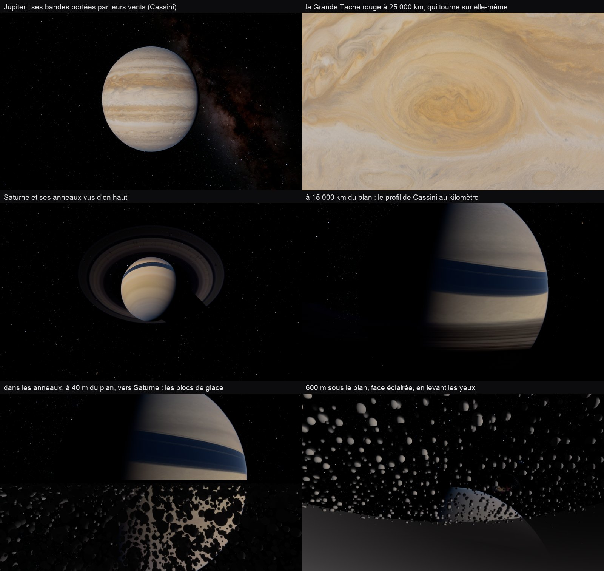
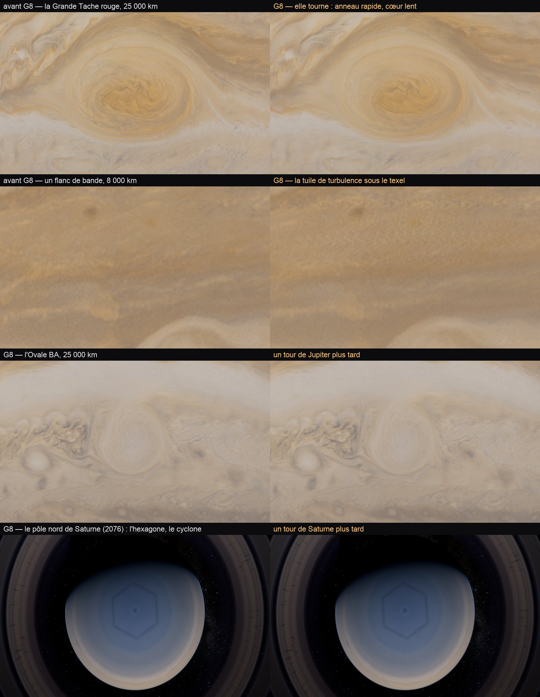

# P9 — Les géantes gazeuses et les anneaux

30 octobre 2026, ce Mac et kerr-mini. Plan : [PLAN-PLANETES-AAA.md](../../PLAN-PLANETES-AAA.md). Décisions : les vents et
une turbulence de près ; le profil fin des anneaux et leurs blocs de glace de près ; Jupiter et Saturne d'abord.

## Le constat de départ (P0)

- Jupiter et Saturne étaient des cartes fixes : leurs nuages ne bougeaient pas, la scène avançant ou non.
- Les anneaux de Saturne avaient leur diffusion physique (deux lobes, le pic d'opposition, l'ombre de la planète, leur
  lumière sur la nuit), mais leur profil radial tenait en 2 048 texels : 35 km le texel, ni annelets ni bords nets de près.
- Saturne était au-dessus du budget (163 % de la Terre en orbite, 161 % en ciné) ; ses vitrines montraient Gargantua par le
  trou de ver, et des anneaux par la tranche.

## Ce qui est fait

- **G1 — les vents zonaux** (`trace.wgsl giantFlow`) : chaque latitude glisse vers l'est à son vent — les profils de
  Cassini, approchés tous les 2,5° : les jets alternés de Jupiter (170 m/s à 24° N), le grand jet équatorial de Saturne
  (450 m/s), en Système III. La carte est lue deux fois, à deux phases d'un cycle de 10 heures de temps de jeu décalées
  d'un demi-cycle, fondues : elle ne s'étire pas sans fin.
- **G2 — la turbulence de près** : la Grande Tache rouge tourne sur elle-même (un anticyclone : dans le sens inverse des
  aiguilles d'une montre au sud, ~6 jours à son bord, son cœur plus lent) ; sous le texel de la carte, un écoulement
  procédural déplace sa lecture d'un texel ou deux, à mesure que l'empreinte du pixel le résout.
  - Ce mouvement n'est calculé que là où l'on dessine les disques (`planetShade`), et seulement dans les noyaux qui
    peuvent montrer une géante en grand (pas ceux des sondes, de la Terre, des mondes sans air ordinaires, de Vénus) : il
    avait débordé les budgets de 18 noyaux, copié dans chaque appel de `planetAlbedo`.
- **G3 — le profil fin des anneaux** : l'occultation radio de Cassini du 3 mai 2005 (Rev 7, bande X, PDS Ring-Moon Systems
  Node, CORSS_8001), sa profondeur optique reconstruite au kilomètre, rangée kilomètre par kilomètre de 69 800 à 140 900 km
  (`scripts/build-ring-profile.py` ; anneau C 0,21, B 2,74, division de Cassini 0,25, A 0,87). Elle est dans les tables du
  traceur (`TABLE_RING`, 284 Ko, aucune liaison de plus) et prend le relais de la carte quand l'empreinte du pixel
  descend sous son texel de 35 km.
- **G4 — les sillages et les rayons** (`ringDetail`) : l'opacité de l'anneau A varie avec l'angle de vue (les amas inclinés
  de ~20° sur l'orbite : ±30 %, l'asymétrie mesurée par Cassini et Hubble) ; sur l'anneau B, des rayons de poussière
  allongés radialement tournent avec le champ de la planète (10,66 h) — clairs à contre-jour, sombres vers le Soleil.

- **G5 — les blocs de glace de près** (`ringBlocks`) : à moins de 20 km du plan des anneaux, au-dessus d'eux, le renderer
  ancre leur repère au mètre près (`P.fine0` à 2, `P.fine1` : l'ancre du sol fin des mondes sans air, libre sur Saturne)
  et le rayon traverse une nappe de ±15 m dans trois grilles — des cellules de 4 m jusqu'à 120 m, de 16 m jusqu'à 500 m,
  de 64 m jusqu'à 2 km : au loin, les petits blocs sous le pixel, les gros seuls. Un bloc au plus par cellule, ses chances
  tirées de la profondeur optique de Cassini à ce rayon ; éclairé par le Soleil à travers la nappe au-dessus de lui, dans
  l'ombre de Saturne ou non, avec la lumière de Saturne sur la face qui la regarde. Au-delà de 2 km, la nappe moyenne. Il
  vit dans le noyau 2 (Mars et les géantes, la clé des noyaux n'ayant plus de genre libre) : Mars n'en paie rien.
- **G6 — les vitrines de Saturne** :
  - le banc cherchait une scène « Saturn: from orbit » qui n'existe pas : la scène d'avant restait, Gargantua et le trou de
    ver mesurés comme l'orbite de Saturne (P0 et les A/B jusqu'ici). Il prend « Saturn: the rings from above » ;
  - « Saturn: backlit » : dans l'ombre de Saturne, 35° au-dessus du plan des anneaux, plus près (420 000 km) — ses anneaux
    vus par derrière, et non plus par la tranche.

- **G8 — l'écoulement hybride** (le plan modifié le 30 octobre ; il remplace les tourbillons fBm de G2). Chaque échelle a
  son outil, et l'aspect reste une pure fonction du temps : la même date, les mêmes nuages (saut de date, réseau, e2e).
  - **La tuile de turbulence** (`src/system/giant-tile.ts`, G8a) : un écoulement 2D sur plan β — la rotation qui fait les
    jets et les tourbillons —, en tourbillon / fonction de courant sur un carré périodique de 128², pseudo-spectral (FFT de
    128 points en mémoire partagée, quatre passes par pas, désaliasé aux 2/3, Adams–Bashforth 2, filtre spectral d'ordre
    8). Quatre jets forcés (U0 sin 4y), instables (U0 n² > β), s'enroulent en tourbillons et en filaments à leurs flancs.
    Depuis une graine fixe, 200 pas d'amorce puis une fenêtre de 128 images ; chaque texel garde le **déplacement intégré**
    depuis le début de la fenêtre (une intégrale de la vitesse : ni étirement ni pulsation, ni divergence), moins la dérive
    zonale de sa ligne (les vents restent ceux de G1), un **colorant** transporté et la vorticité.
  - **Sa place** : le 7ᵉ calque de `mapHi` prévu au plan est impossible — ce tableau est compressé (BC7 ou ASTC, sRGB) sur
    les Mac, kerr-mini et kerr-pc : ni rendu ni calcul dedans, un déplacement abîmé par blocs et par le décodage sRGB. La
    tuile prend donc la seconde moitié de la texture de bruit 3D (`noiseTex`, liaison 24, `rgba16float`, déjà cuite au
    démarrage) : 128 × 128 × 260, les bruits dans les tranches 1 à 128 entre deux gardes, la tuile de 131 à 258 entre les
    siennes ; le temps est sur z, le filtrage matériel l'interpole. Aucune liaison ni aucun palier de textures de plus,
    +16 Mo de mémoire GPU. `dnoise` et `cloudNoise` (les nuages de la Terre, le disque) ramènent leur z sur leur moitié,
    écrit dans l'expression même : leurs noyaux n'ont pas grossi d'une ligne.
  - **Sa cuisson** : sur le GPU, une fois, la première fois qu'une géante est à portée de ses cartes fines.
  - **Sa lecture** (`giantTurb`, G8b) : trois échelles, de périodes 16, 3 et 0,6 texels de la carte (des tourbillons d'un
    texel, d'un cinquième, d'un vingt-cinquième) ; la grande renouvelée avec les phases des vents (10 h), les autres 4 et
    16 fois plus souvent (les petits tourbillons tournent plus vite), chacune par ses deux phases fondues (les textures
    advectées de Neyret) et un décalage tiré à chaque cycle. Posée sur des bandes de 6° de latitude — chacune son nombre
    entier de périodes autour de la planète, fondues à leurs bords —, sur un plan polaire près des pôles ; sa place
    déformée d'une demi-période par un bruit lent pris sur la sphère (une lecture de la première moitié de la texture) : sans
    elle, ses jets roulés en rangées d'« écailles » trahissaient la répétition à 8 000 km. Son intensité suit le
    cisaillement des vents, lissé entre les nœuds de la table (0,25 au cœur des bandes, 1 aux flancs des jets) ; elle s'allume sous le texel de la
    carte, chaque échelle quand ses tourbillons font deux pixels — jamais depuis l'orbite —, et se fige (sa fenêtre au
    milieu) quand le temps va plus vite que ~1 000 ×.
  - **Deux défauts de G1–G2 trouvés en chemin** : de près, sous leur air, Jupiter et Saturne sont dessinées par
    `otherGround` (le sol des mondes à air, celui de Mars), qui lisait la carte fixe — leurs nuages ne bougeaient que vus
    de loin, en disque (`planetShade`) ; et l'empreinte du pixel venait de `mapLod()`, borné au texel de la carte
    grossière (220 km sur Jupiter) : sous la carte fine (55 km), les tourbillons de G2 ne s'allumaient jamais. `giantAlbedo`
    sert maintenant aussi `otherGround` (dans les seuls noyaux où une géante peut être le corps proche : le genre 2, celui
    de Mars, qui en porte la copie sans jamais la prendre), et lit l'empreinte du pixel elle-même.
  - **Les tourbillons nommés** (G8c), dans `giantFlow` : la Grande Tache rouge (22° S, 126,4° E de la carte), son anneau
    rapide à 180 m/s sur son grand côté (Wong et al. 2021, HST 2009–2020), ~3,4 jours pour un tour, son cœur plus lent
    (en r²) ; l'Ovale BA, trouvée dans la carte à 32,1° S et 57,7° W, 135 m/s à son bord (Hueso et al. 2009) — deux
    anticyclones, qui tournent dans le sens inverse des aiguilles d'une montre au sud. Leur intérieur ne suit plus le vent
    zonal (leur dérive en Système III, quelques m/s, est nulle sur une phase), et la tuile se calme dans leur cœur.
    Sur Saturne, le cyclone polaire nord (son jet ~150 m/s vers 88° N, vers l'est) et l'**hexagone** — une onde de Rossby de
    nombre 6 sur le jet de 76° N planétocentrique, fixe en Système III à sa dérive près (+0,0128°/jour, Sánchez-Lavega et
    al. 2014) : la matière suit ses côtés. La carte de Saturne n'en montre ni l'un ni l'autre : le traceur les dessine — une
    allée sombre le long du jet, l'œil du cyclone et son anneau clair.

## Mesures

- **e2e `giants-flow` sur kerr-mini** : 4 sur 4 — Jupiter depuis l'orbite, sa Grande Tache depuis 25 000 km à son midi,
  Saturne depuis l'orbite et ses anneaux depuis 15 000 km au-dessus de leur plan, chacun à un tour d'écart (la même face
  sous le même Soleil : seuls ses nuages, ses rayons ont bougé — 0,24 à 1,31/255 d'écart moyen). Aucune erreur GPU.
- **A/B sur kerr-mini** contre 3719a912 (G1–G4), en ms : Jupiter orbite 20,0 → 21,1 (la Terre 20,7) ; la Terre et la Lune
  inchangées.
- **A/B contre f623e717** (G5, G6 ; deux tours) : Mars inchangée (orbite 23,6 → 23,5, bas 37,2, ciné 36,7 → 36,8) — les
  blocs dans son noyau ne lui coûtent rien —, Jupiter 22,0 → 21,8, la Terre inchangée.
- **Le vrai coût de Saturne en orbite**, mesuré enfin sur sa scène : **59,7 ms** (la Terre 21,0), avant comme après G5.
  Sa vitrine à contre-jour : 64,7 ms (la Terre 39,9 ; la scène a changé, sans comparaison).
- **e2e `giants-flow`** avec les blocs : 7 vues ; les trois vues dans les anneaux ancrées, 18 à 24 % de leur milieu
  éclairé par des blocs.

- **G8, A/B sur kerr-mini contre 858b10eb** (deux tours, médianes, ms) : Jupiter orbite 21,2 → **20,5**, de près (la
  Grande Tache à 25 000 km, la tuile allumée) 20,1 → **19,5** — plus rapide qu'avant alors que ses nuages bougent enfin
  de près : la table des vents passée dans les tables du traceur (un tableau constant indexé à l'exécution était recopié
  à chaque appel) et une seule lecture d'albédo par pixel (`planetAlbedo` ou `giantAlbedo`, plus l'un puis l'autre) ;
  Saturne orbite 59,0 → 58,5, ciné 63,8 → 64,0 ; la Terre (orbite 20,3 → 20,2, bas 39,9 → 39,2, ciné 39,7 → 38,9) et
  Mars inchangées. Un premier A/B, avant ces deux corrections, donnait Jupiter +4 à +8 % et Saturne +3 % ; la Lune y était
  inchangée.
- **La cuisson de la tuile** : 24 à 28 ms de GPU sur ce Mac, 30 à 36 ms sur kerr-mini (horodatages GPU), une fois.
- **e2e `giant-tile`** (kerr-mini, ce Mac) : deux cuissons identiques au bit ; en début de fenêtre |div|/|rot| 0,04 et
  |J − 1| 0,002 (plus tard la carte se replie sous la grille de 128² : 0,3 puis 0,6, consigné) ; les bruits lus comme
  avant à 5,6·10⁻⁴ près, à travers le raccord de z ; aux bornes de phase un saut de 1 à 2·10⁻⁴ contre 0,1 à 0,4 un quart
  de période plus loin ; l'horloge rapide : 0 d'écart.
- **e2e `giants-flow`** (kerr-mini, 11 vues) : chaque vue à un tour d'écart bouge (Jupiter orbite 0,47, la Grande Tache
  0,76, l'Ovale BA 0,34, le pôle de Saturne 0,77/255) ; la Grande Tache revenue à sa date après le saut : **0,000/255**
  — même date, même image.
- **Les noyaux** : la Terre inchangée à la ligne près ; le noyau 2 (Mars et les géantes) +0,5 % (la copie de
  `otherGround`), les autres plus petits. `kernel-budget` vert.

## Limites

- **Saturne coûte 2,8 fois la Terre en orbite** (59,7 contre 21 ms) : à optimiser (la lumière de ses anneaux sur la
  planète — dix lectures d'anneau par pixel —, leur ombre, leur profil).
- **Les blocs sont des sphères**, assez régulières ; leur nappe s'arrête net à 2 km dans la vue rasante.
- **À cette date, le Soleil est bas sur le plan des anneaux et éclaire leur face sud** : vus du nord, ils sont sombres.
- Uranus et Neptune : sans carte fine ni vents (décision : plus tard).
- **G8** :
  - la tuile fait 128² (la texture de bruit) : son détail vient de ses trois échelles ; tout près (3 000 km), un voile
    marbré plutôt que des filaments nets ;
  - la position des tourbillons nommés ne suit pas leur dérive sur des années : la carte (2018) les porte à leur place
    d'alors ; les déplacer laisserait leur fantôme dans la carte (il faudrait les en retirer). Sur une phase, leur dérive
    en Système III (quelques m/s) est nulle ;
  - l'orientation de l'hexagone n'est pas mesurée ici (la carte de Saturne n'en a pas) : une référence choisie, plus sa
    dérive publiée ;
  - le pôle nord de Saturne est dans sa nuit d'hiver en 2067 (le Soleil ~11° au sud) : l'hexagone se voit en 2076.

## In English (G8)

The giants' hybrid flow (PLAN-PLANETES-AAA P9 G8). A 2D β-plane turbulence tile (vorticity–streamfunction, pseudo-spectral,
128², jets forced and rolling up) is baked once on the GPU (~30 ms) into the second half of the 3D noise texture — the
planned 7th layer of `mapHi` is impossible: that array is BC7/ASTC-compressed sRGB. Each texel holds the integrated
displacement since the window's start (no stretching, no divergence), a dye and the vorticity; time runs along z, so the
hardware interpolates it. `giantTurb` reads it at three scales below the map's texel, each renewed by its own two phases
(Neyret's advected textures), laid on 6° latitude bands, warped by a slow noise on the sphere so its lattice never shows,
strengthened by the winds' shear, held still when time runs faster than ~1,000×. Named vortices turn on measured speeds:
the Great Red Spot (180 m/s ring), the Oval BA (135 m/s), Saturn's polar cyclone and its hexagon, which the tracer draws
since the map has none. Two G1–G2 defects surfaced: near the giants (under their air) `otherGround` read the fixed map, so
their clouds only moved as distant discs; and the footprint came from the clamped `mapLod()`, so nothing below the finer
map's texel ever switched on. Everything is a pure function of the date: the same date gives the same image (0.000/255
after a jump there and back). Cost: Jupiter 21.2 → 20.5 ms in orbit, 20.1 → 19.5 ms close; Saturn, the Earth and Mars
unchanged.
