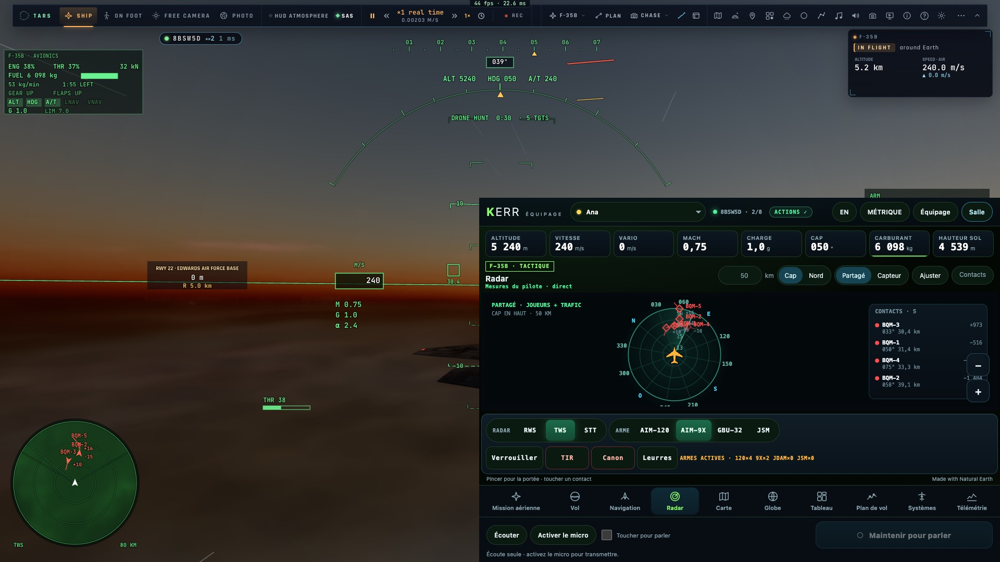

# RD0 — La sonde et le point de départ

*2026-10-21, `main` — `docs/PLAN-RADAR-AAA.md`, phase RD0 (menée avec la priorité 5 de l'audit crew).*

## La sonde

`tests/e2e/radar-sync.e2e.test.ts` monte la chasse aux drones (cinq drones hostiles) pour un F-35 dans une salle. La
console crew tourne dans un cadre de la même page, si bien qu'un même instant se lit des deux côtés.

- Elle **mesure** les critères sans les exiger : les chiffres sont le point de départ de chaque phase.
- Elle écrit `remote-results/radar-sync.json`.
- Elle échantillonne à chaque image, pendant 30 s :
  - **côté pilote**, sa place et les cibles du combat autour de lui (est, nord dans le repère du combat) ;
  - **côté crew**, sa place dessinée et ses contacts (`model.contacts()`), positionnés par WGS84
    (`wgs84Inverse`).
- Elle tient compte des écarts du sol au bord : à 30 km, le repère plat du combat et l'ellipsoïde divergent de quelques
  mètres seulement, bien en dessous des écarts mesurés.

## Les mesures du 2026-10-21 (avant RD1), sur kerr-mini

| # | critère | mesure | objectif |
|---|---|---|---|
| P1 | même image (liste Capteur crew contre pistes radar du pilote) | 26 écarts sur 6 064 pistes·images (0,43 %) | 0, hors pistes de moins de 300 ms |
| P2 | même place | p50 **94 m**, p95 **170 m** ; 0,16 % sous la tolérance | p95 ≤ 25 m + 0,05 s × vitesse (≈ 35 m) |
| P3 | pas de saut | 60 sauts sur 6 695 pas (0,9 %) | 0 |
| P4 | pause et accéléré | en pause, les contacts **dérivent de 18,8 m** en 3 s ; à ×4, vitesse ×4,03 | 0 m ; ×4 |
| P5 | mêmes symboles | 5 fichiers avec leur propre palette IFF, pas de `radar/symbols.ts` | une seule symbologie |
| P6 | toutes les pistes | 8 pistes (`game/sites.ts`), pas de base mondiale | OurAirports |
| P7 | coût | non mesuré par la sonde (trace-ab) | ±1 % |
| P8 | débit | plus gros événement `instruments` : 7 785 caractères ; 22 Ko/s | ≤ 16 384 ; ≤ 48 Ko/s |
| P9 | missiles et leurres | 2 leurres en vol, **0 au crew** (le tir de la sonde partait sans verrou : corrigé pour la suite) | tous, sur tous les écrans |
| P10 | sélection | un toucher crew ouvre un menu ; aucun clic sur les radars du pilote | sélection partagée |
| P11 | zoom | molette crew continue (×0,91 par cran), pas de pas communs | un cran = un pas |

D'où viennent les écarts de P2 et P4 :

- le crew place son propre avion sur le dernier instantané reçu (4 Hz), sans prédiction ;
- les cibles du combat n'arrivent qu'une fois par seconde, avec le reste des environs ;
- elles sont prolongées en temps local, pas en heure de salle, et continuent donc pendant une pause.

