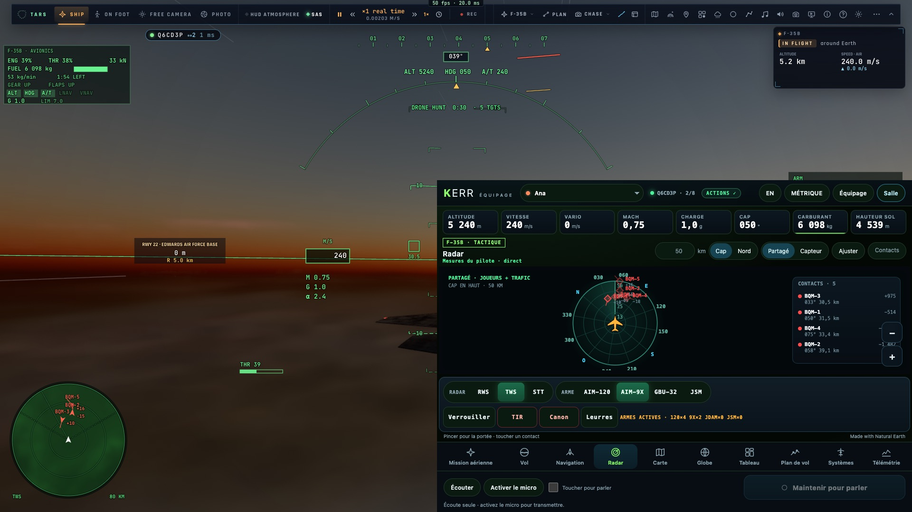

# RD1 — Les correctifs immédiats (côté crew) et le minimum réseau de l'audit

*2026-10-21, `main` — `docs/PLAN-RADAR-AAA.md` RD1, menée avec la priorité 5 de l'audit crew.*

## Ce qui est fait

- **Les pistes triées avant la coupe**, le **camp réel** des cibles, les **cibles du combat en mission** : faits en
  priorité 1 de l'audit (constats 2, 3, 5).
- **Le combat toutes les 250 ms** : le nouveau bloc `tracks` de l'instantané (`ui/crew-feed.ts tracksOf`) porte, à
  chaque envoi :
  - les cibles du combat, unités de mission comprises, avec leur vitesse et leur cap. Leur id est stable (`f:<id>` du
    combat, et non plus leur rang dans la liste) ;
  - **les missiles en vol** et **les leurres vivants** (constats 7 et 25 ; premier pas de RD8).

  Avant, ces cibles venaient une fois par seconde, sans vitesse : figées, puis elles sautaient.
- **Leur place juste** : le décalage de notre plan tangent (est, nord) passe sur l'ellipsoïde par le problème direct
  de la géodésique (`wgs84Direct`), plus par un décalage plat en latitude et longitude. Celui-ci tournait de la moitié
  de la convergence des méridiens : 89 m d'erreur à 37 km au-dessus des Alpes (constat 4, mesuré par la sonde).
- **L'heure de salle** (constat 8) : la console prolonge chaque contact du temps de salle écoulé depuis son envoi
  (`net.roomNow() − t`). En pause, rien ne bouge ; en accéléré, tout va plus vite d'autant.
- **Le virage** : le taux de virage d'un contact vient de ses deux derniers caps envoyés. Il est prolongé sur cet arc
  (±0,5 rad/s au plus).
- **Pas de saut** (P3) : une nouvelle place est prise en 0,2 s. Ce qui était dessiné est gardé en décalage, qui
  s'efface ; au-delà de 2 km, c'est un vrai saut, pris tout de suite.
- **Les joueurs à leur place prédite** (constat 9) : la console place chaque pilote, dont le sien, par la prédiction
  de sa piste (`remotes.track(slot).at(roomNow)`), comme le font les pages des pilotes. Elle ne prend plus le dernier
  échantillon brut.
- **Les événements sous la limite du serveur** (16 384 caractères ; au-delà, il les jette en silence) :
  - `NetClient.event` refuse un événement trop long et le compte (`net.sent.oversize`, `lastOversize`) ;
  - `fitSnapshot` allège l'instantané avant l'envoi : il coupe le trafic de moitié, puis les corps, les trajectoires,
    les autres vaisseaux, le chemin vers Gargantua, la prédiction, la route, le trafic, et enfin le combat
    (`netsession.crewCut` compte les instantanés allégés).
- **La reconnexion garde le pilote suivi** : la console le retrouve par son appareil (`member.device`), après sa
  reconnexion comme après celle du pilote.
- **Le passage des commandes** (N3) : à `helm` (ou `board` avec `gone`) venant du pilote suivi, la console suit le
  vaisseau, piloté désormais par celui qui a pris les commandes, et l'annonce.
- **Missiles et leurres sur les écrans crew** : un dard dans l'axe de la route pour un missile (le nôtre cyan,
  l'ennemi rouge), une étoile orange pour une fusée, un nuage de points pour des paillettes. On les voit au radar
  (Partagé et Capteur), au ND, sur la carte et dans la liste des contacts.

## Pas faits dans cette phase

- **Côté pilote** : le code mort du scope du HUD (15), `netRadar` calculé et dessiné nulle part (19), et `radarHud`
  calculé deux fois par image (18). Ce sont les écrans du pilote, que RD2 (l'image tactique unique) remplace ; je ne les
  ai pas touchés sans la mesure A/B de coût qui va avec.

## Mesures (sonde `radar-sync`, kerr-mini)

| # | RD0 | après RD1 | objectif |
|---|---|---|---|
| P1 même image | 0,43 % d'écarts | 0,26 % | 0 |
| P2 même place | p50 94 m, p95 170 m, 0,2 % dans la tolérance | **p50 3,4 m, p95 53 m, 90 %** dans la tolérance (place propre 2,5 m, contacts 1,5 m) | p95 ≤ 25 m + 0,05 s × v |
| P3 pas de saut | 0,9 % | **0** | 0 |
| P4 pause | 18,8 m de dérive | **3 mm** ; ×4 : ×3,96 | 0 ; ×4 |
| P8 débit | 7 785 car. max, 22 Ko/s | 7 763 car., 24 Ko/s ; trop long : allégé, compté | ≤ 16 384 ; ≤ 48 Ko/s |
| P9 missiles et leurres | 0 au crew | **3/3** (un AIM-120, deux leurres) | tous |

Le reste de P2 (p95 53 m) vient des virages serrés et des accélérations entre deux envois, à 4 Hz. L'image unique
(RD2, RD5) le traitera.

`tests/crew-radar.test.ts` (4) :
- l'heure de salle (immobile en pause, plus loin en accéléré) ;
- la nouvelle place prise sans saut ;
- missiles et leurres lus ;
- la reconnexion et le passage des commandes ;
- l'allègement et le refus des événements trop longs.

e2e verts : `radar-sync` 4/4, `net-crew` 2/2 (avec la console qui suit la passation des commandes et se reconnecte),
`crew-actions` 6/6, `crew` 7/7, `crew-en` 4/4, `crew-space` 3/3, `crew-demo-space` 2/2, `crew-aar` 3/3.

