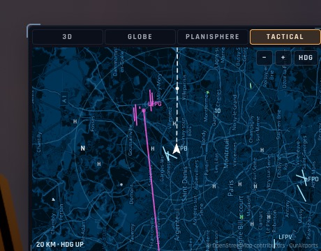

# RD11 — Les terrains du monde sur les radars et les cartes

*2026-10-21, `main` — PLAN-RADAR-AAA.*

**Un dessin commun** (`src/world/runwaydraw.ts`, pur, jeu et crew) :
- **loin** : un point, cerclé pour un grand aéroport, ou un H pour un héliport ;
- **plus près** : chaque piste en trait entre ses seuils, à sa largeur dès qu'elle se voit, en tirets si elle est
  reconstruite ;
- **de près** : son contour, son axe et ses deux numéros.

La couleur suit la surface (revêtue cyan clair, herbe verte, terre ocre, eau bleue, neige blanche). Les codes sont
posés sans se chevaucher. Les terrains du plan de vol sont en magenta. Le niveau de détail suit la portée affichée
(`fieldShown`, PLAN-RADAR §5).

**Où** :
- **la carte tactique** : les terrains du monde à la place des 8 sites. Un clic sur un terrain ouvre sa fiche : codes,
  nom, ville, altitude, chaque piste (numéros, longueur, surface, balisage, ≈ si reconstruite) et deux boutons,
  « Direct » et « Ajouter au plan » ;
- **le TSD du PCD** : les terrains à 200 km, au niveau de détail de sa portée ;
- **le scope du radar du HUD** : les grands terrains, puis les pistes quand elles se voient ;
- **le crew** : sa carte (et les grands aéroports sur le globe) et son ND, avec les tuiles lues en `../runways/`.

**Avancé de RD13** : n'importe quel terrain du monde entre dans le plan de vol par son code (OACI, ident local,
IATA). L'outil `flight_plan add` le cherche dans la base mondiale si ce n'est pas un des 8 sites, et lui donne sa
plus longue piste revêtue pour la descente.

**Reste** : la carte de mission et la trace au sol (cartes secondaires), et RD13 : la 3D aplanie, l'ILS et
l'autopilote sur toutes les pistes.

**Vérification** : e2e `jetmap` sur kerr-mini, 5/5 :
- au-dessus de Paris, LFPG et LFPB sur la carte ;
- la fiche de LFPG (08L/26R 4 215 m revêtue et balisée…), LFPG ajouté au plan ;
- KSFO ajouté par son code (37,62° N, piste 118°).

