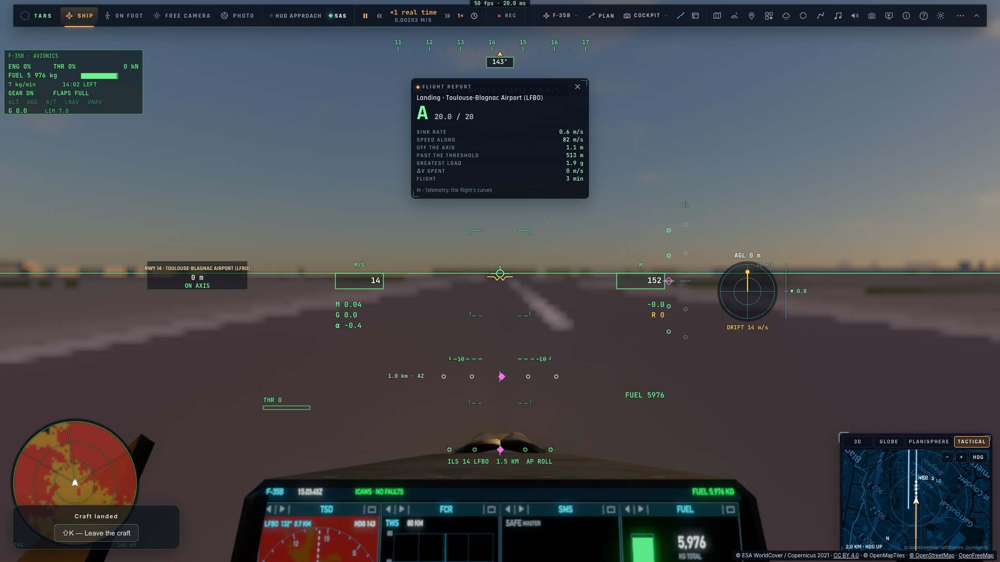

# RD13 — Les pistes du monde utilisables : en 3D aplanies, l'ILS, l'autopilote, partout

*2026-10-21, `main` — PLAN-RADAR-AAA, décisions du 2026-10-21 (« 3D + ILS + autopilote ») et consignes de l'utilisateur en
cours de route : « les nouvelles pistes aplanies comme les autres », « que ça marche partout : radar, cartes, HUD et
assistances, pilote auto et crew ».*

## En 3D, aplanies comme les 8 sites (`src/world/runways3d.ts`)

Toutes les 1,5 s, les 24 pistes terrestres les plus proches de l'œil (25 km) deviennent des pistes du jeu
(`sites.ts setWorldRunways`). Elles sont traitées comme les 8 sites :
- **l'aplanissement**, le même côté jeu (`runwayGrade`) et côté shader (`trace.wgsl runwayGrade`) : le train d'atterrissage
  et l'œil voient le même sol ;
- **le niveau de chaque piste** : la médiane du relief nu sous elle (onze points de son axe), comme les 8 sites (A7).
  Pendant la mesure, la piste est laissée hors de l'aplanissement. Le niveau est mesuré à son arrivée, puis à 5 s et à
  20 s, le temps que les tuiles plus fines arrivent. Sur LFBO, il donne 151,2–151,3 m, l'altitude officielle étant de
  152 m ;
- **l'étendue de l'aplanissement** : sa demi-largeur plus 100 m de chaque côté (adoucie sur 200 m) et 300 m au-delà
  des bouts. Les 8 sites, eux, aplanissent 320 m de chaque côté pour leur taxiway et leur tablier synthétiques ;
- **le dessin** (le 4ᵉ mot de chaque piste porte des drapeaux) :
  - une piste revêtue a ses marquages, et ses feux et son PAPI si elle est balisée ;
  - une piste en herbe, terre ou neige est une bande sans peinture ;
  - les hydrobases ne sont ni aplanies ni dessinées ;
  - aucun taxiway, tablier, terminal ou manche à air n'est inventé : le décor de l'aéroport est le sien ;
- **le décor** est tenu à l'écart de la bande (exclusions de la scène).

Bug trouvé en route : la mesure du niveau prenait la latitude **géocentrique** au lieu de la latitude géodésique
WGS84. À 43° N, l'écart est de 0,19°, une vingtaine de kilomètres : chaque piste était nivelée à l'altitude d'un
endroit à 20 km.

## L'ILS et l'autopilote

- **L'ILS** accepte n'importe quel terrain par son code (`ilsStart("LFBO")`) ou le plus proche dans 150 km, sur sa plus
  longue piste revêtue de 1 800 m ou plus, à sa vraie longueur. Il suit le niveau mesuré de la piste.
- **L'approche** : elle restait à 1 000 ou 1 300 m puis remettait les gaz en boucle. Dans l'axe, l'ILS vise
  maintenant juste sous le plan, là où il se trouve, pour le capter par-dessous ; plus loin que le repère initial, il
  vise sa hauteur (985 m) ; arrivé au-dessus du plan, il le rejoint par le haut.
- **Le HUD d'approche** (contour, axe, PAPI, portes, fiche de la piste) et l'écran d'approche du cockpit voient la piste
  de l'ILS en cours et les pistes revêtues du monde proches, à leur vraie longueur.

## Partout (recensement de 60 usages des 8 sites, 16 à corriger)

- **mise en piste, mise en finale, clic sur une piste dessinée** : `lineUp`, `glideTo` ;
- **TARS** : la résolution d'un lieu, la requête par code, `list_places` (les terrains du monde à 300 km), le
  résolveur des missions, `prepare_flight` (le terrain est chargé d'abord) ;
- **le hub de vol** : un champ code OACI en plus des 8 terrains ;
- **le plan de vol** :
  - sa carte dessine les terrains du monde, un clic en ajoute un ;
  - un champ code OACI ;
  - ses procédures (départ, arrivée) sur une piste du monde ;
- **le retour à la base** du pilote et de ses ailiers, vers le terrain le plus proche du monde ;
- **le PCD** : son terrain le plus proche (« LFBO 132° 0,7 km ») ;
- **les cartes d'approche et l'écran d'approche du cockpit** : la vraie longueur de piste ;
- **les recherches de lieux** (panneau de placement, recherche générale) : par code ;
- **la météo réelle** : le METAR du grand ou moyen aéroport le plus proche ;
- **le crew** : sa carte, son ND et l'ILS. Ce dernier lui arrive par le bloc `ils`, et donc vaut pour toute piste.

Plus :
- **la carte tactique** : les pistes sont dessinées par-dessus la trace, pour que l'approche ne cache plus la piste
  sous l'avion ;
- **les recherches de terrains** sont mises en cache (8 i/s sinon) ;
- **le verrou de Chrome du mini** n'est plus laissé coincé après une annulation.

## Vérification

e2e `tests/e2e/world-runway.e2e.test.ts` sur kerr-mini, 2/2 (environ 4 min) :
- **LFBO** : plate de bout en bout à 151,2 m ;
- **le HUD** : il voit « LFBO 14R, 3500 m » ;
- **l'approche** : départ dans l'axe à 18 km, en finale à 6 km, sans remise de gaz ;
- **l'arrêt** : posé, arrêté à 3,4 m de l'axe ; le compte rendu d'atterrissage donne A 20/20 (1,1 m de l'axe, 0,6 m/s
  de vitesse verticale).

Tests unitaires : l'aplanissement d'une piste du monde (`runway-parity`), l'ILS, les procédures, les pistes.

