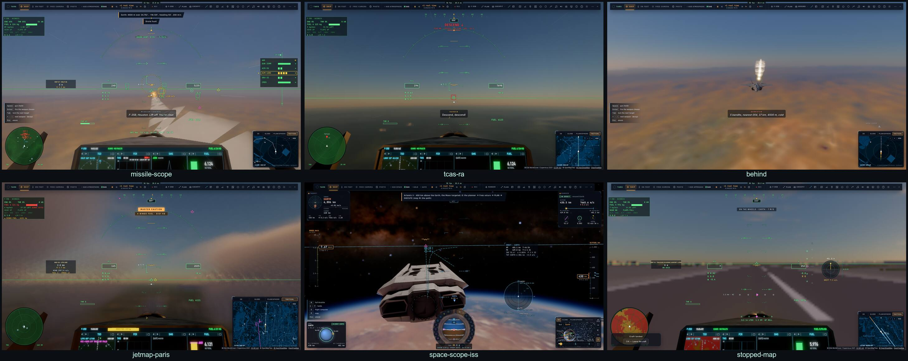

# RD14 — Clôture du plan radar

*2026-10-21, `main` — PLAN-RADAR-AAA.*

## Les critères de « parfait », mesurés

La sonde `radar-sync` vérifie maintenant chaque critère avec un seuil, au lieu de seulement imprimer les chiffres.
Mesures sur kerr-mini, pilote et crew dans la même page, 30 s de chasse aux drones :

| # | critère | mesure | seuil |
|---|---|---|---|
| P1 | même image | 0,4 % d'écarts (pistes nées ou perdues entre deux blocs) | < 2 % |
| P2 | même place | médiane 1,35 m, p95 26 m, 96 % dans 25 m + 0,05 s × v de la place chez le pilote | > 95 % |
| P3 | pas de saut | 0 | < 0,1 % |
| P4 | pause et accéléré | 3 mm de dérive en pause ; ×3,96 à ×4 | < 1 m ; ±0,25 |
| P5 | mêmes symboles | les 4 écrans (HUD, PCD, carte tactique, crew) dessinent par `drawSym` | tous |
| P6 | toutes les pistes | la base mondiale et ses tuiles ; LFPG, KJFK, EGLL, herbe, hydrobase en unitaire ; LFBO posé en e2e | — |
| P7 | coût | **écarté** : l'A/B contre le commit de départ n'est pas fait, à ta demande | — |
| P8 | débit | 6,7 Ko par événement au plus, 20 Ko/s | ≤ 16 Ko ; < 48 Ko/s |
| P9 | missiles et leurres | 3/3 au crew (un AIM-120, deux leurres) | tous |
| P10 | sélection | le scope, la vue, le TSD (`radar-select`), la carte tactique et une salle (`jetmap`), le crew (`crew-actions` A6) | — |
| P11 | molette | scope du HUD 40 → 160 km, TSD 20 → 10 km, champ de la caméra inchangé (`radar-select`) ; crew 40 → 80 km par les pas du jeu | — |

**P2 avant cette phase** : la sonde comparait le crew au repère plat du combat. Or l'image place chaque cible exactement
sur l'ellipsoïde, et les deux diffèrent de 0,3 % de la distance, soit environ 60 m à 20 km. Elle compare maintenant au
pilote, comme le plan le définit.

## Ce qui a été fait pour la clôture

- **La molette sur tous les radars** (P11) :
  - au-dessus du disque du scope du HUD, un cran change sa portée d'un pas ;
  - au-dessus d'un TSD ou d'un FCR du PCD, un cran change sa portée ;
  - dans les deux cas, le champ de la caméra ne bouge pas.
- **Les anciens blocs retirés du flux** : avec l'image compacte, la liste radar, le combat (`tracks`) et le trafic de
  `traffic` ne partent plus. Restent les unités de mission et les zones. Ce qui les lisait passe à l'image :
  - la liste Capteur du crew ;
  - les e2e `crew-actions` et `radar-sync`.
- **Le type d'un objet** (« A330 MRTT » pour le ravitailleur, le type d'un avion de ligne, d'un porte-avions) passe
  par l'image, que le crew lit.
- **La docs** :
  - `docs/RADAR.md` (anglais) et `docs/RADAR.fr.md` ;
  - les sections radar de `F35.md`, `F35.fr.md` et `CREW.md` ;
  - `BH-API.md` (`__bh.radar.scope()`, `camera.tcas`, `camera.spacePic`, `radarSources`) ;
  - une section radar dans `E2E-CATALOGUE.md`.

## La campagne e2e sur kerr-mini

19 fichiers lancés, avec les captures de la planche :
- **17 passés au premier tour** ;
- **2 corrigés puis passés** :
  - `crew-aar` : il manquait le type du ravitailleur dans l'image ;
  - `jetmap` : à 10 km de portée, Ben était dessiné sous les boutons de la carte ; le test passe à 20 km.

| fichier | résultat |
|---|---|
| radar-sync | 4/4 |
| radar-select | 5/5 |
| jetmap | 5/5 |
| decoys | 2/2 |
| missile-cues | 3/3 |
| tcas | 1/1 |
| space-sensors | 2/2 |
| link16 | 2/2 |
| world-runway | 2/2 |
| crew | 7/7 |
| crew-actions | 7/7 |
| crew-en | 4/4 |
| crew-aar | 3/3 |
| net-wing-fight | 3/3 |
| f35-pcd | 3/3 |
| f35-hud | 2/2 |
| f35-combat | 3/3 |
| bh-api | 2/2 |
| crew-demo-space | 2/2 |

## Ce qui reste hors du plan

- **P7**, écarté.
- **Le radar de nez du Ranger** en atmosphère, et **le radar d'atterrissage du Lander** (RD4).
- **L'image spatiale côté crew** : le crew a la cible, l'amarrage et les autres joueurs, mais pas encore les pistes
  LVLH des capteurs du vaisseau.
- **Un curseur de désignation (TDC)** à la manette et au HOTAS (constat 29).

