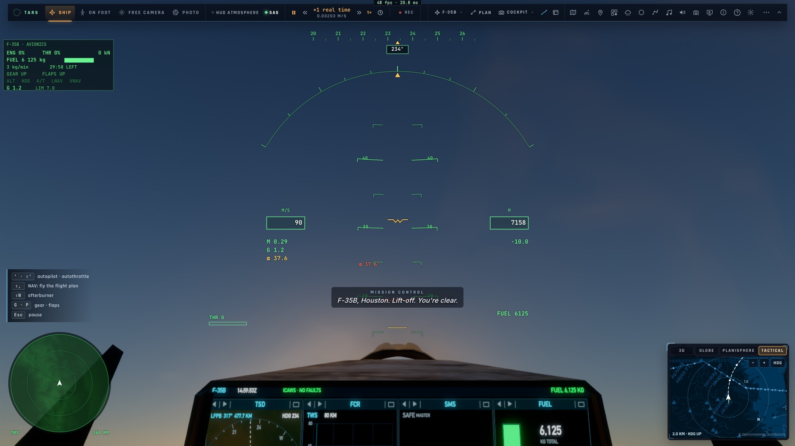

# RD15 — La mini-carte et la route de l'avion

*2026-10-21, `main` — PLAN-RADAR-AAA, décisions du 2026-10-21.*

**La carte tactique** (`src/ui/jetmap.ts`) est le panneau de droite en vol, sous l'onglet « Tactique ». Elle s'ouvre
seule la première fois que le F-35 est en l'air ; le choix du pilote est gardé ensuite. Elle reste visible dans le
cockpit du F-35 et passe en plein écran avec M.

- **Centrée sur l'avion**, elle le suit, cap en haut ou nord en haut (bouton `CAP`/`N`).
- **Le fond** : OpenStreetMap de nuit, les tuiles mêmes du crew (`crew/draw/tiles.ts`), crédit affiché.
- **La trace** de l'avion : un point par seconde sur les 15 dernières minutes, colorée par l'altitude.
- **La prédiction** de sa trajectoire : le virage en cours prolongé (taux de virage mesuré, vitesse sol, vario), en
  WGS84, sur 1,5 fois la portée affichée. Une marque chaque minute (chaque 10 s sous 10 km), son terme en minutes.
- **Le plan de vol** (magenta, point actif cerclé) et **les terrains**.
- **L'image tactique** dans la symbologie commune :
  - les pistes que tiennent les capteurs ;
  - les missiles, avec leur trait vers la cible et leur temps avant impact ;
  - les leurres ;
  - le verrou et la sélection.
- **La molette** change la portée par pas (2, 5, 10, 20, 40, 80, 160, 320 km, gardée). L'événement ne touche jamais au
  champ de la caméra.
- **Un clic** sur une piste la sélectionne (RD9) ; un clic dans le vide désélectionne.
- **La taille** se règle en tirant le coin haut-gauche du panneau. Elle est gardée et vaut pour tous les onglets.

**Les autres cartes du F-35** : le TSD montre aussi la trace (les 5 dernières minutes) et la prédiction (3 minutes, une
marque par minute). La console crew les avait déjà.

**Solo et salle** : en salle, l'autre joueur est sur la carte dès que les capteurs le tiennent. C'est une piste `net:`
(datalink) entre amis, ou la cible du combat libre une fois balayée par le radar.

Fichiers :
- la trace et la prédiction : `controller/owntrack.ts` ;
- la carte : `ui/jetmap.ts` ;
- l'onglet, la poignée et le dessin à 10 Hz : `ui/flighthud.ts` ;
- les données : `main.ts` (`jetMap`) ;
- le TSD : `f35/cockpit.ts`, `f35/pcd.ts` ;
- les styles : `style.css`.

**Vérification** : e2e `tests/e2e/jetmap.e2e.test.ts` sur kerr-mini, 4/4, en vrais événements CDP :
- l'onglet pris seul, la trace qui grandit, la prédiction ;
- la molette (portée 2 → 5 km, champ de la caméra inchangé) ;
- la poignée (282 × 196 → 414 × 292, gardée) ;
- une salle à deux, où Ben est cliqué sur la carte d'Ana.

`decoys` et `radar-select` sont repassés verts. Leurs `flyAt` avaient le cap et la vitesse inversés : ils mettaient
l'avion à 90 m/s.

