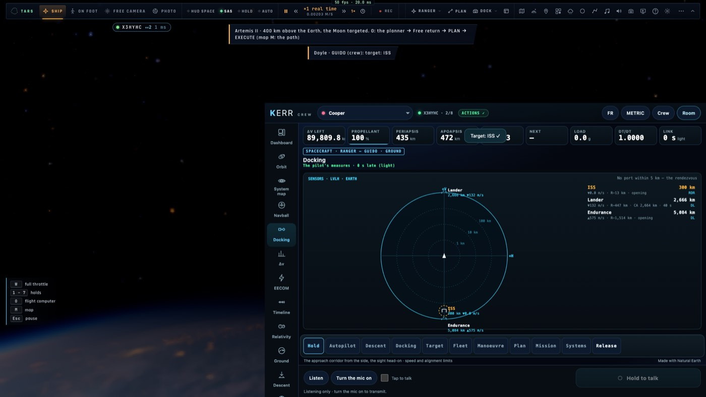

# RD4 suite — l'image spatiale au crew

*2026-10-21, `main` — reste de PLAN-RADAR-AAA (RD4 et RD14, « Ce qui reste »).*

## Ce qui est fait

- **Le bloc `spacePic`** des instruments spatiaux (`net/instruments-space.ts`), envoyé à chaque instantané (un
  rendez-vous va vite) par `ui/crew-space.ts` depuis `camera.spacePic` (`controller/spacepic.ts`) : le corps de
  référence, puis au plus 12 pistes, les plus proches d'abord. Chacune porte :
  - sa place et sa vitesse dans le repère LVLH ;
  - sa distance et sa vitesse d'approche ;
  - les capteurs qui la tiennent (radar, lidar, liaison) ; si l'astre la cache ;
  - son point de rapprochement maximal.

  La lecture est bornée (un événement de salle n'est pas sûr) : 12 pistes, les bits à trois, les lignes invalides
  écartées.
- **L'échelle du scope partagée** : `scopeRadius` et `scopeXY` passent de `ui/hud/kindhud.ts` à `radar/space.ts`
  (pur). Le scope spatial du HUD et celui du crew placent les pistes avec la même fonction.
- **La vue Amarrage du crew** (`crew/draw/lvlh.ts`) :
  - **à plus de 5 km de tout port**, où elle ne montrait qu'un message, elle dessine le scope LVLH comme le pilote : le
    V-bar en haut, le H-bar à droite, de 100 m à 1 000 km, les anneaux à 1, 10 et 100 km, la symbologie commune
    (tirets pour la seule liaison, estompé si caché, la cible cerclée en ambre). À côté, la liste : distance, vitesse
    d'approche, écart sur le R-bar, point de rapprochement, RDR / LID / LIAISON (DL en anglais) ou CACHÉ ;
  - **près d'un port**, la liste passe sous les chiffres de l'amarrage.
- **Une piste touchée** ouvre son menu (distance, vitesse, capteurs) avec **Cibler** (`nav.target`), sans « Désigner au
  pilote », qui n'a pas de sens en orbite.
- Français et anglais par `crew/lang.ts`.

## Preuves

- Tests unitaires : `crew-space.test.ts` (l'Endurance en orbite : `spacePic` relu du JSON, borné, chaque distance égale
  à la norme LVLH ; un événement hostile borné, ses déchets écartés) ; `space-picture.test.ts` (`scopeXY`,
  `scopeRadius`) ; `crew.test.ts` (le bundle du crew reste indépendant et sous son budget).
- e2e sur kerr-mini (`crew-lvlh.e2e.test.ts`, 1/1) : le vrai Ranger à 300 km de l'ISS dans une salle, la console dans un
  cadre (GUIDO). `crew: ISS about earth at 300.0 km (pilot 300.0 km), sensors 1` ; la vue Amarrage dessine le scope ;
  un vrai clic sur le symbole de l'ISS ouvre son menu, sans désignation ; **Cibler** met la cible du pilote sur l'ISS ;
  la vue en français puis en anglais.

