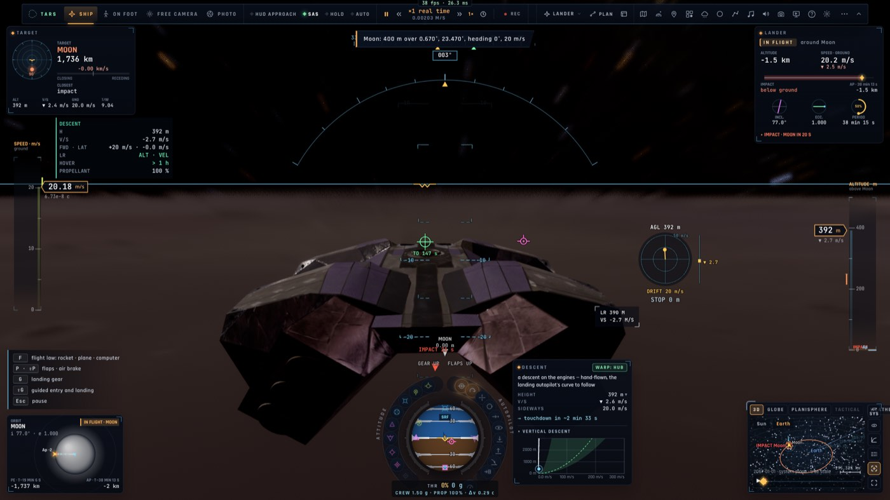

# RD4 suite — le radar d'atterrissage du Lander

*2026-10-21, `main` — reste de PLAN-RADAR-AAA (RD4, « Ce qui n'est pas fait »).*

## Ce qui est fait

- **Le capteur** (`radar/landing.ts`, pur) : un radar Doppler sous le ventre, comme celui du LM d'Apollo. Son faisceau
  d'altitude et ses trois faisceaux de vitesse sont fixés à l'engin :
  - l'altitude s'accroche sous 12 km (≈ 40 000 ft chez Apollo), les vitesses sous 7,5 km (≈ 25 000 ft) ;
  - le ventre doit regarder le sol à moins de 50° de la verticale ; posé, il est toujours accroché ;
  - il rend ses accroches (ALT, VEL), les chiffres qu'il tient (hauteur, vitesse verticale, vitesses avant et
    latérale ; `null` sans accroche) et la distance oblique le long du ventre.
- **Pas de logique en double** : ses chiffres sont ceux que les sondes de l'engin mesurent déjà
  (`controller/craftpanel.ts descentFigures`, sorti du panneau DESCENTE, qui s'en sert aussi). Le capteur ne recalcule
  rien : il dit quand ces chiffres sont mesurés. `LANDING_RADARS` le donne au Lander ; `flightInfo().landRadar`.
- **Où on le voit** :
  - le panneau **DESCENTE** du HUD (HUD spatial comme HUD d'approche) a une ligne **LR** : `ALT · VEL` en vert,
    `ALT` en ambre, sinon `PAS D'ACCROCHE · NAV` (estompé en haut, rouge sous 3 km) ;
  - **le HUD d'approche** marque sa hauteur **LR** quand l'altitude est accrochée, **NAV** (ambre) sinon, au lieu du
    **RA** d'un avion.

## Preuves

- Tests unitaires : `landing-radar.test.ts` (4 : les accroches selon la hauteur et l'inclinaison, les chiffres tenus,
  la distance oblique, la ligne LR et ses tons) ; `craftpanel.test.ts` (le Lander à 3 km au-dessus de la Lune : ALT ·
  VEL, sa hauteur celle des sondes, l'oblique égale à la hauteur à plat).
- e2e sur kerr-mini (`lander-radar.e2e.test.ts`, 1/1) : `10 km : ALT` ; `3 km : ALT · VEL, H 2992 m (sondes 2992 m)` ;
  `400 m : ALT · VEL, HUD approche` — « LR 390 M » sur le HUD d'approche.

