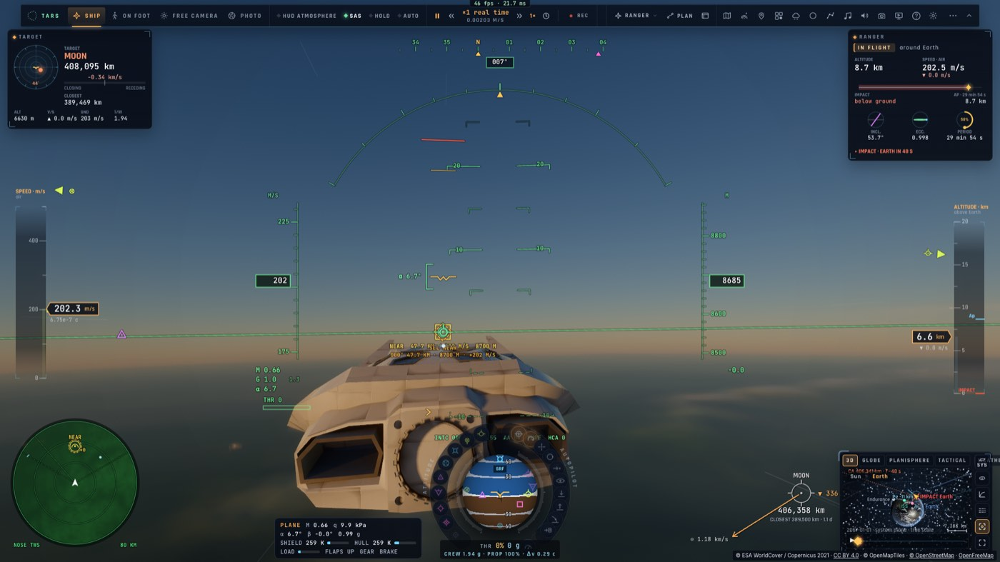

# RD4 suite — le radar de nez du Ranger

*2026-10-21, `main` — reste de PLAN-RADAR-AAA (RD4, « Ce qui n'est pas fait »).*

## Ce qui est fait

- **Sa spec** (`game/radar.ts`, `RANGER_NOSE`) : le même moteur que l'APG-81, un radar plus petit dans un nez de
  spaceplane :
  - 90 km sur un chasseur de 5 m² (60 % de l'APG-81), environ 180 km sur un avion de ligne ;
  - ±60° en gisement balayés en 2,5 s, ±30° en site ;
  - l'IFF des transpondeurs à 80 km, l'identification à vue à 3 km ;
  - **coupé au-dessus de 1 500 m/s** dans l'air : le plasma d'une rentrée (le champ `maxSpeed` de la spec).
- **Un radar par appareil** (`AIR_RADARS` : `f35` → APG-81, `ranger` → NOSE). `camera.airRadar()` donne la spec du
  radar de l'appareil piloté, en vol ; le contrôleur (`controller/radar.ts radarStep`) fait tourner le moteur avec elle
  et le remet à zéro quand on change d'appareil. Le verrou (Tab, second clic) marche aussi en Ranger. Les fonctions
  propres au F-35 (interception, patrouille, armes) restent derrière `radarFix()`.
- **Son écran** : le scope du HUD (`drawRadar`), avec son étiquette `NOSE` et ses ±60°, le relief et les terrains
  dessous. Hors du HUD spatial, il prend le coin du panneau d'orbite (`.fl-root[data-craft="nose"]`), les aides de
  touches montent au-dessus, comme en F-35. Le crew reçoit son image par le flux habituel.

## Preuves

- Tests unitaires (`radar.test.ts`, 3 nouveaux) : la portée à 60 %, un chasseur à 120 km vu par l'APG-81 et pas par
  le nez, un contact à 32° de site vu par l'APG-81 seul.
- e2e sur kerr-mini (`ranger-radar.e2e.test.ts`, 2/2) : le Ranger au-dessus des Alpes, `NOSE: near true, far false;
  HUD NOSE ±60°`, sélectionné puis verrouillé, le panneau d'orbite écarté ; puis le F-35, son APG-81 tient le lointain.

