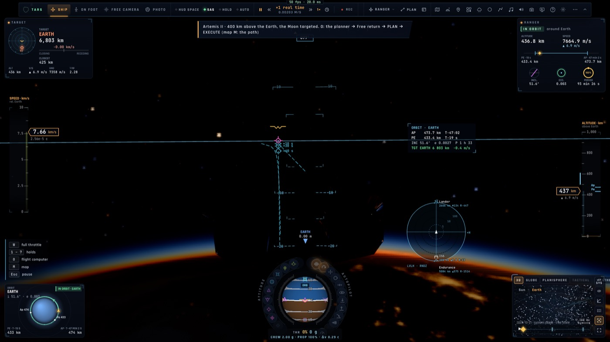

# RD4 — Les capteurs par vaisseau

*2026-10-21, `main` — PLAN-RADAR-AAA.*

## Le moteur radar générique

`game/radar.ts` reçoit une `RadarSpec` : sa portée sur 5 m², son champ, son balayage, son maintien, son encoche Doppler,
son IFF et son horizon. L'APG-81 en est une instance. Les dix tests de `radar.test.ts` sont inchangés et passent.

## Le DAS et l'EOTS, de vrais capteurs (constats 16 et 17)

- **Le DAS** voit à la chaleur, tout autour :
  - les avions à 30 km ;
  - les moteurs de missiles à 20 km, à 3 km une fois éteints ;
  - les fusées éclairantes à 10 km.
- **L'EOTS** voit à ±30° du nez, jusqu'à 60 km.
- Ni l'un ni l'autre ne donne d'IFF : une piste vue seulement par eux est inconnue.

Conséquences sur les écrans :
- **la bande DAS du PCD** dessine ce que tient le DAS, et non plus les contacts radar ni la vérité du combat ;
- **les missiles** : un missile ennemi n'est montré que si un capteur le tient. Les nôtres le sont toujours, par leur
  liaison de guidage.

## Le TCAS pour tous (`radar/tcas.ts`)

Chaque appareil en vol classe les transpondeurs alentour, avec les seuils du TCAS II à son niveau 5 :
- **proche** : à moins de 6 NM et de 1 200 ft ;
- **TA** : le point de rapprochement maximal à 40 s, ou l'intrus déjà dans le volume protégé ;
- **RA** : à 25 s, seulement sur un intrus qui se rapproche. Un ailier tenu dans le volume ne donne qu'un TA. Le RA
  demande de monter ou de descendre, à l'écart de l'endroit où passera l'intrus.
- Pas de RA sous 1 000 ft sol (300 m).

Où on le voit et l'entend :
- **les symboles** du TCAS II, dans la symbologie commune :
  - le losange, plein quand le trafic est proche ;
  - le disque ambre du TA, le carré rouge du RA ;
  - les autres camps sont cerclés dans ces couleurs.

  On les voit sur le scope du HUD (le trafic entendu par le seul TCAS y entre dès qu'il est proche), le TSD, la carte
  tactique, et la carte et le ND du crew.
- **le HUD de tout appareil** : TRAFIC, ou MONTEZ ↑ / DESCENDEZ ↓, avec la distance, l'écart de hauteur et le temps.
  L'intrus est marqué dans la vue.
- **les annonces** : « Trafic, trafic », « Montez, montez ! », « Descendez, descendez ! », puis « Fin de conflit ».
- **l'Auto-ACAS du F-35** suit le sens du RA.
- **un réglage `tcas`**, actif par défaut (Réglages › Trafic réel).

## Les vaisseaux (`radar/space.ts`, `controller/spacepic.ts`)

Cinq fois par seconde, en vol dans notre univers, chaque engin tient les engins autour de lui avec ses propres capteurs.
Les engins candidats sont l'ISS, les autres engins de la flotte et les joueurs de la salle en orbite.

Les capteurs de chaque engin :

| engin | radar de rendez-vous (sur 5 m², ∝ σ^¼) | lidar d'amarrage |
|---|---|---|
| Ranger | 120 km | 5 km |
| Lander | 80 km | 3 km |
| Endurance (veille) | 300 km | 5 km |

À ces capteurs s'ajoute le datalink : les engins de la flotte et les joueurs de la salle sont toujours connus.

Le corps de référence (la Terre, la Lune) cache un engin au radar et au lidar, jamais au datalink. Les pistes sont
données dans le **repère LVLH** de notre orbite (V-bar, H-bar, R-bar), avec la distance, la vitesse d'approche et le
point de rapprochement maximal.

**Le scope spatial du HUD** est en bas à gauche, en vue de poursuite : le HUD des vaisseaux est nu dans le cockpit, ce
sont les écrans du cockpit qui informent.
- Le V-bar est en haut, le H-bar à droite.
- La distance est logarithmique, de 100 m au bord à 1 000 km, avec des anneaux à 1, 10 et 100 km.
- Chaque piste porte son nom, sa distance, sa vitesse d'approche et son écart sur le R-bar.
- Une piste tenue par le seul datalink est en tirets ; une piste cachée par le corps est estompée.
- La cible est cerclée.

## Ce qui n'est pas fait dans RD4

- **Le radar de nez du Ranger** en atmosphère (le moteur générique le permet ; il reste à lui donner une spec et un
  écran).
- **Le radar d'atterrissage du Lander** (la hauteur et la vitesse sol existent déjà par ses sondes).
- **L'image spatiale côté crew** : elle passera par le flux compact de RD5 (le crew a déjà la cible, l'amarrage et les
  autres joueurs).

*Suite du 2026-10-21* : les trois sont faits — [le radar de nez du Ranger](RD4-ranger-nose.md), [le radar
d'atterrissage du Lander](RD4-lander-lr.md), [l'image spatiale au crew](RD4-crew-lvlh.md).

## Vérification

**Unitaires** :
- `tcas` (4 tests) : de face, le TA puis le RA ; le sens du RA ; l'ailier ; la portée ;
- `space-picture` (5 tests) : LVLH, l'ISS à 300 km, la portée et le datalink, le corps entre les deux, la Lune ;
- `radar-picture` : le DAS et l'EOTS ;
- `callouts` : les annonces TCAS ;
- `radar` : inchangé.

**e2e sur kerr-mini** :
- **`tcas`** : un avion de ligne de face, 60 m au-dessus. TA à 40,0 s, RA à 25,0 s « descendez », les trois annonces
  dans l'ordre, sur le HUD et le scope, puis proche en s'éloignant.
- **`space-sensors`** :
  - le Ranger tient l'ISS à 300,0 km sur son radar de rendez-vous ;
  - le Lander en orbite lunaire tient l'Endurance 148,6 km devant, par radar et datalink.
- `radar-select`, `jetmap`, `radar-sync` et `f35-hud` sont repassés.

