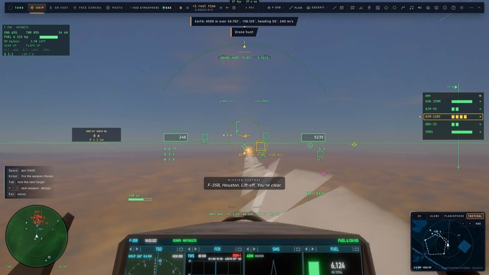

# RD8 — Les missiles et les leurres

*2026-10-21, `main` — PLAN-RADAR-AAA (RD8a, les leurres visibles, était passé avant).*

**Chaque missile est une piste de l'image tactique** (`msl:`). Elle porte :
- son autodirecteur, sa cible et le temps avant impact ;
- s'il est à nous, s'il est leurré ;
- sa fin : SPLASH ou RATÉ, montrée 3 s là où il a fini (`game/combat.ts` `end` et `diedAt`).

**Sur tous les écrans du pilote** :
- **le scope du HUD** : le trait pointillé vers la cible, le temps avant impact et LEURRÉ.
  - Les nôtres au radar affichent **PITBULL** dans leurs 15 derniers km (l'AIM-120 sur son propre radar), avec
    l'**A-pole** : notre distance à la cible à cet instant.
  - À la fin : SPLASH ou RATÉ, avec le **F-pole** : notre distance au point d'impact.
- **le TSD** : les mêmes repères, en anglais comme toute l'avionique du F-35 ;
- **la carte tactique** : la fin et LEURRÉ.

**Le crew** reçoit, sur la carte, le ND et le radar :
- la fin du missile ;
- « → NOUS » quand il vient sur le pilote ;
- LEURRÉ et le temps avant impact.

**Les leurres** :
- **une fausse piste** : en RWS, aux assistances réaliste et manuelle, une gerbe de paillettes est un écho inconnu
  pendant ses 2,5 premières secondes, comme le serait un avion ;
- **une autodestruction** : un missile qui a perdu sa cible (hors de son cône, ou son leurre éteint) s'autodétruit
  6 s plus tard, compté comme RATÉ. Avant, il pouvait voler 70 s.
- **Le temps avant impact** compte la poussée restante du moteur, environ 700 m/s. Au départ, il annonçait 4 minutes ;
  il annonce maintenant 53 s.

**En salle** (combat libre), deux corrections réseau :
- chaque page ancre son combat là où il a commencé, et les missiles et leurres d'un autre joueur arrivaient dans son
  repère à lui. L'état de combat envoyé porte maintenant la place du tireur. Le receveur replace ses missiles et ses
  leurres par rapport à l'avion de ce joueur tel que le réseau le place (`ui/netmatch.ts` `fromHere`).
- un missile tiré sur nous par un autre joueur est hostile, jamais « à nous ».

**La salle de démo du crew** (`scripts/crew-demo.ts`) joue en boucle toutes les 30 s :
- un AIM-120 sur un bandit, puis SPLASH ;
- un SA-6 sur le leader, des leurres largués, le SA-6 leurré, puis RATÉ.

**Vérification** : e2e `missile-cues` sur kerr-mini, 3/3.
- **Solo, AIM-120 sur un drone** : temps avant impact de 53 s au plus, PITBULL avec un A-pole de 34,3 km, SPLASH avec
  un F-pole de 30,6 km.
- **Solo, SA-6 sur nous** : vu sur nous à 13 s, leurres largués, sa fin dite.
- **En salle, Ana tire sur Ben à 8 km** :
  - Ana voit son missile, avec PITBULL et un F-pole de 11,7 km ;
  - Ben le voit venir sur lui à 11 s, largue ses leurres, et le missile est leurré ;
  - le crew d'Ana lit « 11s · → US 11s · LEURRÉ · RATÉ ».

`net-wing-fight` (3/3) et `decoys` (2/2) sont repassés.

