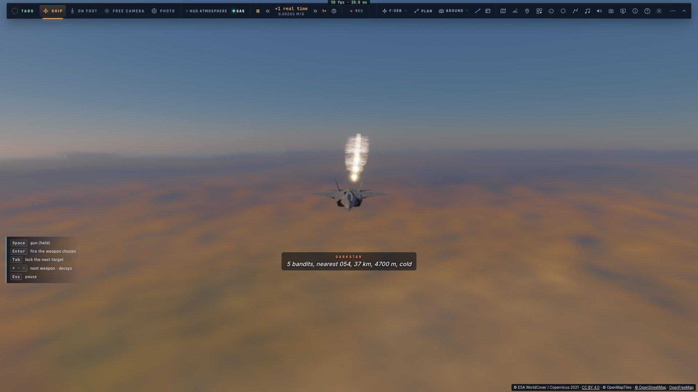

# RD8a — Les leurres visibles

*2026-10-21, `main` — PLAN-RADAR-AAA, décisions du 2026-10-21.*

**Avant** : les leurres marchaient dans la simulation. À chaque largage (−), une fusée IR et une gerbe de paillettes
vivaient 5 s et pouvaient détourner un missile dont l'autodirecteur les voyait (`game/combat.ts`). Mais ils n'étaient
dessinés **nulle part** chez le pilote : ni dans la vue, ni sur ses radars. Seule la console crew les montrait.

**Maintenant** :

| où | ce qu'on voit |
|---|---|
| vue 3D | chaque fusée est un astre brûlant (passe « halo » des lampes, `ship.wgsl lampVs`) : allumée en 0,1 s, blanche et chaude, vacillante, elle meurt sur sa dernière seconde et demie. Son halo fait au moins 16 px à toute distance et le relief ou un nuage le cache (profondeur tracée). Elle laisse une **corde de fumée blanche** (traînée, nature 5). Les paillettes donnent un **nuage gris-argent** qui s'étale (nature 6) et quelques reflets dans leurs 2 premières secondes |
| scope du HUD | étoile orange pour une fusée, nuage de points gris pour des paillettes ; les deux pâlissent en fin de vie |
| TSD | les mêmes marques, plus **les missiles en vol** (rouge s'ils nous visent), qui n'y étaient pas |
| FCR | les paillettes en écho radar ; une fusée n'est pas un écho |
| bande DAS | les fusées en points chauds |

Ce sont **les mêmes leurres partout** : les nôtres, ceux des avions de combat IA et ceux des autres joueurs en match.
Ces derniers arrivent par l'événement `cm` dans le même monde de combat, ils sont donc dessinés de la même façon,
**en solo comme en salle**.

Fichiers :
- **vue 3D** : `controller/combat.ts combatGlares`, `ship-lights.ts` (`Glare`, `MAX_GLARES` après les 8 lampes),
  `ship.wgsl` (les éclats dans le repère caméra), `contrails.ts` (natures 5 et 6), `controller/computer.ts` (leurs
  sources de fumée) ;
- **écrans du pilote** : `symbology.ts`, `f35/cockpit.ts`, `f35/pcd.ts decoyMark`.

**Vérification** :
- `tests/ship-lights.test.ts` : la place des éclats dans l'uniforme ;
- e2e `tests/e2e/decoys.e2e.test.ts` sur kerr-mini, 2/2. Trois largages par la touche − donnent :
  - 6 leurres, 6 éclats dessinés, 6 sur le scope ;
  - 243 segments de traînée ;
  - des marques sur le TSD, le FCR et le DAS ;
  - plus aucun éclat après 5 s.

