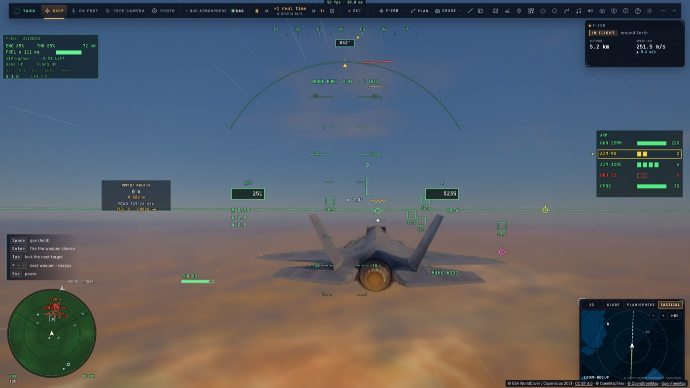
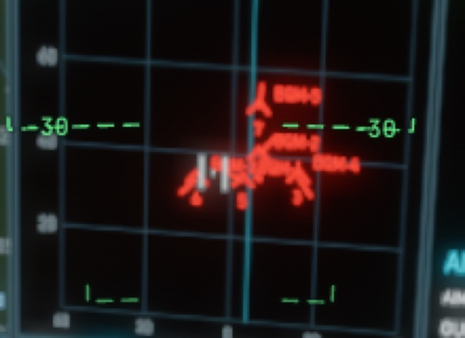

# Le curseur de désignation (TDC) — constat 29

*2026-10-21, `main` — reste de PLAN-RADAR-AAA (RD9, RD14 « Ce qui reste »).*

## Ce qui est fait

- **Le curseur** (`input/tdc.ts`, pur). On le maintient sur un écran ; un manche le déplace, plus fin près du centre
  (la course à la puissance 1,6) :
  - **le scope du HUD** : 1,1 rayon par seconde, gardé dans le disque ;
  - **une page du PCD** : 0,28 largeur d'écran par seconde, gardé dans le corps de la page.

  Lâché, il disparaît. Repris, il revient où on l'avait laissé sur cet écran ; sur un nouvel écran, il part de son
  centre. `slewOf` prend, sur chaque axe, la commande la plus poussée.
- **Le tenir** :
  - **la manette du F-35** : les deux gâchettes hautes ensemble (`input/jetpad.ts`). Leurs palonniers s'annulent de
    toute façon. Le stick droit déplace alors le curseur et la tête reste où elle était ; A désigne au lieu du canon ;
  - **un HOTAS** : la commande maintenue « Curseur de désignation (TDC, maintenu) » (`input/bindings.ts`, `tdc`),
    donnée à un de ses boutons dans l'écran des manettes ;
  - **le clavier** : F15 par défaut. Aucune touche n'est libre en vol, en AZERTY comme en QWERTY (ZQSD/AE/WX, les
    translations, les tenues, Tab, C, M sont pris) ; le joueur en choisit une dans les touches.
- **Le déplacer** : le stick droit de la manette, le mini-manche d'une manette des gaz (les axes de translation RCS des
  profils de manettes des gaz), un chapeau affecté au regard (il ne tourne plus la tête pendant ce temps) ou les flèches
  (elles ne mettent plus les gaz pendant ce temps).
- **Désigner** : A sur la manette, ou l'action « Désigner sous le curseur (TDC) » (`designate`, F14), qu'on donne à la
  détente d'un HOTAS. Elle fait ce qu'un clic ferait au même endroit (`camera.tdcPick`, main.ts) :
  - **sur le scope** : la piste dessous est sélectionnée, puis verrouillée à la seconde fois ; dans le vide, la
    sélection est lâchée ;
  - **sur le PCD** : `jetPcd.touch(u, v)`, donc un symbole sélectionné, ou une touche de page appuyée.
- **Où il se pose** (`camera.tdcWhere`) : seulement en vol avec un radar (`airRadar` : le F-35, le Ranger). Dans le
  cockpit du F-35, c'est la page du PCD au centre de la vue (`jetPick(0, 0)`, `Pcd.pageRect`) ; sinon le scope du HUD
  tant qu'il est dessiné.
- **Ce qu'on voit** :
  - sur le scope : les deux barres et le point du F-35, et « TDC » sous le mode ;
  - sur le PCD : les mêmes barres, sur la page. Sa partie est redessinée à chaque image tant que le curseur y est
    (sans relire les données), puis une fois quand il la quitte.
- L'aide des touches (FR et EN) et les docs `HOTAS.md`, `F35.md`, `F35.fr.md`, `RADAR.md`, `RADAR.fr.md`.

## Preuves

- Tests unitaires :
  - `tdc.test.ts` (5) : le scope, la page, le retour où on l'avait laissé, lâché, les commandes mêlées, les liaisons
    (F15 hors des touches de vol, F14, les deux dans l'écran des manettes) ;
  - `jetpad.test.ts` : les deux gâchettes, la tête qui reste, A qui désigne sans tirer, le canon rendu au lâcher.
- e2e sur kerr-mini (`tdc.e2e.test.ts`, 3/3, une fausse manette, le F-35 contre les drones) :
  - sur le scope, le curseur mené sur `cmb:1` puis A : sélectionné, sans un obus tiré ; A encore : verrouillé ;
  - dans le cockpit, la tête tournée par le stick vers la page FCR : le curseur mené sur un drone puis A : `cmb:3`
    sélectionné ;
  - un HOTAS dont le bouton tient `tdc`, puis « désigner » : « Selected: BQM-3 · 33.1 km ».

