# La Terre en raster « façon Unreal » — plan et suivi

Démarré le 25/10/2026. Demande : en raster, la Terre **à pleine résolution, chaque pixel ombré à chaque image** — plus de
taux ×2 / ×4 / ×16 ni d'échelle 0,5 — avec la qualité d'une vue convergée, sur le M1 de kerr-mini. Le traceur reste pour
la vue à l'arrêt (affinage), les photos et l'espace.

## Le constat (25/10)

Le « raster » d'aujourd'hui ne rastérise que la visibilité : chaque pixel du sol lance ensuite le code du traceur
(`shade` → `earthNear` → `earthLook` → `earthGround`), ~40 ms par Mpx sur un M1. Le gouverneur ne peut qu'en ombrer un
sur 16 à l'échelle 0,5 — un pixel neuf sur 64 à l'écran — et le reste est reconstruit et porté par l'historique : flou en
vol. `earthLook` est déjà différé en partie (nuages : passe en demi-résolution `clouds` ; air : table aérienne `apRead`) ;
le coût par pixel restant est dans :

1. la **marche du sol** depuis la distance raster (`earthMarchHinted`, et la marche entière en rasant) ;
2. le **parcours du décor** (`worldScenery` : bâtiments en BVH, arbres en grille, sculptés par sphere tracing) ;
3. **`earthGround`** : détail procédural du relief, normale fine, ombres (relief, décor, nuages), matériaux, surfaces OSM.

## L'architecture visée (comme Unreal)

| Aujourd'hui (par pixel, tracé) | Visé (raster) |
|---|---|
| Marche du sol depuis l'indice | La profondeur raster **est** la surface (maillage assez fin près) |
| Décor tracé | Bâtiments et arbres en maillages / instances, matériau à part |
| Ombres par rayons | Cartes d'ombre (relief, décor), nuages en carte |
| Imagerie filtrée à la main | Anisotrope (fait), mips |
| Détail procédural par pixel | Orthophoto + normale de la carte de relief |
| Air intégré | Table aérienne (déjà) |
| Nuages | Passe en demi-résolution (déjà) |
| 1 pixel sur 4–64 + historique | **Chaque pixel, chaque image** ; TAA pour l'antialiasing seul |

## Les phases

| Phase | Contenu | État |
|---|---|---|
| U0 | Mesurer ce que coûte chaque partie de `shade` à chaque pixel (Paris bas, mini) | en cours |
| U1 | Le sol léger à chaque pixel : sans marche, sans détail procédural, ombres en cartes ; taux 1, échelle 1 | fait |
| U2 | Le décor en raster : bâtiments (prismes déjà triangulés) et arbres (instances déjà) ombrés par un matériau simple | fait (1re version) |
| U3 | Ombres du décor en carte (cascades), plus de rayons d'ombre | à faire |
| U4 | Gouverneur : l'échelle et le taux retirés en raster ; le TAA à 1 échantillon par pixel | à faire |
| U5 | Le cockpit du F-35 allégé : la verrière d'une seule couche (~40 ms sur le mini) | fait |
| U6 | Finition : netteté (RCAS), comparaison avec la vue convergée, mini à 50 Hz | à faire |

Chaque phase : mesurée sur le mini (GPU par passe, img/s), une capture en vol au-dessus de Paris, un commit poussé, une
ligne ici.

## Journal

### 25/10 — avant le plan (3d359212)

Vol net en raster : noyaux du raster prêts avant les bits du décor, historique gardé quand le cache recuit, repli tracé
mesuré, orthophoto anisotrope, albédo par pixel accumulé. Voir [VOL-NET-2026-10-25.md](VOL-NET-2026-10-25.md).

### 25/10 — le détail par pixel coupé par défaut

L'échange d'albédo (`renderer.rasterDetail`) grainait le sol en mouvement et le tachait d'une image à l'autre ; à l'arrêt,
il s'emballait (vue noire, croix blanches — corrigé, 26176b7c). À chaque pixel ombré, l'image est propre sans lui : coupé
par défaut, gardé comme interrupteur.

### U0 — mesure (kerr-mini, Paris bas, chaque pixel, 1920 × 1080)

`RASTER_BENCH=1 RP_PLACE=paris-low RP_RATE=every bun test tests/e2e/raster-shade-ablation.e2e.test.ts` — le banc gèle
désormais le vol pendant les compilations (l'avion se posait sur le sol, train cassé). `shade` seul : **~161 ms** par image
(~80 ms par Mpx). Ce qu'on gagne en retirant une partie (deuxième mesure de chaque paire ; la première est faussée par la
compilation de la variante) :

| Retiré | gain |
|---|---|
| le décor | −51 ms |
| la marche des rayons rasants | −16 ms |
| le détail procédural du relief | −30 ms |
| les ombres du relief | −9 ms |
| les ombres du décor | −4,5 ms |
| la normale fine du relief | −3,5 ms |
| les matériaux proches, l'imagerie, les nuages | ~0 |

Même tout retiré, l'ombrage du sol par le code du traceur resterait à ~50 ms : régler le traceur ne suffit pas — il faut un
noyau de sol neuf.

### U1 — le sol à chaque pixel (`shadeLite`) — en cours

Nouveau point d'entrée `shadeLite` (trace.wgsl), un fil par pixel à pleine résolution, chaque image : la surface du maillage
raster (sans marche), sa normale depuis les distances des pixels voisins, l'imagerie anisotrope, la surface régionale, le
soleil et le ciel, les ombres lues dans les cartes (relief `sunShadowFar`, arbres et bâtiments `treeShadowAt` /
`buildingShadowAt`, nuages `cloudShadowAt`), l'air par la table aérienne, les nuages par la passe en demi-résolution, l'eau
OSM (Fresnel, ciel, reflet du Soleil). La mer et le décor restent à `shade`. `renderer.rasterLite` (vrai par défaut) pour
comparer.

Première mesure (ce Mac, M1 Max, Paris, chaque pixel) : **`earth lite (raster)` 0,6 ms** pour tout le sol — contre ~160 ms
pour `shade` sur le mini ; le reste de `shade` (le décor, la mer) 7,9 ms.

Vu en vol : bon ; deux défauts relevés et corrigés — les lacs sombres (l'eau OSM n'était que l'orthophoto) ; un saut des
ombres des arbres toutes les ~0,8 s (la carte d'ombre du décor, ±900 m, se recentre sur une grille de 128 m : lue jusqu'à
son bord, ses ombres y apparaissaient en bloc — estompées désormais de 550 à 750 m). Reste : les ombres proches du relief
(la carte ne compte que les reliefs au-delà de la portée de la marche de `shade`).

Le « blip » de chaque seconde (relevé image par image en vol) : (1) l'historique temporel coupé presque tout le temps
— le garde-fou de parallaxe (`taParallaxPx`, pensé pour les profondeurs approximatives des rayons clairsemés) le jetait, il
revenait par salves de quelques images ; sans lui chaque image est un seul échantillon décalé qui scintille — levé quand
`shadeLite` ombre le sol (sa profondeur est exacte), le poids d'un pixel frais porté à 0,3 (`RASTER_LITE_ALPHA` : au
1/16 d'avant, l'historique rééchantillonné sous l'avance brouillait le sol) ; (2) le flou de mouvement d'une image en
retard (pics à 45 ms et plus toutes les 0,5–1 s) deux à trois fois plus long — ramené à la durée d'une image habituelle
(`shutterShare`). Les pics eux-mêmes restent à trouver.

**La « bouillie » de tout le paysage, plusieurs fois par seconde** (attrapée en rafale de captures, puis par
`terrainRasterStats.rings` image par image) : les anneaux du relief au-delà du patch fin (153 m) tombaient de 6 à 0–2 pendant
une à trois images, toutes les 0,5–1 s — le cache du relief invalidait la cuisson d'un niveau dès que sa fenêtre se
recentrait mais n'en recuisait qu'un par image ; les anneaux au-delà d'un niveau en attente n'étaient pas dessinés, et tout
le lointain retombait dans les blocs tracés. Corrigé (system/terrain-cache.ts) : chaque niveau déplacé est recuit dans son
image (un uniforme par niveau), puis un niveau périmé par de nouvelles tuiles par image. Mesuré : 0 chute sur 1 033 images
de vol (une vingtaine en 15 s avant).

**Sur le mini (vol Paris, « chaque pixel », avant ce dernier correctif)** : la netteté du sol mesurée **2,2** (médiane, contre
0,8 avant U1), mais **9,4 img/s** : le réglage « chaque pixel » fait aussi ombrer à chaque pixel, par le vieux `shade`, les
bâtiments, les arbres et la mer — la moitié de l'écran au-dessus de Paris. C'est U2 (le décor en matériau raster) qui
rendra ce mode jouable sur le M1.

Le dernier blip (vu par l'utilisateur : « les légères différences entre deux images ») : le gouverneur d'échelle changeait la
résolution (0,5 ↔ 0,625) toutes les quelques secondes, l'historique rééchantillonné à chaque pas au poids d'un échantillon.
Avec `shadeLite`, l'échelle est tenue à celle du raster (`earthRasterScale`, main.ts). Mesuré sur 30 s de vol : aucun
changement d'échelle, l'historique toujours tenu, aucune chute d'anneau — mais 18 img/s à l'échelle 1 en « chaque pixel » sur
ce Mac : le décor par `shade` à chaque pixel (U2).

Reste : des images à plus de 45 ms (~2 par seconde), à attribuer.

### U2 — le décor en matériau raster (25/10)

- **Bâtiments** : leurs triangles (roof-mesh.ts, jusqu'ici dans la seule carte d'ombre) dessinés dans la visibilité raster
  (`meshVs` / `meshFs` : distance exacte, marque 3), après leurs boîtes. `shadeLite` les ombre : le toit d'après
  l'orthophoto désaturée (elle « penche » : sa couleur sur un toit est souvent la rue ou l'arbre voisin — zinc et ardoise,
  un cinquième de sa teinte), les murs en pierre, une teinte par îlot, des fenêtres (étages de 3,1 m, travées de 2,6 m sur le
  repère du décor) au verre sombre qui reflète le ciel ; leurs ombres par la carte, le point soulevé de 1,2 m et vers le
  Soleil (à 0,35 m, leurs propres triangles les mouchetaient). Les bâtiments sans triangles restent aux rayons de `shade`.
- **Arbres** : l'arbre désigné par le raster testé seul sur sa forme simple (`sceneryTreeLite` : sans la sculpture des
  couronnes, des bosses dans la normale à sa place ; la grille parcourue depuis lui s'il est manqué), son aspect de
  `forestLook`, la lumière à travers les feuilles ; les arbres sur fond de ciel restent à `shade`.
- Correction de U1 : les pixels des boîtes de bâtiments ne sont plus pris par `shadeLite` (il dessinait le sol à leur place).

Mesuré ici (M1 Max, Paris, 150 m, « chaque pixel », échelle 1, 839 × 596) : `earth lite` 5,2 ms (sol, bâtiments, arbres),
`shade` 9,8 ms (sans les triangles : 16,3) — il reste à `shade` les bâtiments sans triangles, la mer, les arbres sur le ciel
et surtout son lancement sur chaque pixel pour en rendre la plupart à `shadeLite`.

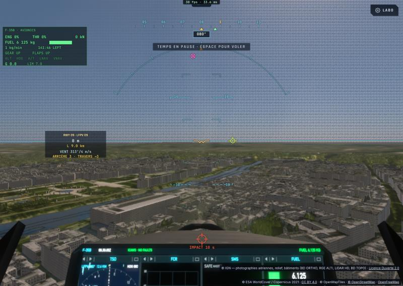

### U2 — suite (25/10)

- Les boîtes des bâtiments à triangles retirées de la visibilité (`BOX_SKIP_MESHED`) : elles envoyaient aux rayons de
  `shade` les pixels au-dessus des toits en pente et le long des marges — `shade` 10,4 → 3,9 ms, 42 img/s à l'échelle 1 ici.
- Les arbres éclairés comme `windsockShade` les éclaire (six dixièmes du ciel, le dessous de la couronne dans son ombre, la
  lumière à travers les feuilles au bord contre le Soleil) : l'ombrage du sol les rendait jaunes et trop clairs.
- Un indicateur de compilation (un « thinking orb » et le nombre de compilations, sous le compteur d'images ;
  `data-pending` pour les tests).
- Mini, Paris, « chaque pixel » à l'échelle native (1920 × 1080), noyaux prêts : **5 img/s** avec le matériau comme avec
  l'ancien `shade` — à cette taille, ce n'est plus l'ombrage du sol qui limite : passes mesurées en cours.

#### Les passes sur le mini (Paris, 300 m, « chaque pixel », 1920 × 1080, noyaux prêts)

| Passe (calcul — fiables ; les passes de rendu du vaisseau et l'affichage se chevauchent sur Apple) | ms |
|---|---|
| `earth shade` (le décor par rayons : les bâtiments **sans triangles** — les lointains, tout l'horizon —, la mer, les arbres sur le ciel) | 53–96 |
| `earth lite` (sol, bâtiments à triangles, arbres) | 45–50 |
| visibilité raster · ciel tracé · cartes d'ombre | 7 · 7 · 3 |

Prochaines étapes : (1) les bâtiments sans triangles dessinés comme leurs boîtes pleines (toit plat) dans la visibilité,
au matériau — plus aucun bâtiment par rayons ; (2) `earth lite` à ~22 ns par pixel sur le M1 : mesurer ses parties (l'eau
OSM, qui parcourt des polygones à chaque pixel, en tête ; l'imagerie anisotrope ; les cartes d'ombre lues en 4 × 4) et les
alléger — viser quelques ns par pixel.

### U2c — plus aucun bâtiment par rayons, `earth lite` allégé, l'eau d'un seul tenant (25/10)

Mesure des parties de `shadeLite` (ce Mac, Paris, 150 m, chaque pixel, ~0,5 Mpx ; `TUNE_LITE`) : base 5,4–7,2 ms ; tout
retiré 0,66 ms ; les arbres — surtout la grille parcourue quand l'arbre désigné est manqué : **2,4 ms**, 40 % — en tête ;
l'eau OSM −0,5 ; l'imagerie −0,3 ; les cartes d'ombre ~0.

- La grille des arbres n'est plus parcourue sur un manqué (le sol là ; `TUNE_LITE` 256 pour la remettre) : rien de visible à
  la taille d'un pixel.
- Les bâtiments ont leurs triangles jusqu'à 2 000 m du centre du décor (`BUILDING_MESH_M`, 1 100 avant) ; au-delà, leurs
  boîtes sont dessinées **pleines** (toit plat, `boxSolidVs`) au matériau — les boîtes de marquage ne sont plus dessinées.
- L'eau : sa couverture franche (le bord du polygone seul adouci), une surface plate, un seul ton de fond éclairé par le
  Soleil non ombré, le ciel réfléchi selon l'angle de vue ; les ombres sur le reflet du Soleil seul.

Mesuré ici : `shade` **0,2 ms** (4–10 avant), `earth lite` 3,9 ms, visibilité 1,5 ms — 43 img/s à l'échelle 1.

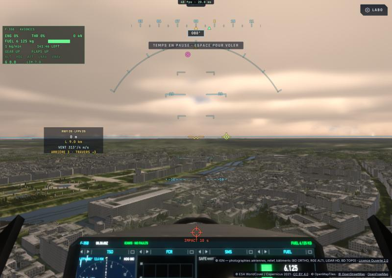

**L'eau, d'un seul tenant (vue de près)** : des bandes sombres en diagonale coupaient la Seine — peinte en rouge (`TUNE_LITE`
512), l'eau reconnue y montrait des lignes vides : `scenerySurface` garde la surface OSM du rang le plus haut, et une ligne
(un rail, une route en tunnel sous le fleuve) l'emporte sur un polygone. `sceneryWaterAt` parcourt désormais les surfaces
pour l'eau seule (polygones et cours d'eau en ligne, la plus forte couverture ; les îles d'un fleuve sèches, comme avant).

| Avant (l'eau reconnue en rouge) | Après |
|---|---|
| 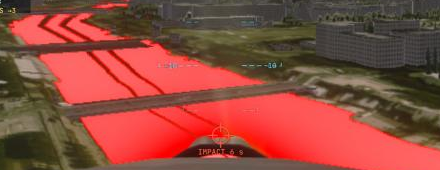 | 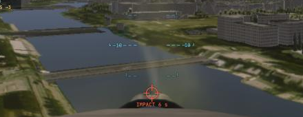 |

**Mini, Paris, « chaque pixel », 1920 × 1080, noyaux prêts (U2c)** : **8,9 img/s** (5 avant) ; `earth shade` hors du
classement (< 1,6 ms) ; `earth lite` 26 ms ; visibilité 7 ms, ciel tracé 7 ms, cartes d'ombre des arbres 3 ms ; le reste
dans les passes de rendu du cockpit et du vaisseau (MSAA à la pleine taille : leurs horodatages se chevauchent sur Apple,
~50 ms d'après leur somme). Suite : `earth lite` (26 ms sur le M1, ~13 ns par pixel), le cockpit à la pleine taille (U5).

### U2d — l'eau AAA : la mer, les rivières, les lacs, les cascades (25/10)

- **La mer** quitte `shade` : `shadeLite` prend tout le sol, la mer comprise, et l'ombre par `seaShade` — le shader d'eau du
  traceur, déjà complet : les trains d'ondes résolus et les cascades de la FFT près, le reflet du Soleil de Cox–Munk, le
  miroir moyenné sur les pentes non résolues (Bruneton), le monde reflété près (`seaSSR`), les nuages lointains, le fond peu
  profond, l'écume et le ressac.
- **Les rivières et les lacs** ont leur propre style (`inlandWater`), pas la mer calmée : quatre trains de rides
  capillaires-gravitaires autour du vent, chacun estompé sous l'empreinte du pixel (sa variance alors à la rugosité) ;
  rivière : rides courtes, étirées, eau trouble vert-brun ; lac : presque un miroir, des risées par plaques de 40 m, eau
  plus sombre. Le ciel par Fresnel sur la facette ridée, le monde reflété près, le reflet du Soleil (Beckmann). Une rivière
  se reconnaît à sa classe OpenMapTiles (`river`, `canal`, `stream`…), portée par la couleur de son polygone.
- **Les cascades** : là où le sol de l'eau penche (la normale du maillage à plus de ~16° de la verticale), une eau blanche
  aérée en traînées tirées dans la pente, qui la descendent avec l'horloge.

Mesuré ici (Paris, 60 m, chaque pixel) : `earth lite` 6,4 ms (+2,5 pour l'eau), `shade` 1,8 ms (les arbres sur le ciel).
Cascades non encore vues sur un vrai site.

| La Seine (rivière) | La mer à Tarifa |
|---|---|
| 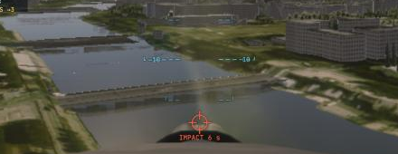 | 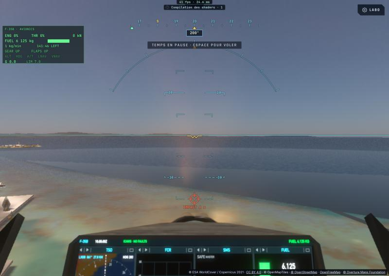 |

**La mer plate près de la côte, puis normale** : près des côtes, la mer vient des polygones OSM (classe `ocean`), que le
matériau prenait pour des lacs — presque un miroir — jusqu'à la portée du décor, au-delà de laquelle le masque de mer du relief
prenait le relais, en `seaShade`. Les polygones `ocean` sont désormais marqués (leur couleur, scenery-worker) et ombrés en mer.

| Avant | Après |
|---|---|
| 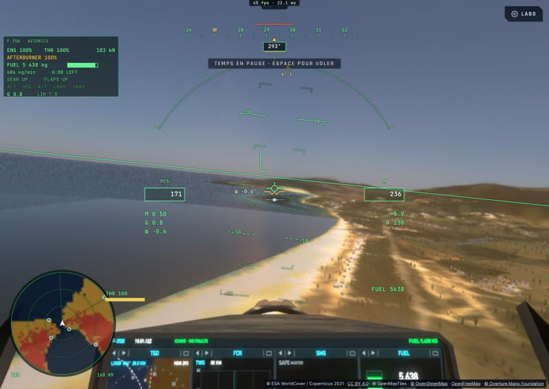 | 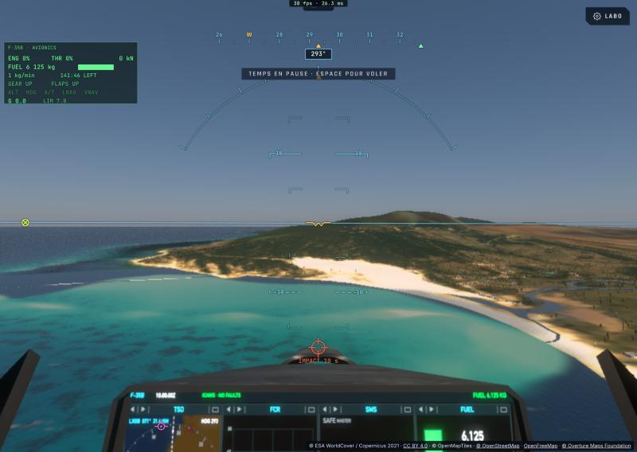 |

**Le trait blanc à la frontière de la mer** (Tarifa) : l'effet cascade — la pente lue sur la normale du maillage, tirée des
pixels voisins — basculait à la couture de deux anneaux du relief (leurs maillages s'y rejoignent à leur tolérance près) : une
ligne d'eau blanche le long de la couture. Corrigé : la normale n'est plus prise à travers une couture d'anneaux ; les
cascades ne sont que pour l'eau intérieure. Au passage : le ressac et le fond visible de `seaShade` ne s'appliquent plus que
là où la bathymétrie est sûre (au bord de ses données, la profondeur moyennée sur quelques texels valides tombait au mètre).
Reste : une langue sombre près de la côte, là où la bathymétrie (Terrarium z 10 — ETOPO, GEBCO — ; SRTM met la mer à 0 près des
côtes) ne donne aucune profondeur et que la mer y est supposée profonde — une donnée à trouver (une bathymétrie côtière plus
fine) ; deux essais pour la masquer (l'imagerie de la mer — trop sombre, la mosaïque Sentinel peint la mer d'un ton
uniforme —, une profondeur devinée — une couture de plus) retirés.

Les compilations : un réglage de mesure (`renderer.tune`) recompile **tous** les noyaux de chaque clé (le traceur principal,
`shade`, `shadeMark`, `shadeLite`, le ciel, les nuages…) — plusieurs minutes ici ; `shadeLite`, qui porte désormais l'eau de
la mer, les rivières, les arbres et le décor, est devenu gros : à découper (l'eau dans son propre noyau).

| Avant (le trait, HUD masqué) | Après |
|---|---|
|  | 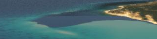 |

### U2e — l'eau dans son propre noyau (`shadeWater`) (25/10)

`shadeLite` portait l'eau de la mer (`seaShade`), celle des rivières et des lacs, les arbres et le décor : gros à compiler et
lourd en registres pour chaque pixel. Découpé : `shadeLite` trouve l'eau et laisse au pixel sa surface (`accum`, avant l'air)
et un marqueur (`moments.x` : `RASTER_WATER` moins son genre — mer, rivière, lac — et un quart de sa couverture) ; `shadeWater`
(`renderer.rasterWater`, bit 256) refait la géométrie et la lumière (`liteSun`, `liteSky`, communs), ombre l'eau et les
cascades, puis l'air et les nuages (`liteFinish`, commun).

Mesuré ici (Tarifa) : compilation `shadeLite` 2,8 s, `shadeWater` 2,9 s — l'attente de plus d'une minute vient du noyau
principal du traceur (74 s pour une clé), pas du raster ; temps `earth lite` 2,2 ms, `earth water` 2,6 ms, `shade` 0,2 ms.

**L'ordre des compilations** : pour chaque clé, le noyau principal spécialisé du traceur (~74 s ici) passait avant les noyaux
raster (~3 s) : une fois le noyau général du traceur prêt (il dessine le ciel en attendant), les noyaux raster passent
désormais en premier. Et le découpage paie : après une modification de l'eau seule, seul `shadeWater` recompile (10 s), les
autres viennent du cache de Chrome — l'image raster complète 37 s après le chargement de la page.

**Les cascades (Niagara)** : la pente lue sur les facettes du maillage dessinait des triangles blancs sur la gorge ; sur ±8 m
des hauteurs, le bruit du relief sous la rivière (SRTM, ses vides) la striait de blanc. Désormais : la pente des hauteurs du
relief sur ±25 m (de ~17° à ~39°), et une chute exige de l'eau au-dessus et en dessous d'elle (une berge a la terre en haut).
Les fausses taches ont disparu ; la chute du Fer-à-Cheval elle-même n'est pas encore apparue blanche à l'écran — à vérifier
(le polygone OSM sur la falaise, le relief à 30 m qui l'adoucit).

| Avant (fausses cascades sur la rivière) | Après |
|---|---|
| 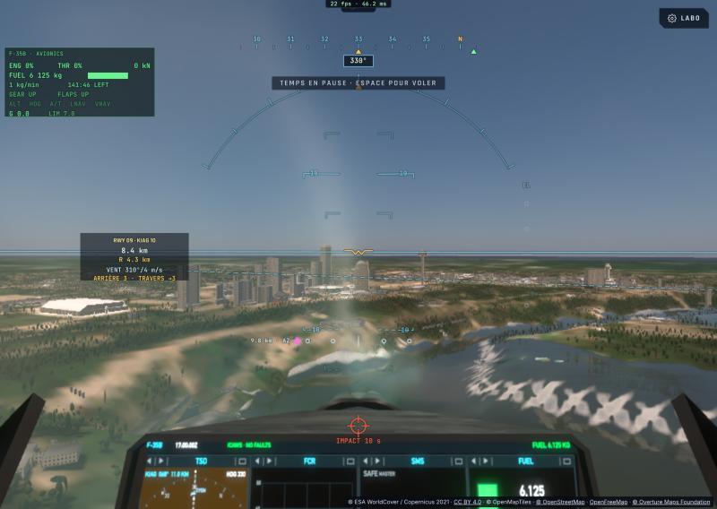 | 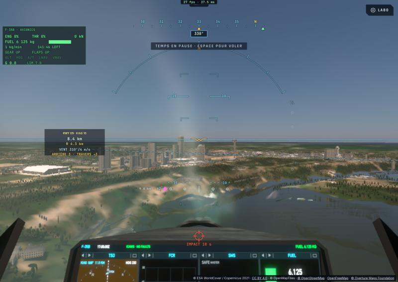 |

**Mesure kerr-mini après U2e** (c8ec0909 — vol bas sur Paris, train sorti, chaque pixel, échelle native, 40 s) :
**8,4 i/s** (U2c : 8,9 — l'eau dans son noyau, la Seine comprise, dans le bruit de la mesure) ; aucune image tracée, le
raster tenu tout le vol. Netteté médiane 2,98, p10 1,78 ; 19 creux sur 75 échantillons, isolés (un échantillon à chaque fois,
sans période — plus la pulsation d'une seconde) : des images tardives à 8 i/s plutôt qu'un flou du sol. Le reste du budget
est hors de la Terre : la cabine et le vaisseau (U5).

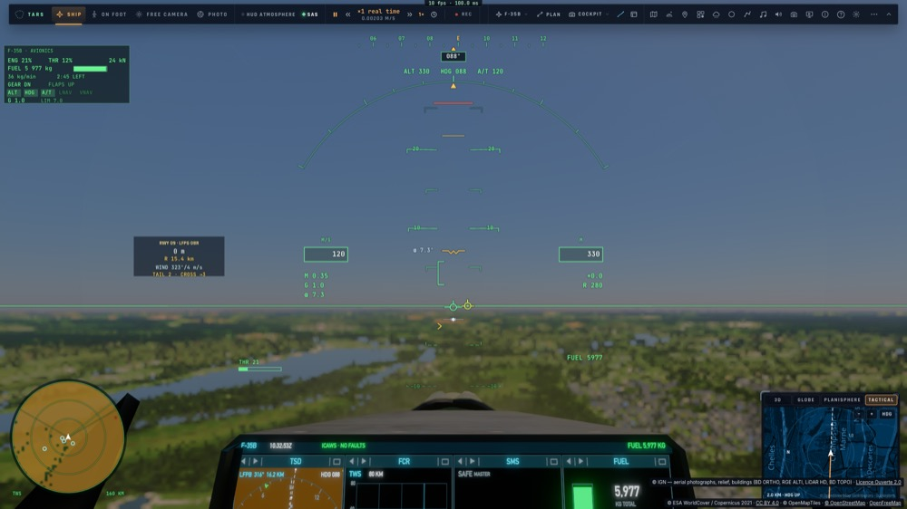

**La teinte du sol** (question de l'utilisateur, Paris) : le sol lu à l'écran est R≈G>B (ville proche 84/82/68, B/G ≈ 0,84),
d'où un aspect olive ; le traceur donne la même chose (82/79/68) — ce n'est donc pas l'ombrage raster mais le commun :
l'orthophoto d'été, la lumière du Soleil à travers l'air et la perspective aérienne. Jugé acceptable, laissé tel quel.

### U5 — la verrière d'une seule couche ; la pause en raster ; les pistes au matériau (25/10)

**Où passait le temps du mini** (vol bas sur Paris, chaque pixel, 1920 × 1080) : ~100 ms de GPU par image, le processeur à
~5 ms — le temps GPU réel (entre deux images achevées), plus les horodatages des passes : activés, ils coûtent eux-mêmes ~10 ms
par image (chaque passe coupée) et avaient faussé la première mesure. Leviers un à un : sans le vaisseau 50 ms ; **sans la
verrière 54 ms** ; sans la coque −9 ms ; l'ombre, la pré-passe de profondeur, les flammes, le masque, le HUD, le
post-traitement : dans le bruit. Sur la verrière seule : sans sa réflexion d'écran, rien ; teinte plate, −13 ms : le reste
était le dessin lui-même.

**Pourquoi** : un rayon de l'œil traversait **4 triangles de verrière** — la coque du modèle a deux parois à 5 mm l'une de
l'autre et chacun de ses triangles deux fois (une copie par sens) ; dessinés sans élimination, mélangés en MSAA 4×, toute la
vue couverte quatre fois. `src/f35/glass-shell.ts` (`thinGlass`, au chargement) : les copies une fois, la paroi intérieure
retirée (de deux triangles face à face à travers l'épaisseur, le plus proche de la tête). Verrière 1 652 → 490 triangles,
visière 534 → 416 ; une couche exactement dans toutes les directions de la vue (626 rayons de l'œil comptés), aucun trou
nouveau. Le code de l'A320 (son disque de soufflante lu à chaque pixel de la verrière du F-35) sous une constante de
pipeline (`GLASS_A320`).

**Mini, même vol** : **~60 ms par image, 15–17 i/s** (9–10 avant) ; la verrière ne se mesure plus (sans elle : pareil), tout
le vaisseau ~6 ms. Le reste : la Terre (le matériau `earth lite` en tête), le ciel tracé.

| Avant (104 ms) | Après (56 ms) |
|---|---|
| 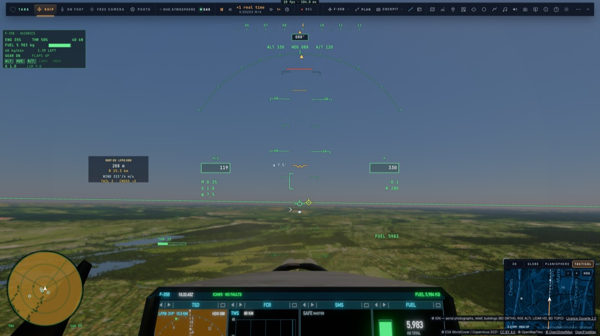 | 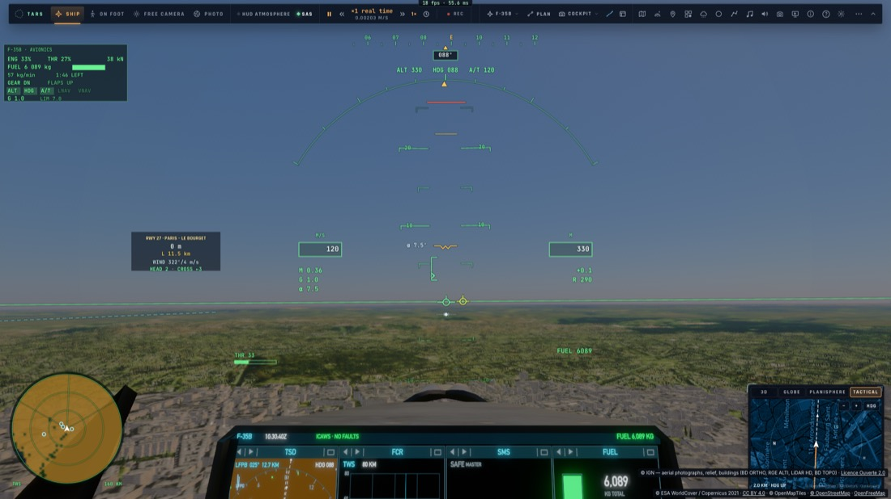 |

**La pause garde le raster** : une vue tenue (pause du jeu, `__bh.freeze`) restait à affiner par le traceur — une autre clé
de noyaux, donc des compilations, et l'image changeait. `renderer.rasterHold` (main : tout sauf le mode photo) : les images
temps réel continuent tant que le raster est voulu et éligible (même avant que ses noyaux soient prêts) ; seul le mode
photo affine, tracé.

**Les pistes au matériau raster, plus de compilation en approche** : une piste à moins de 150 km ajoutait un bit à la clé
(256) — le traceur entier recompilé en vol à chaque aéroport. `runwayPave` (trace.wgsl) : le revêtement, les marquages et
les feux d'une piste, partagés par le sol tracé et `shadeLite` ; les noyaux raster ont le code des pistes compilé quelle que
soit la clé (leurs paramètres disent s'il y en a), et la clé en raster n'a plus ce bit (le choix du pipeline, pas l'état du
raster à l'image : il s'éteint pendant ses compilations — la clé allait et venait). L'aérodrome nivelé est de la terre pour
l'eau. En mode photo, à pied, ou dans le pipeline tracé : le bit, comme avant.

**L'ordre des compilations** : une clé compilée d'avance (le décor, les surfaces qui arrivent) n'est plus urgente tant
qu'elle n'est pas celle de l'image — son traceur (102 s ici) passait entre les noyaux raster de la clé courante, la Terre
proche tracée pendant ce temps ; les noyaux raster d'abord dès qu'un traceur (général ou d'une autre clé) dessine déjà.

### U6 (1) — le sol raster allégé : l'eau dans son propre arbre, la houle et les étoiles quand elles se voient (25/10)

**La mesure propre** (kerr-mini, Paris bas, chaque pixel, 1920 × 1080, horodatages des passes de calcul seuls lus — ceux des
passes de rendu se chevauchent sur Apple) : `earth lite` 17–21 ms, le ciel tracé 6–8, la reprojection 2,6, la sonde du
vaisseau 1,7, la houle FFT 1,4–1,8 (à 150 km de la mer), l'ombre du relief 1,3–1,6, les étoiles ~1 (en plein jour), le
reste ≤ 1,5 chacune.

**Ce que coûte `earth lite`** (ce Mac, vue tenue, `renderer.liteSkip` : les bits de `TUNE_LITE` lus aussi à l'exécution —
`P.jet2.w`, inutilisé —, une partie coupée sans recompiler ; 1024 la passe seule, 2048 sans l'air, 4096 sans la lumière) :
3,6 ms dont **la recherche de l'eau 1,2** (un tiers), l'imagerie anisotrope 0,85, l'air 0,3, le Soleil et le ciel 0,6, les
arbres 0,25, la passe seule 0,3.

- **L'eau** : `sceneryWaterAt` parcourait l'arbre de toutes les surfaces du décor (routes, rails, zones) pour n'en garder que
  l'eau, à chaque pixel. `packScenery` construit désormais un arbre de l'eau seule (`scenery[2].y/.z`), ses feuilles les
  mêmes enregistrements (rien de copié) : loin de l'eau, un nœud ou deux. `earth lite` 3,6 → 2,4 ms ici ; la Seine reconnue
  pareil (le masque rouge, `liteSkip` 512).
- **La houle FFT** : calculée dès qu'on vole sous 30 km, même à Paris. Le noyau de l'eau marque l'image où il a dessiné de la
  mer (le dernier mot du tampon `stamps`), relu toutes les 15 images (`seaProbeFor`) : sans mer depuis 120 images, plus de
  FFT (les trains au loin) ; elle revient dès que la mer est dessinée. Vérifié : 0 à Paris, en marche au-dessus du détroit.
- **Les étoiles** : leur passe plein écran tournait sous l'exposition du jour (EV 14,6 au-dessus d'une Terre éclairée, 16,3
  dès le crépuscule) ; coupée près du sol sous EV 15,5 (ailleurs — le trou, son disque, ses étoiles lentillées — toujours).
- **La sonde du vaisseau** : une image sur deux en mouvement quand le raster dessine la Terre.
- **L'imagerie** : l'orthophoto couvrant tout, de jour, les niveaux plus grossiers des tuiles ne sont plus lus sous elle
  (seule leur alpha servait — les lumières des villes la nuit).
- **La vue tenue** ne lance plus en fond la compilation du noyau « qualité » général (des minutes pour un affinage qui ne
  viendra pas : la pause garde le raster).

**Mini, même vol** (temps GPU réel, sans horodatages) : **~53 ms par image, 19 i/s** (60 ms et 16–17 i/s avant ; 105 ms et
9–10 i/s avant U5). Le palier suivant de l'écran à 50 Hz est 40 ms (25 i/s) : il reste `earth lite` (~12–14 ms estimés, son
imagerie anisotrope en tête), le ciel tracé (6–8 ms : 32 pas d'air par rayon de ciel — une table de ciel n'en gagnerait que
la moitié, le bloc 8 en trace déjà un sur 64), la visibilité raster, le vaisseau (~6 ms).

### U6 (2) — l'imagerie anisotrope, l'eau en bandes, le Soleil une fois (25/10)

**Mesurer sur une vue tenue** : les leviers pris en vol variaient de 47 à 96 ms (l'avion fait 36 km pendant la série, la
ville change sous lui). `PULSE_FREEZE` (raster-pulse e2e) tient le vol : la pause garde le raster, la même image à chaque
trame — les écarts d'une même série sont sûrs à ~1 ms près ; entre deux séries le mini dérive de ±3 ms (sa chaleur).

**Ce que coûte `earth lite` sur le mini** (vue tenue, Paris, sans lui : la passe seule) : ~16 ms — l'eau 3–5, l'imagerie
2,5–3, la lumière ~2, l'air ~1,5, les arbres ~1, le reste (la géométrie, l'écriture, les registres) ~5.

- **L'imagerie anisotrope** réécrite (`earthImageryAniso`) : la place des échantillons sur les tuiles prise du centre et de
  son axe (linéaire sur l'empreinte d'un pixel), plus un atan2 et un atanh par échantillon ; la boucle des niveaux dehors,
  celle des échantillons dedans (chaque niveau lu une fois) ; la courbe sRGB une fois par niveau. **−2,4 ms sur le mini**
  dans la même série (55,0 → 52,7 ; 58,5 → 56,1) ; l'image la même (écart moyen 2/255, le bruit d'une trame à l'autre).
- **L'eau en bandes** : `sceneryPolygon` compte les arêtes croisées par un rayon le long de +x — toutes, à chaque pixel dans
  la boîte du polygone : la Seine à Paris, des milliers. `waterBands` (scenery-data.ts) coupe un grand polygone d'eau en
  bandes horizontales de ≤ 24 arêtes (celles qui atteignent la bande, entières : la même réponse — 4 000 points comparés,
  l'île comprise). L'eau ~2,5 ms (3–5 avant).
- **La transmittance du Soleil** (`sunThrough`, deux colonnes d'air) une fois par pixel, pas deux (la lumière directe, le
  rebond).

**Où on en est** : ~55 ms vue tenue, 19 i/s en vol. Sans `earth lite` du tout, ~41 ms : le palier de 40 ms (25 i/s) ne
viendra pas du sol seul — le ciel tracé (6–8 ms), la visibilité raster, le vaisseau (~6 ms), le post-traitement (~8 ms) en
sont l'autre moitié.

### U6 (3) — le ciel d'un rayon pour 16 × 16 pixels au-dessus du raster (25/10)

**Le post-traitement** (mini, vue tenue) : sans flou de mouvement, halo ni netteté, −4 ms à peine — pas là. **Le ciel tracé
9–10 ms** : sous 1,5 km, le dernier anneau du raster (±155 km) passe l'horizon, le traceur ne dessine que le ciel — à l'infini,
l'historique le reprojette exactement quand la caméra tourne. `RASTER_SKY_BLOCK` : un rayon pour 16 × 16 pixels (8 × 8 avant)
quand le matériau raster dessine le sol, sous `RASTER_SKY_KM` 1,5 (`renderer.rasterSkyBlock`, un interrupteur ; le régulateur
de bloc garde le sien pour quand le traceur dessine à nouveau du sol). La reconstruction (`gatherH`, ±bloc lectures par
pixel : 33 au bloc 16) coûtait alors plus que le traceur n'avait gagné : au bloc 16, le ciel reconstruit en bilinéaire des
rayons de l'image (les coins du sol raster écartés — le sol ne bave pas sur la ligne des toits), l'historique l'affine ;
`gatherH` sort aussi d'emblée sur les pixels du sol (frais, jamais reconstruits). Vérifié : le halo du Soleil couchant,
l'horizon, le ciel pendant un regard qui tourne vite — sans blocs.

**Mini** : trace 5,7 → 2,5 ms ; l'image **~46–48 ms, 22 i/s** vue tenue (51,5 au bloc 8 dans la même série).

**Le vaisseau, vue tenue cette fois** : sans lui 39 ms ; **sans la coque 40 ms (−6,5)** — depuis le cockpit, la coque du
modèle c'est tout le tableau de bord ; l'ombre, les flammes, le masque ~1 ms chacun ; la pré-passe de profondeur fait gagner
(sans elle +1,5 ms).
