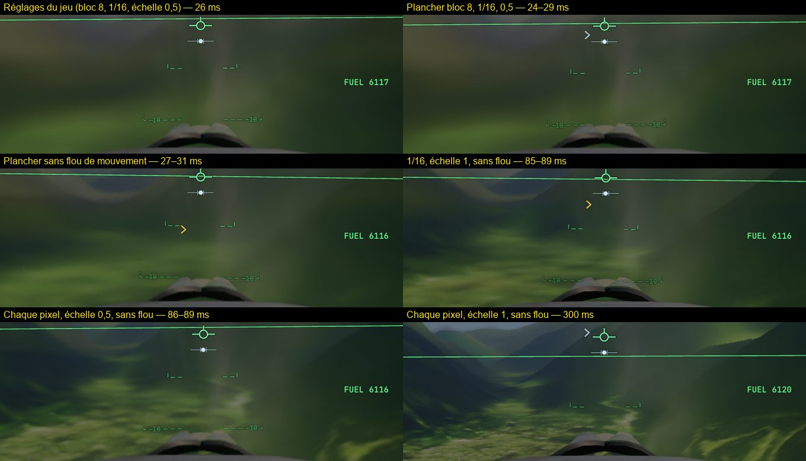
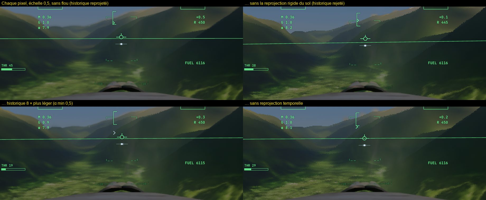
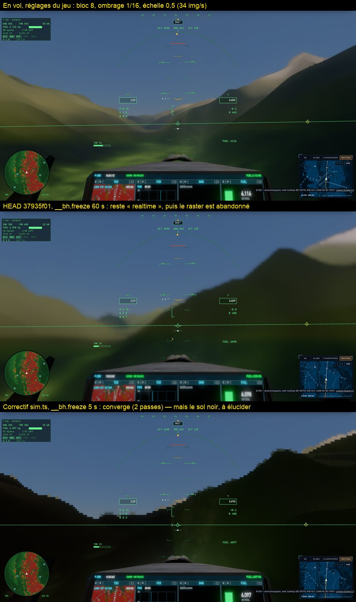

# Le sol sans texture en vol bas — mesures du 24/10/2026 (kerr-mini)

La question : en F-35 à 120 m/s, 450 m au-dessus de la vallée de Chamonix (raster, orthophotos IGN, qualité « game »),
le gouverneur tient le bloc 8 et le sol paraît lisse, sans le détail des orthophotos pourtant chargées. Régression des
changements raster I2–I8a, ou attendu ? Et pourquoi une vue tenue par `__bh.freeze` ne s'affine-t-elle jamais ?

Banc : `tests/e2e/lowflight-governor.e2e.test.ts` (vol automatique échantillonné, blocs tenus, vue gelée, pause ;
`LF_ABLATE=1` un levier à la fois, `LF_LEVERS=history|fix`, `LF_PROBE=1`), deux révisions servies dans un même Chrome par
`scripts/ab-commit.ts <révA>` avec `AB_REV_B=<révB>` et `AB_CMD=…`. kerr-mini : M1, 1920 × 1080 plein écran, écran 50 Hz
(budget d'image 18 ms), palier matériel 2.

```bash
bun scripts/remote.ts run -- env AB_REV_B=8632a8f9 AB_ROUNDS=2 "AB_CMD=E2E=1 bun test tests/e2e/lowflight-governor.e2e.test.ts --timeout 3600000" bun scripts/ab-commit.ts 3e81fc9c
```

## 1. Pas de régression : le M1 est au plancher du gouverneur

A/B à chaud, manches A B B A, réf. 3e81fc9c (avant I2) contre 8632a8f9 (I8a) :

| | bloc | ombrage raster | échelle | GPU | img/s |
|---|---|---|---|---|---|
| 3e81fc9c | 8 | 1/16 | 0,5 | 28,8–29,1 ms | 33,4–33,6 |
| 8632a8f9 | 8 | 1/16 | 0,5 | 30,1 ms | 34,3 |

Aucune ligne du gouverneur (`adaptBlock`, `adaptRasterRate`, `frameBudget`, l'échelle dynamique de main.ts) n'a changé
entre les deux. Le plancher (bloc 8, 1/16, échelle 0,5) coûte ~29 ms contre un budget de 18 ms : le M1 de base ne peut pas
mieux, et le raster n'est pas abandonné pour autant (le repli exige > 1,5 × budget, 27 ms, 12 s de suite — à la limite).

En raster, **le bloc ne touche pas le sol** : la passe `shade` ombre le sol à son propre taux, le bloc ne règle que le ciel
tracé ; le détail mesuré est le même aux blocs 2, 4 et 8. (`perf().terrainRaster.primary` lu entre deux images vaut faux :
un `writeParams` tardif de la même image le réécrit — la passe `earth shade (raster)` tourne bien.)

## 2. Où va le temps au plancher (A/A, ±2 ms)

| Levier (le reste au plancher) | GPU |
|---|---|
| plancher : bloc 8, 1/16, échelle 0,5 | 24–30 ms |
| échelle 0,75 / 1 | 54–56 / 85–90 ms |
| ombrage 1/8 / 1/4 / chaque pixel | 32–33 / 39 / 86–89 ms |
| vue extérieure (sans le cockpit du F-35) | 20–22 ms |
| chaque pixel à l'échelle 1 | 300 ms |

Le coût est par pixel (~40 ms par Mpx au plancher) ; le cockpit du F-35 pèse à lui seul ~8 ms.

## 3. Pourquoi le sol est lisse en vol



Aucun levier ne rend seul l'orthophoto en vol : seule la combinaison chaque pixel + échelle 1 + sans flou de mouvement la
montre (8 img/s, 300 ms par image). Trois causes s'additionnent :

1. **L'ombrage clairsemé** : à 1/16 et à l'échelle 0,5, un échantillon frais par 8 × 8 pixels de l'écran à chaque image ;
   le reste est reconstruit (`resolve` 7 × 7) et pris à l'historique.
2. **L'accumulation temporelle sous l'avance** : en vol vers l'avant l'historique est agrandi et rééchantillonné à chaque
   image (α 1/16) ; son flou s'accumule plus vite que les échantillons frais ne le corrigent — les traînées radiales depuis le
   point de fuite, même sans flou de mouvement. Preuve : à chaque pixel ombré, couper la reprojection rigide du sol
   (`renderer.reprojectGround = false`) rend le détail (1,05 → 1,43–1,54, A et B), comme couper la reprojection temporelle
   (1,41–1,55) ; un historique 8 × plus léger aide à moitié (1,25).

   

   La reprojection rigide (R4) n'est pas fausse : mesuré en vol (`LF_PROBE=1`), le centre de la Terre se déplace de 8,3 m
   en 20 ms de scène vu de la caméra, dont 6,45 m de rotation terrestre (340 m/s à 46° N) ; le sol ne bouge que de 2,4 m
   (120 m/s), ce que donne la formule rigide. Le chemin sans elle se trompe de ~6,5 m par image : le clamp rejette alors
   l'historique et l'image est la seule image fraîche — nette à chaque pixel, inutilisable à 1/16. Une réécriture de la
   formule mieux conditionnée en float32 (le centre à 6 400 km retranché d'un point à 500 m) a été essayée : sans effet
   mesurable, retirée.
3. **Le flou de mouvement** (0,5 par défaut) : faible part (détail 0,84 → 0,94 au plancher).

## 4. La vue gelée

`__bh.freeze` ne s'affinait jamais : `sim.applyRender` marquait la scène changée à chaque image tant que le jet « brûle » —
l'horloge `play` gelée avec lui, `firing` restait vrai. La pause s'affine parce qu'elle met `settings.animate` à faux
(applyRender sort avant les flammes). Effet de bord mesuré : une vue gelée restée « realtime » compte comme un vol au-dessus du
budget, et **le raster est abandonné** pour la session (53 s après le dégel sur 37935f01) — d'où le `rasterFellBack = false`
de l'e2e des zones.

Un correctif (redessiner seulement quand les flammes changent ou que l'horloge avance) fait bien converger la vue gelée
(2 passes en 5 s, raster gardé), mais ses premières passes montrent en raster un sol noir, absent en pause : non poussé tant que
ce n'est pas élucidé (les e2e qui gèlent avant leurs captures y tomberaient).



## Pistes

- **Accumulation sous l'avance** (le levier principal) : pondérer l'historique par son agrandissement local — plus de poids aux
  échantillons frais là où le sol s'étire vite (bas de l'écran en vol bas), ou un historique lu à une résolution supérieure ;
  à mesurer avec `quality.ts` en translation (`STEP_JS`) et ce banc.
- **Le coût par pixel au plancher** : 29 ms pour 18 de budget sur M1 ; le cockpit ~8 ms, le reste par pixel (visibilité
  raster, reconstruction, passes du vaisseau) — à profiler sans les horodatages des passes de rendu (qui se chevauchent sur
  Apple).
- **Le budget à 50 Hz** : accepter deux rafraîchissements (36 ms) sur un GPU faible laisserait le gouverneur monter — sans
  rendre le détail tant que l'accumulation l'efface (échelle 1 à 1/16 : 1,03).
- **La vue gelée** : comprendre le sol noir des premières passes d'affinage en raster sous `freeze`, puis pousser le correctif.
