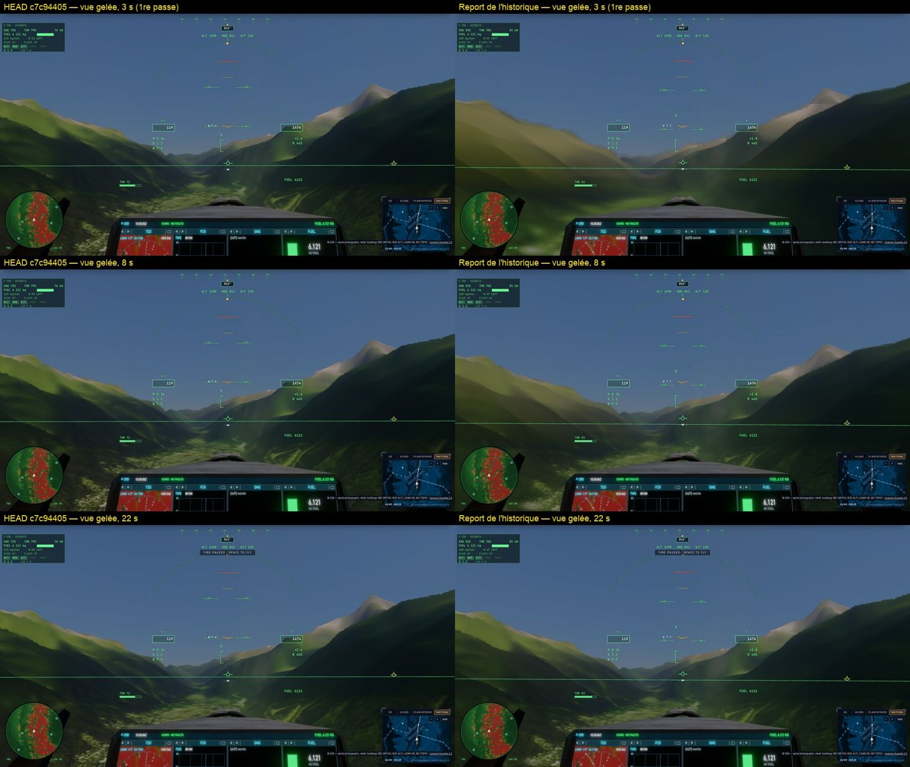
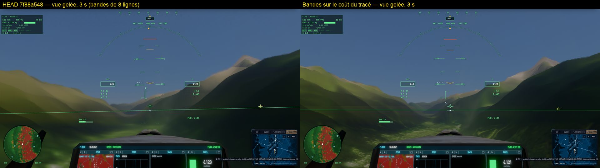

# Le sol sans texture en vol bas — mesures du 24/10/2026 (kerr-mini)

La question : en F-35 à 120 m/s, 450 m au-dessus de la vallée de Chamonix (raster, orthophotos IGN, qualité « game »),
le gouverneur tient le bloc 8 et le sol paraît lisse, sans le détail des orthophotos pourtant chargées. Régression des
changements raster I2–I8a, ou attendu ? Et pourquoi une vue tenue par `__bh.freeze` ne s'affine-t-elle jamais ?

Banc : `tests/e2e/lowflight-governor.e2e.test.ts` (vol automatique échantillonné, blocs tenus, vue gelée, pause ;
`LF_ABLATE=1` un levier à la fois, `LF_LEVERS=history|fix`, `LF_PROBE=1`), deux révisions servies dans un même Chrome par
`scripts/ab-commit.ts <révA>` avec `AB_REV_B=<révB>` et `AB_CMD=…`. kerr-mini : M1, 1920 × 1080 plein écran, écran 50 Hz
(budget d'image 18 ms), palier matériel 2.

```bash
bun scripts/remote.ts run -- env AB_REV_B=8632a8f9 AB_ROUNDS=2 "AB_CMD=E2E=1 bun test tests/e2e/lowflight-governor.e2e.test.ts --timeout 3600000" bun scripts/ab-commit.ts 3e81fc9c
```

## 1. Pas de régression : le M1 est au plancher du gouverneur

A/B à chaud, manches A B B A, réf. 3e81fc9c (avant I2) contre 8632a8f9 (I8a) :

| | bloc | ombrage raster | échelle | GPU | img/s |
|---|---|---|---|---|---|
| 3e81fc9c | 8 | 1/16 | 0,5 | 28,8–29,1 ms | 33,4–33,6 |
| 8632a8f9 | 8 | 1/16 | 0,5 | 30,1 ms | 34,3 |

Aucune ligne du gouverneur (`adaptBlock`, `adaptRasterRate`, `frameBudget`, l'échelle dynamique de main.ts) n'a changé
entre les deux. Le plancher (bloc 8, 1/16, échelle 0,5) coûte ~29 ms contre un budget de 18 ms : le M1 de base ne peut pas
mieux, et le raster n'est pas abandonné pour autant (le repli exige > 1,5 × budget, 27 ms, 12 s de suite — à la limite).

En raster, **le bloc ne touche pas le sol** : la passe `shade` ombre le sol à son propre taux, le bloc ne règle que le ciel
tracé ; le détail mesuré est le même aux blocs 2, 4 et 8. (`perf().terrainRaster.primary` lu entre deux images vaut faux :
un `writeParams` tardif de la même image le réécrit — la passe `earth shade (raster)` tourne bien.)

## 2. Où va le temps au plancher (A/A, ±2 ms)

| Levier (le reste au plancher) | GPU |
|---|---|
| plancher : bloc 8, 1/16, échelle 0,5 | 24–30 ms |
| échelle 0,75 / 1 | 54–56 / 85–90 ms |
| ombrage 1/8 / 1/4 / chaque pixel | 32–33 / 39 / 86–89 ms |
| vue extérieure (sans le cockpit du F-35) | 20–22 ms |
| chaque pixel à l'échelle 1 | 300 ms |

Le coût est par pixel (~40 ms par Mpx au plancher) ; le cockpit du F-35 pèse à lui seul ~8 ms.

## 3. Pourquoi le sol est lisse en vol


Aucun levier ne rend seul l'orthophoto en vol : seule la combinaison chaque pixel + échelle 1 + sans flou de mouvement la
montre (8 img/s, 300 ms par image). Trois causes s'additionnent :

1. **L'ombrage clairsemé** : à 1/16 et à l'échelle 0,5, un échantillon frais par 8 × 8 pixels de l'écran à chaque image ;
   le reste est reconstruit (`resolve` 7 × 7) et pris à l'historique.
2. **L'accumulation temporelle sous l'avance** : en vol vers l'avant l'historique est agrandi et rééchantillonné à chaque
   image (α 1/16) ; son flou s'accumule plus vite que les échantillons frais ne le corrigent — les traînées radiales depuis le
   point de fuite, même sans flou de mouvement. Preuve : à chaque pixel ombré, couper la reprojection rigide du sol
   (`renderer.reprojectGround = false`) rend le détail (1,05 → 1,43–1,54, A et B), comme couper la reprojection temporelle
   (1,41–1,55) ; un historique 8 × plus léger aide à moitié (1,25).

   

   La reprojection rigide (R4) n'est pas fausse : mesuré en vol (`LF_PROBE=1`), le centre de la Terre se déplace de 8,3 m
   en 20 ms de scène vu de la caméra, dont 6,45 m de rotation terrestre (340 m/s à 46° N) ; le sol ne bouge que de 2,4 m
   (120 m/s), ce que donne la formule rigide. Le chemin sans elle se trompe de ~6,5 m par image : le clamp rejette alors
   l'historique et l'image est la seule image fraîche — nette à chaque pixel, inutilisable à 1/16. Une réécriture de la
   formule mieux conditionnée en float32 (le centre à 6 400 km retranché d'un point à 500 m) a été essayée : sans effet
   mesurable, retirée.
3. **Le flou de mouvement** (0,5 par défaut) : faible part (détail 0,84 → 0,94 au plancher).

## 4. La vue gelée

`__bh.freeze` ne s'affinait jamais, pour deux raisons :

1. `sim.applyRender` marquait la scène changée à chaque image tant que le jet « brûle » — l'horloge `play` gelée avec lui,
   `firing` restait vrai. La pause y échappait parce qu'elle met `settings.animate` à faux (applyRender sort avant les
   flammes). Une vue gelée restée « realtime » comptait de plus comme un vol au-dessus du budget, et **le raster était
   abandonné** pour la session (53 s après le dégel sur 37935f01) — d'où le `rasterFellBack = false` de l'e2e des zones.
   Corrigé (src/sim.ts) : redessiné quand les flammes changent, ou que l'horloge avance.
2. Ce premier défaut levé, l'affinage repartait sans cesse et montrait un sol noir : le gouverneur d'échelle de main.ts
   (raster) passait la vue tenue à la pleine échelle, puis prenait l'image qui suit ce redimensionnement — forcément
   « realtime » — pour un mouvement et remettait l'échelle du mouvement (0,75) ; 86 redimensionnements en 22 s mesurés
   (l'exposition et les tuiles hors de cause : 0 relance), l'historique perdu à chacun, l'accumulateur brut à l'écran —
   le sol du raster n'y est ombré qu'un pixel sur seize. Corrigé : ces décisions (l'échelle du raster sans échelle
   dynamique, son plafond en mouvement, le pas du gouverneur, le repli du raster) ne tiennent pour un mouvement que ce
   qui dure 0,15 s, la règle qui rendait déjà l'échelle du mouvement. Un seul redimensionnement ; la vue gelée s'affine,
   ~8,5 s par passe pleine résolution sur le mini, le détail des orthophotos à 22 s.


La première passe d'une vue tenue montrait encore l'accumulateur brut (sol noir) : le passage à la pleine échelle refait la
cible, son historique vide, pas de passation possible — vrai aussi pour la pause. Corrigé (renderer `keepHistory` /
`carryHistory`) : au redimensionnement, la dernière image de l'historique est gardée, puis rééchantillonnée dans l'historique
de la nouvelle cible (et dans l'autre sens quand la caméra repart : l'image affinée devient le premier historique du
mouvement). Son poids est plafonné à un échantillon — à son poids accumulé (jusqu'à 15), l'affinage ne pesait que 7 % après
une passe et la vue restait floue à 22 s. Mesuré sur le mini (`LF_FREEZE=1`, HEAD c7c94405 contre le report) : plus de sol
noir à la première passe, l'image du mouvement à sa place ; le même détail que HEAD à 8 et 22 s.



Le rythme de l'affinage : les bandes étaient dimensionnées sur le temps de toute l'image (cockpit, post-traitement : ~60 ms
fixes sur le mini) contre un budget de 18 ms, donc au minimum de 8 lignes — ~8,5 s par passe ; une image mal mesurée les
faisait parfois exploser à 553 lignes (une image de 670 ms). Corrigé : la passe de tracé de l'affinage est chronométrée seule
sur le GPU (`GpuProfiler.timed`, une paire d'horodatages, que le profileur soit allumé ou non), son temps par ligne dimensionne
les bandes, leur croissance bornée à ×2 par image (le ciel coûte peu, le sol beaucoup, la mesure arrive une image ou deux plus
tard) ; sans horodatages, l'image entière comme avant. Mesuré sur le mini : la première passe en 3,3 s au lieu de 9,4, ~2,6 s
par passe au lieu de ~8,3 ; des bandes de 20 à 65 lignes, des images de 65 à 116 ms pendant l'affinage (~20 ms de tracé en
moyenne) au lieu de ~65.



## Pistes

- **Accumulation sous l'avance** (le levier principal) : pondérer l'historique par son agrandissement local — plus de poids aux
  échantillons frais là où le sol s'étire vite (bas de l'écran en vol bas), ou un historique lu à une résolution supérieure ;
  à mesurer avec `quality.ts` en translation (`STEP_JS`) et ce banc.
- **Le coût par pixel au plancher** : 29 ms pour 18 de budget sur M1 ; le cockpit ~8 ms, le reste par pixel (visibilité
  raster, reconstruction, passes du vaisseau) — à profiler sans les horodatages des passes de rendu (qui se chevauchent sur
  Apple).
- **Le budget à 50 Hz** : accepter deux rafraîchissements (36 ms) sur un GPU faible laisserait le gouverneur monter — sans
  rendre le détail tant que l'accumulation l'efface (échelle 1 à 1/16 : 1,03).
