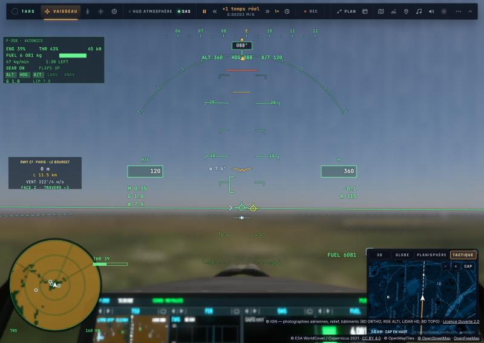
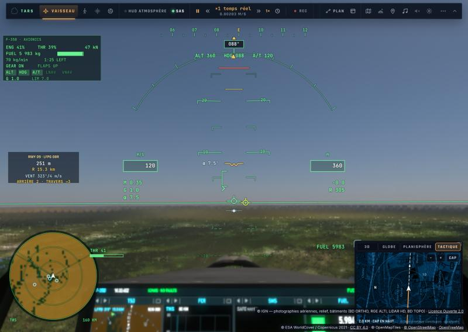

# Le vol net en raster — 25/10/2026

La plainte : en raster, en vol, le sol devient une « bouillie » (net à l'arrêt), avec une saccade floue toutes les
secondes sur kerr-mini. Vol d'essai : F-35 à 300 m au-dessus de Paris, 120 m/s, train sorti, cockpit
(`tests/e2e/raster-pulse.e2e.test.ts` ; `PULSE_LEVERS` pour comparer des leviers dans le même vol).

## Ce qui rendait le vol flou

1. **Le raster coupé pendant les compilations.** Les bits des tuiles (4096) et du décor (8192) s'allumaient dès le noyau du
   tracé prêt, pas ceux du raster (`shade`, `shadeMark`) : à l'arrivée des bâtiments, le raster était abandonné pour leur
   compilation (plus d'une minute sur un M1), le sol tracé en blocs de 6 à 8 pixels. Et la file de compilation, en FIFO, les
   mettait derrière le noyau « qualité » d'une pause. Corrigé : `rasterReady` retient ces bits jusqu'aux noyaux du raster ;
   `CompileQueue.run(…, urgent)` fait passer les noyaux de l'image devant ; `rasterStandIn` garde le raster sur la clé
   voisine la plus proche le temps d'une compilation.
2. **L'historique jeté à chaque cuisson du cache de terrain** : en vol le cache recuit ~15 fois par seconde (581 cuissons en
   40 s), et chaque cuisson jetait l'historique temporel — au plancher du mini (1 pixel ombré sur 64), une image sans
   historique est une bouillie. Corrigé : en temps réel, l'historique est gardé (le clamp absorbe l'écart).
3. **Le repli raster → tracé** (12 s au-dessus du budget) : mesuré au-dessus de Paris, le tracé n'était pas plus rapide
   (14–17 img/s, 57 ms) et bien plus flou. Corrigé : 6 s après le repli, si le tracé n'est pas 10 % plus rapide, retour au
   raster pour la session (`renderer.rasterKept`), annoncé.
4. **Le filtrage isotrope de l'orthophoto** : en vol à plat le sol n'est vu que rasant, et son niveau était choisi sur le
   grand axe de l'empreinte — le flou maximal. Corrigé : `earthImageryAniso`, le niveau du petit axe et jusqu'à 4 prises
   (`TUNE_ANISO`) le long du grand.

## Le détail par pixel (le pas « Unreal »)

L'ombrage du raster reste clairsemé (1 pixel sur 4 à 64) ; l'albédo de l'orthophoto, lui, est lu à chaque pixel à chaque
image (`rasterAlbedo`, porté dans `moments.x`, lu au point décalé du pixel comme son rayon), accumulé dans le temps
(`ALB_ALPHA`, ~5 images : antialiasé — lu au centre à chaque image, il scintillait à l'horizon) et substitué à celui des pixels d'où vient la couleur — dans la
reconstruction (`resolve`) et dans l'historique temporel (un historique d'albédo à côté, rééchantillonné comme la couleur).
La texture est nette, la lumière reste celle de l'ombrage clairsemé. Pas sur les anneaux lointains (leurs croix au bord de
l'horizon), ni sur le décor, la nuit, l'eau rencontrée avant le sol. `renderer.rasterDetail = false` pour comparer.

| Avant (raster coupé, bloc tracé) | Après |
|---|---|
|  |  |

## Reste à faire

- La saccade périodique au plancher du mini (1/16, échelle 0,5) : non reproduite ici, à mesurer là-bas (candidats : le cycle
  du motif 4 × 4 à ~20 img/s, les anneaux ombrés un cycle sur `TUNE_RING_RATE`, les changements d'échelle du gouverneur).
- Le motif sombre des anneaux lointains près de l'horizon (préexistant).
- Le vrai matériau raster bon marché à chaque pixel (normale, soleil, ombre en carte, brume par la table aérienne), l'ombrage
  cher en basse résolution — à planifier.
